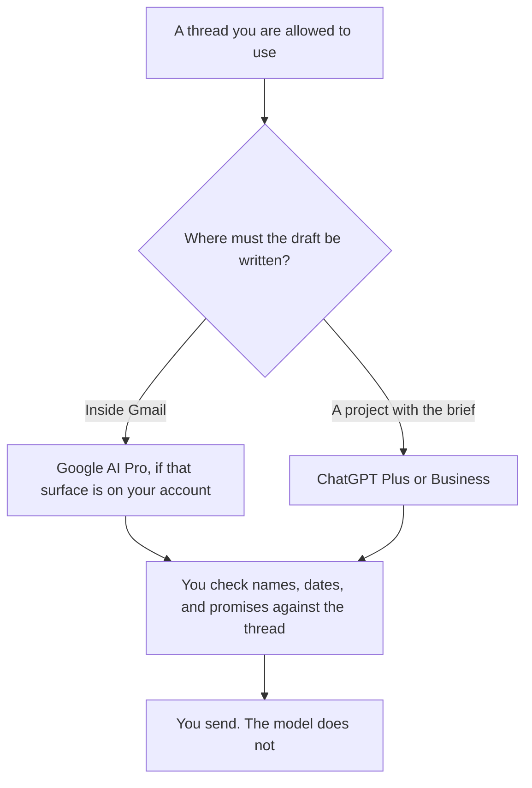

**Use Gemini when the draft has to happen inside Gmail and you are willing to pay for the Google plan that lists that surface. Use ChatGPT when the email is one input to a Project that also holds the brief, the policy, or the last thread you pasted.** Neither product sends the message for you on the facts this directory records. You still read the draft against the thread. A fluent reply that invents a meeting time is a worse email than a short one you typed.

The writing pair, if the message is a document and not a reply, is [ChatGPT vs Claude for writing](/blog/chatgpt-vs-claude-for-writing-2026/). A sentence that was not in the thread is [what an AI hallucination is](/blog/what-is-ai-hallucination-2026/). The check before you hit send is [how to fact-check AI writing](/blog/how-to-fact-check-ai-writing-2026/).

Prices are US list prices excluding tax from directory pages checked October 16, 2026. Published October 24, 2026. We did not score email drafts. The directory says some Gemini features are limited by country. Confirm Gmail access in your account before you standardize a team on it.

## Where the draft is born

| | [Gemini](/tools/gemini/) | [ChatGPT](/tools/chatgpt/) |
|---|---|---|
| Free | A Google account. The card lists Flash-Lite, image tools, and 15 GB of storage. It does not list Gemini in Gmail on the free line | Limited tools. You can paste a thread into a chat |
| The seat that names Gmail | Google AI Pro at $19.99 a month lists Gemini in Gmail and Docs, 4x usage versus Free, and 5 TB of storage | No Gmail surface is listed. Plus at $20 a month adds projects and higher upload limits |
| A cheaper Google step | Google AI Plus at $4.99 a month lists 2x usage, video generation, and 400 GB. The Gmail line is on the Pro card, not this one | Go at $8 a month. The card says Go may include ads |
| A heavier personal tier | Ultra at $99.99 a month (5x Pro limits) or $199.99 (20x) | Pro at $100, $200, or $500 |
| A company admin seat | Not a separate Gmail admin price on this card | Business is $20 a user a month billed annually for two or more users, or $25 monthly. No training on business data by default |
| What you still do | Read the draft in the thread and send it yourself | Paste only what the reply needs, then send it yourself |

Google AI Pro at $19.99 is $239.88 a year if you keep it. ChatGPT Plus at $20 is $240 a year. The stickers match. The surface does not. Five people on ChatGPT Business annual are 5 × $20 = $100 a month, with a two-user minimum. Five Google AI Pro seats are 5 × $19.99 = $99.95 a month, and that bundle includes storage the directory lists at 5 TB. Storage is not an email feature. Do not buy Pro only to justify a drive.

## When a third tool is the real inbox

**The thread is a Microsoft mailbox.** [Microsoft Copilot](/tools/microsoft-copilot/) is free with a signed-in Microsoft account, with limits. Microsoft 365 Personal is $9.99 a month. Premium is $19.99 a month. Copilot Business is listed from $18 a user a month paid yearly, and the directory marks that as promotional, originally $21. Confirm the promo. This page is the Gmail question. Outlook is a different app.

**The reply is long and the tone has to stay careful.** [Claude](/tools/claude/) Pro is $20 a month, or $17 billed annually. Claude's card lists a Chrome extension and Microsoft 365 extensions. It does not list a Gmail add-on on the lines we used. Paste the thread. The writing comparison is [ChatGPT vs Claude for writing](/blog/chatgpt-vs-claude-for-writing-2026/).

**The line edit after the facts are right.** [Grammarly](/tools/grammarly/) Pro is $12 a member a month billed annually. It will not know which sentence in the thread you were supposed to answer.

**A confidential mailbox.** Prefer the company plan your admin already allows. ChatGPT Business is the admin step on the OpenAI card. A personal free account is a poor place for a customer's contract terms. The record habit is [what a system of record for AI is](/blog/what-is-a-system-of-record-for-ai-2026/).

A prompt that holds the line:

"Draft a reply to this thread. Use only facts that appear in the paste. If a date, a price, or a commitment is not in the thread, write Missing and ask me. Do not invent a meeting time. Keep it under 120 words."

The person who sends is [what human-in-the-loop AI is](/blog/what-is-human-in-the-loop-ai-2026/).

## What this page will not pretend

It will not rank which model writes warmer email. It will not claim a Gmail plugin for ChatGPT that the directory does not list. It will not treat Google AI Plus as the Gmail plan, because the Gmail and Docs line on the card sits on Pro. If checkout shows Gmail on a lower plan in your country, checkout wins, and this page should be updated.

A public incident note is a different genre from a customer reply. That workflow is [how to write a status page update with AI](/blog/how-to-write-a-status-page-update-with-ai-2026/).

## FAQ

### Is Gemini free inside Gmail?

The directory's free line does not list Gemini in Gmail. The Pro line does, at $19.99 a month, along with Docs. Confirm the control in your Google account. Country limits are called out on the card.

### Can I forward mail into ChatGPT instead?

Yes, if you paste the part the reply needs and you are allowed to. Delete attachments the question does not need. A forwarded mailbox is a data export. Treat it like one.

### Which is better at tone?

We did not measure tone. Pick the surface your team will actually re-read. A draft you do not check is the same risk in either product.

### Should the model send the email?

No, on any workflow this page recommends. Sending is a commitment. The draft is a suggestion until you press send.

## Last verified

October 16, 2026 for Gemini, ChatGPT, Claude, Grammarly, and Microsoft Copilot. The Copilot Business yearly figure is the promotional price recorded on that card. Published October 24, 2026.

**Sources:** [Google AI subscriptions](https://gemini.google/subscriptions/), [ChatGPT pricing](https://chatgpt.com/pricing/), [Claude pricing](https://claude.com/pricing).

*Published by Andrew for [AI Tools Optimizer](https://aitoolsoptimizer.com).*

[Gemini](/tools/gemini/) is in the [chatbots and assistants directory](/tools/category/chatbots-assistants/). Directory pages may use affiliate links. A purchase through them may earn us a commission at no extra cost to you.
