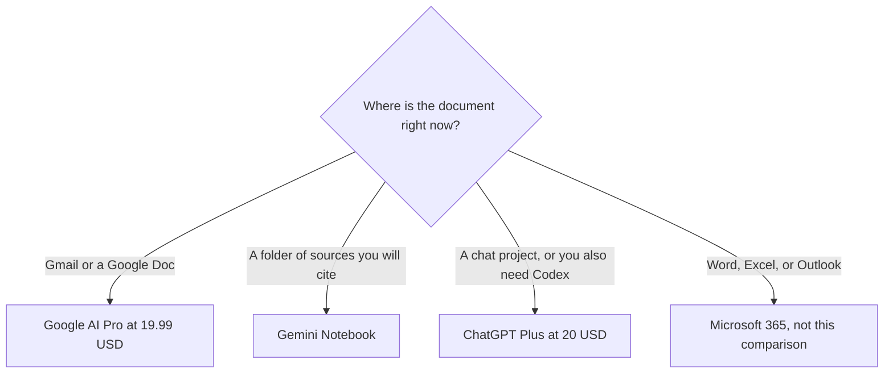

**If the draft has to stay in Gmail or Google Docs, Google AI Pro is the plan this directory records as including Gemini there, at $19.99 a month. If the work is a separate chat, with projects and custom GPTs, ChatGPT Plus at $20 is the other seat.** Pasting a Doc into ChatGPT works on any plan that allows the upload. It is a copy, not the Doc.

This directory does not record a separate Google Workspace admin add-on price. The figures below are the consumer Google AI plans and ChatGPT's consumer and Business plans. If your admin console shows a different Workspace SKU, the console wins. The three-assistant map is [ChatGPT vs Gemini vs Claude](/blog/chatgpt-vs-gemini-vs-claude-2026/).

Prices are US list prices excluding tax. Google AI and the Gmail/Docs line were recorded October 16, 2026. ChatGPT's plan rows used here match the October 24, 2026 matrix in the Go versus Plus versus Pro article. Published October 24, 2026. We did not score writing quality inside Docs.

## Where the file lives

| The job | Prefer | Why the recorded feature matches |
|---|---|---|
| A reply in the Gmail thread, or a rewrite in the Doc | [Gemini](/tools/gemini/) on Google AI Pro | Pro at $19.99 lists Gemini in Gmail and Docs, plus Gemini 4 Argon and 5 TB |
| A notebook over Drive files you choose | [Gemini Notebook](/tools/gemini-notebook/) | Answers stay on the sources you add. Free with a Google account |
| A project, a custom GPT, or Codex in the same month | [ChatGPT](/tools/chatgpt/) Plus | $20. Projects and custom GPTs are Plus features. Upload the file. It does not edit the Doc in place |
| The team needs admin controls and a no-training default | ChatGPT Business | $20/user/month billed annually for 2+ users, or $25 monthly |
| The files are in Microsoft 365, not Google | [Microsoft Copilot](/tools/microsoft-copilot/) | A different suite. Personal is $9.99/month. Do not buy Gemini to sit inside Word |

## The plans that actually mention the suite

**Google AI Free** is Flash-Lite, image generation and editing, and 15 GB. It is a real assistant on a Google account. The recorded three-way does not put Gemini in Gmail and Docs on Free.

**Google AI Plus at $4.99** is 2× usage, video generation, 200 Flow credits, and 400 GB. Video starts here, not on Free. The Gmail and Docs line recorded for this site is on Pro, not on Plus. Buy Plus for usage, video, and storage. Do not buy it expecting the Docs integration the Pro card lists.

**Google AI Pro at $19.99** is the Workspace-adjacent seat we can price: 4× usage, Gemini 4 Argon, 1,000 Flow credits, Gemini in Gmail and Docs, and 5 TB. The storage matters if you already pay Google for a smaller Drive plan. Five terabytes can retire that bill. Confirm what your current storage SKU costs before you call Pro "the AI price."

**Google AI Ultra at $99.99 or $199.99** is 5× or 20× Pro limits, with YouTube Premium on the higher tier. It is capacity and a bundle. It is not required to open Gemini in Docs.

**ChatGPT Free** includes unlimited GPT-6 text chats, with limits on uploads and tools, and limited memory. **Go at $8** adds more messages, uploads, images, and memory, and may include ads. **Plus at $20** is projects, custom GPTs, advanced reasoning, and expanded Codex. **Pro from $100** is usage. None of those cards, as recorded here, say "edits the Google Doc in place." You upload or paste. The container choice after you paste is [ChatGPT Projects vs custom GPTs](/blog/chatgpt-projects-vs-custom-gpts-2026/).

ChatGPT Business is the seat when a personal Google login is the wrong place for the transcript. It does not move the draft back into Docs for you.

## Notebook, Sheets, and the wiki

[Gemini Notebook](/tools/gemini-notebook/) is the right Gemini surface when the question must stay inside files you uploaded. Google AI Plus at $4.99 raises notebook limits. Pro at $19.99 is the larger step, described as about 5× on the directory card. The habit is [how to study with Gemini Notebook](/blog/gemini-notebook-study-workflows/). A deck or a scan, not only a Doc, is [what multimodal RAG is](/blog/what-is-multimodal-rag-2026/).

Sheets are a separate article: [best AI for Excel and Google Sheets](/blog/best-ai-for-excel-and-google-sheets-2026/). Do not assume the Docs sentence covers a financial model.

If the team wiki is Notion, the in-place assistant is [Notion AI](/tools/notion-ai/) Business at $20 per seat, not Gemini and not ChatGPT. The notes split is [Notion AI vs ChatGPT for notes](/blog/notion-ai-vs-chatgpt-for-notes-2026/).

Microsoft 365 is the mirror case. Copilot with Microsoft 365 Personal is $9.99 a month on the October 16 card. Microsoft 365 Premium is $19.99. A business Copilot seat was recorded from $18, with a note that the promotional price had been $21. If the company is on Microsoft, stop this comparison and read that card. Gemini Pro does not become a Word add-in.

## What to do with the draft

Write the decision in the Doc, or in the chat, in your own words first. Let the assistant tighten it. Check names, dates, and any number against the source. A fluent paragraph in Docs is still [something you fact-check](/blog/how-to-fact-check-ai-writing-2026/). Memory settings are a different feature from the Doc itself. What they save is [what AI memory is](/blog/what-is-ai-memory-2026/).

One Pro seat and one Plus seat is a reasonable month if one person lives in Gmail and another lives in Codex. It is a poor default for a five-person team. Pick the surface where the file already is.

## FAQ

### Does Gemini free work inside Google Docs?

Not on the line this directory recorded. Google AI Pro at $19.99 is the plan that lists Gemini in Gmail and Docs. Free is the assistant and image editing. Plus at $4.99 is usage, video, and storage.

### Is there a Google Workspace Gemini price?

This directory does not record one as a separate dollar amount. Workspace data-protection options are mentioned on the Gemini Notebook card without a list price. Use the admin console's price if you are buying for a domain. Use $19.99 when you are buying Google AI Pro for a person.

### Can ChatGPT edit a Google Doc directly?

The recorded ChatGPT cards describe upload, projects, and tools. They do not describe an in-Doc editor. Paste or upload, then bring the finished text back. If that round trip is the annoyance, Pro is the product that lists the in-place feature.

### Which $20 should a founder buy?

Google AI Pro if the company runs on Gmail and Docs and the 5 TB matters. ChatGPT Plus if the month also includes custom GPTs, reasoning, or Codex. The general rule for not buying every seat is [which AI subscription is worth paying for](/blog/which-ai-subscription-is-worth-paying-for/).

## Last verified

October 16, 2026 for Google AI plan prices, the Gmail and Docs line on Pro, Gemini Notebook limits, Notion, and Microsoft 365. October 24, 2026 for the ChatGPT Go, Plus, and Pro feature rows as recorded in that comparison. Published October 24, 2026.

**Sources:** [Google AI subscriptions](https://gemini.google/subscriptions/), [ChatGPT pricing](https://chatgpt.com/pricing/), [Gemini Notebook](https://workspace.google.com/products/gemini-notebook/).

*Published by Andrew for [AI Tools Optimizer](https://aitoolsoptimizer.com).*

[Gemini](/tools/gemini/) is in the [chatbots directory](/tools/category/chatbots-assistants/). Directory pages may use affiliate links. A purchase through them may earn us a commission at no extra cost to you.
