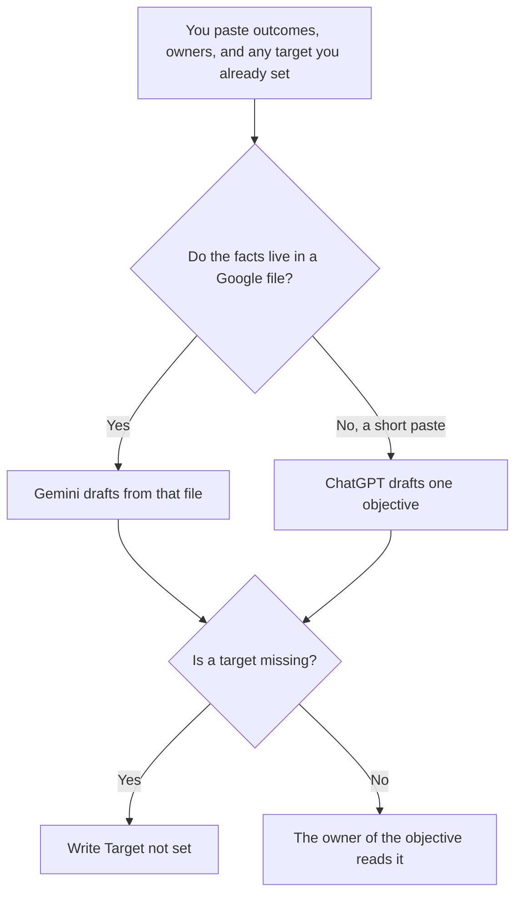

**Use Gemini when the OKR draft should sit next to a Doc or Sheet you already have in Google. Use ChatGPT when you paste this quarter's outcomes and want one objective phrased from that paste.** The model may order the lines. It may not invent a key result, a target, or a team that will do the work. If the number is missing, the draft says Target not set.

The scorecard that also refuses an invented number is [ChatGPT vs Claude for interview scorecards](/blog/chatgpt-vs-claude-for-interview-scorecards-2026/). The place a figure is allowed to live is [what a system of record for AI is](/blog/what-is-a-system-of-record-for-ai-2026/).

Gemini, ChatGPT, and Notion prices are from directory pages checked October 16, 2026. Claude's prices are from claude.com/pricing on October 24. chatgpt.com/pricing returned HTTP 403 that day. Published October 24, 2026. We did not score goals.

## Which seat matches the draft

| The draft in front of you | Start here | First paid step | The limit |
|---|---|---|---|
| The outcomes already live in a Google Doc or Sheet | [Gemini](/tools/gemini/) | Google AI Plus is $4.99 a month. Pro is $19.99 | The file is the source. The chat does not set the target |
| One objective, from a paste | [ChatGPT](/tools/chatgpt/) | Plus is $20 a month | No metric that was not in the paste |
| The page the quarter will be read from | [Notion AI](/tools/notion-ai/) | Business is $20 a seat a month | Plus at $10 is not the full AI tier |
| A long set that must use one definition | [Claude](/tools/claude/) | Pro is $17 a month billed annually, or $20 monthly | Still no target you did not write |

Gemini's free plan is $0 with a Google account, on the October 16 card. Plus at $4.99 adds usage. Pro at $19.99 is the seat the card ties to higher limits and Gemini in the Google apps. Confirm the current subscription page before you assume a Doc is in the context. The invoice is [Gemini pricing explained](/blog/gemini-pricing-explained-2026/).

ChatGPT Go is $8 a month and may include ads, on the October 16 card. Plus is the seat for a saved outline. The review is [ChatGPT review](/blog/chatgpt-review-2026/).

## What the OKR is allowed to claim

The outcome you wrote, the metric you named, the target if a person already set it, and the owner if you pasted the name. "Increase activation" is not a key result until it names the event and the number. A model that adds "by 20%" has written a target you did not choose.

**Gemini Pro** is the path when the Sheet is the source. Ask for an objective that quotes the column you name. If the cell is empty, the line says Target not set.

**ChatGPT Plus** is the one-objective path. Paste three outcomes at most. A draft that adds a fourth objective "for balance" is the draft you delete.

**Notion Business** holds the accepted OKR if that is the wiki. The chat is not the quarter's record.

**Claude Pro** is the path when several teams must use one metric definition and you keep that definition in a Project. It does not replace the Sheet. The review is [Claude review](/blog/claude-review-2026/).

A prompt that holds the line:

"Draft one objective and key results from the outcomes I pasted. If a target or an owner is missing, write Target not set or Owner missing. Do not add a percentage."

## What not to delegate

Do not ask which goal is strategic. Do not copy last quarter's targets forward because the sentences look similar. Do not publish the OKR from the chat. The capacity note that uses the same numbers, after finance has them, is [how to write a capacity risk memo with AI](/blog/how-to-write-a-capacity-risk-memo-with-ai-2026/).

## FAQ

### Which one writes better OKRs?

We did not measure that. Gemini fits a draft next to a Google file you already trust. ChatGPT fits one objective from a paste. The OKR is usable when every target traces to a cell or a sentence a person accepted.

### Do I need Claude as well?

Only if the definition has to stay identical across a long set. One objective does not need a third seat. Merging three drafts is how the target changes in the merge.

### Can the model split one outcome into key results?

Yes, if each key result uses a metric you already named. If you named one metric, you get one key result. The model does not invent a leading indicator to make the list look complete.

### Who may call the quarter's OKR final?

The owner named on the objective. A polished sentence is not a commitment. A line with no target is still a draft.

## Last verified

October 24, 2026 for Claude. October 16, 2026 for Gemini, ChatGPT, and Notion. Published October 24, 2026.

**Sources:** [Gemini subscriptions](https://gemini.google/subscriptions), [ChatGPT pricing](https://chatgpt.com/pricing/), [Notion pricing](https://www.notion.com/pricing), [Claude pricing](https://claude.com/pricing).

*Published by Andrew for [AI Tools Optimizer](https://aitoolsoptimizer.com).*

[Gemini](/tools/gemini/) is in the [chatbots and assistants directory](/tools/category/chatbots-assistants/). Directory pages may use affiliate links. A purchase through them may earn us a commission at no extra cost to you.
