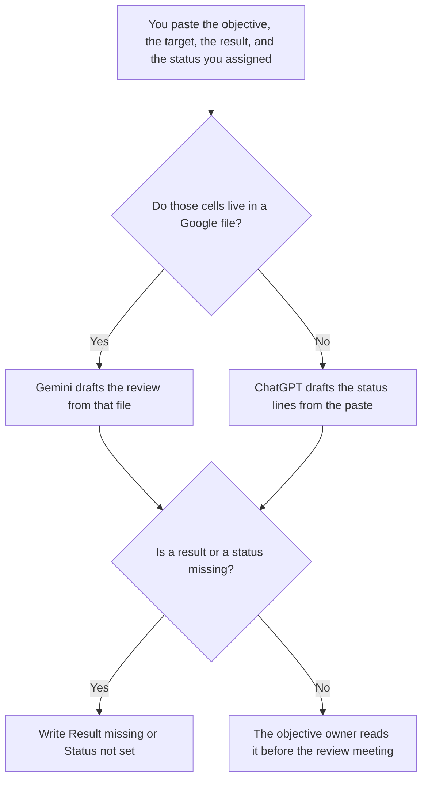

**Use Gemini when the OKR review should sit next to the Doc or Sheet where the targets already live. Use ChatGPT when you paste this period's results and want a status line for each key result.** The model may format the status you already assigned. It may not mark a key result on track, change a target, or invent a number. The first time you phrase the objective is [Gemini vs ChatGPT for OKR drafts](/blog/gemini-vs-chatgpt-for-okr-drafts-2026/). A weekly note that is not an OKR is [ChatGPT vs Gemini for status updates](/blog/chatgpt-vs-gemini-for-status-updates-2026/).

Gemini, ChatGPT, and Notion prices are from directory pages checked October 16, 2026. Claude's prices are from claude.com/pricing on October 24. chatgpt.com/pricing returned HTTP 403 that day. Published October 24, 2026. We did not score goals.

## Which review you are writing

| The set in front of you | Start here | First paid step | The limit |
|---|---|---|---|
| Targets already live in a Google Doc or Sheet | [Gemini](/tools/gemini/) | Google AI Plus is $4.99 a month. Pro is $19.99 | The file is the source. The chat does not move the target |
| A status line from results you paste | [ChatGPT](/tools/chatgpt/) | Plus is $20 a month | No status you did not assign |
| The page the quarter is read from | [Notion AI](/tools/notion-ai/) | Business is $20 a seat a month | Plus at $10 is not the full AI tier |
| A long set that must use one status word | [Claude](/tools/claude/) | Pro is $17 a month billed annually, or $20 monthly | Still no target you did not write |

This page is the check-in. If you do not yet have a target, stop and use the draft article. A review that writes the target and the result in the same afternoon has skipped the quarter.

Gemini's free plan is $0 with a Google account, on the October 16 card. Plus at $4.99 adds usage. Pro at $19.99 is the seat that card ties to higher limits and Gemini in the Google apps. The invoice is [Gemini pricing explained](/blog/gemini-pricing-explained-2026/).

ChatGPT Go is $8 a month and may include ads, on the October 16 card. Plus is the seat for a saved review. The review of the product is [ChatGPT review](/blog/chatgpt-review-2026/).

## What the review may say

The target you set, the result you measured, and the status word you already chose, such as on track, at risk, or missed. If you have not chosen the word, the line says Status not set. A model that picks "on track" because the prose sounds positive has graded the quarter.

**Gemini Pro** is the path when the Sheet is the system of record. Ask for a review that quotes the cells. If a cell is blank, the review says the cell is blank.

**ChatGPT Plus** is the path when the results are a paste. One objective per pass is enough. A second version that adds a new key result has started a draft, and this page is not the draft.

**Notion Business** holds the page if that is where the quarter is read. Link the Sheet or the paste date. The invoice is [Notion AI pricing explained](/blog/notion-ai-pricing-explained-2026/).

**Claude Pro** is the long set, when every objective must use the same status words. Put those words at the top. The review is [Claude review](/blog/claude-review-2026/).

A prompt that holds the line:

"Write the OKR review from the targets, the results, and the status words I pasted. If a status is missing, write Status not set. Do not change a target. Do not add a key result."

## What not to delegate

Do not ask whether the team "did well." Do not average a missing result into a number. Do not present the review as the new OKR. The owner of the objective accepts the status in the meeting. The document does not.

## FAQ

### How is this different from an OKR draft?

The draft phrases an objective and leaves the target unset when you have not set one. This review starts from a target and a result that already exist. If either is missing, you are still drafting, and the other article is the one to follow.

### Which tool writes a fairer review?

We did not measure that. Gemini fits the Google file. ChatGPT fits a paste. The review is fair when every status traces to a word a person assigned and every number traces to a cell.

### Can the model recommend a new target for next quarter?

Only as a blank. Next quarter's target is a decision. Put Target not set until a person writes it. A suggested number in the same paragraph as this quarter's result will be copied into the next plan.

### Who presents the review?

The objective owner. A formatted page is not the presentation. A status the owner did not choose is not the status.

## Last verified

October 16, 2026 for Gemini, ChatGPT, and Notion. October 24, 2026 for Claude. Published October 24, 2026.

**Sources:** [Gemini subscriptions](https://gemini.google/subscriptions), [ChatGPT pricing](https://chatgpt.com/pricing/), [Notion pricing](https://www.notion.com/pricing), [Claude pricing](https://claude.com/pricing).

*Published by Andrew for [AI Tools Optimizer](https://aitoolsoptimizer.com).*

[Gemini](/tools/gemini/) is in the [chatbots and assistants directory](/tools/category/chatbots-assistants/). Directory pages may use affiliate links. A purchase through them may earn us a commission at no extra cost to you.
