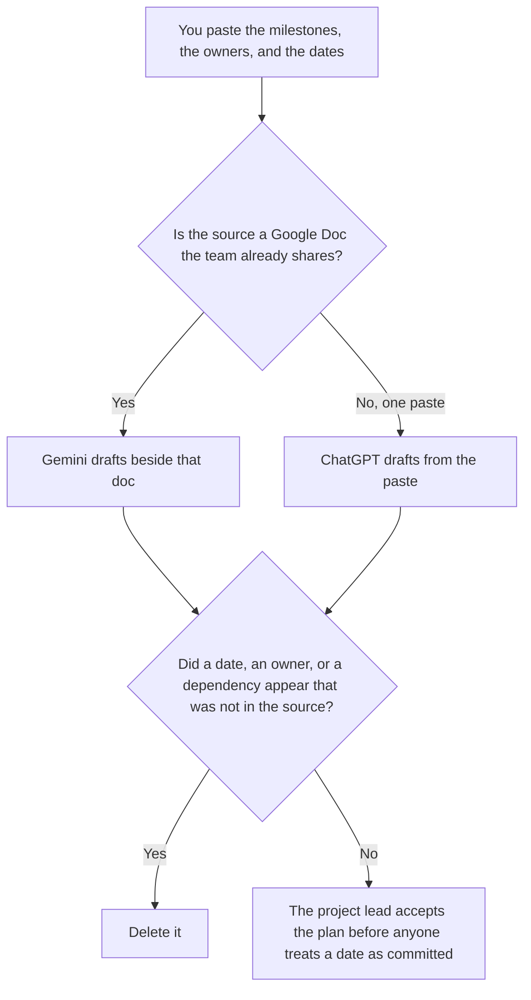

**Use Gemini when the project plan already lives in a Google Doc the team shares, and you want a draft beside that file. Use ChatGPT when the plan is one paste: milestones, owners, and dates a person already wrote.** The model may order those fields. It may not invent a date, an owner, or a dependency. The goal list, which is not the schedule, is [Gemini vs ChatGPT for OKRs](/blog/gemini-vs-chatgpt-for-okrs-2026/). The rollout after a use case is accepted is [how to write an AI rollout plan with AI](/blog/how-to-write-an-ai-rollout-plan-with-ai-2026/).

Gemini's prices are from the directory page checked October 16, 2026. ChatGPT's Plus price is the October 24, 2026 plan-page figure recorded in [ChatGPT vs Claude for stakeholder updates](/blog/chatgpt-vs-claude-for-stakeholder-updates-2026/). Notion's price is from the October 16 directory. Claude's prices are the October 24 read of claude.com/pricing recorded in [Claude pricing explained](/blog/claude-pricing-explained-2026/). Published October 24, 2026. We did not score plans.

## Which plan you are editing

| The page | Start here | First paid step | The limit |
|---|---|---|---|
| A Google Doc the team already shares | [Gemini](/tools/gemini/) | Google AI Pro is $19.99 a month | No date that was not in the doc |
| One paste of milestones | [ChatGPT](/tools/chatgpt/) | Plus is $20 a month | No owner you did not name |
| The register the next lead opens | [Notion AI](/tools/notion-ai/) | Business is $20 a seat a month | Plus at $10 is not the full AI tier |
| A second draft when the plan is a company record | [Claude](/tools/claude/) | Pro is $17 a month billed annually, or $20 monthly | The Project holds the dates. It does not move them |

A plan that says a milestone is "on track" has added a status. If the date is missing, the row says Date not set. It does not propose a Friday. Put proposals in a note labeled Not in the plan.

Google AI Plus is $4.99 a month on the October 16 card. Pro at $19.99 is the seat the directory describes as including Gemini in Gmail and Docs, plus 5 TB of storage. Ultra is $99.99 or $199.99 a month on that card. This page does not need Ultra to format a plan. The directory is [Gemini](/tools/gemini/).

ChatGPT Go is $8 a month on the October 24 plan page. Plus is the seat for a saved plan. The review is [ChatGPT review](/blog/chatgpt-review-2026/).

## What the plan is allowed to contain

The milestone names you wrote, the owners you named, and the dates you supplied. A risk that was not in the source stays out. A dependency that was not in the source says Dependency not in the source. An OKR can name the outcome this plan serves. It does not replace the dates.

**Gemini on a Doc** is the path when the file is already the source of truth. A draft that adds a phase the doc did not have is the draft you discard. Pro is the paid step on the October 16 card when you want the Doc seat the directory describes. Confirm the current Google plan page before you put $19.99 in a new forecast. This article did not refetch it on October 24.

**ChatGPT Plus** is the one-paste path. The milestones stay in your words. A version that sequences them into weeks you did not write is the version you delete.

**Notion Business** stores the accepted rows: milestone, owner, date, the lead who accepted them. The invoice is [Notion AI pricing explained](/blog/notion-ai-pricing-explained-2026/).

**Claude Pro** is the second copy when the plan must stay identical across an audience. It is not a reason to move a date. The review is [Claude review](/blog/claude-review-2026/).

A prompt that holds the line:

"Draft the project plan from the milestones, owners, and dates I pasted. If a date is missing, write Date not set. Do not add a dependency. Do not mark a milestone on track."

## What not to delegate

Do not ask for a "realistic" schedule. Do not paste a private complaint so a risk "sounds human." Do not send the plan because the table is neat. The project lead accepts the dates. A formatted week is not a commitment.

## FAQ

### How is this different from an OKR page?

An OKR names an objective and the key results you already wrote. A project plan names milestones, owners, and dates. A key result can exist with no schedule yet. A plan can slip without changing the objective. Do not let the plan rewrite the key result so the dates look kinder.

### How is this different from a rollout plan?

The rollout plan says how you will introduce a use case that was already accepted. A project plan can cover that rollout, or a different effort. If you do not have a use-case brief yet, you are not on the rollout page. You are still listing milestones someone has to own.

### Which one builds a better schedule?

We did not measure that. Gemini fits a Google Doc you already share. ChatGPT fits one paste. The schedule is safer when every date matches the source, and a missing date says so.

### Who may call a date committed?

The project lead. A draft in Docs or in chat is not a commitment. If two files disagree on a date, stop and fix the source. Do not publish both.

## Last verified

October 16, 2026 for Gemini and Notion. October 24, 2026 for ChatGPT's plan page and for Claude, via the posts cited above. Published October 24, 2026. This page did not refetch Google's plan page on October 24.

**Sources:** [Google AI plans](https://one.google.com/about/google-ai-plans/), [ChatGPT and Codex pricing](https://learn.chatgpt.com/docs/pricing), [Notion pricing](https://www.notion.com/pricing), [Claude pricing](https://claude.com/pricing).

*Published by Andrew for [AI Tools Optimizer](https://aitoolsoptimizer.com).*

[Gemini](/tools/gemini/) is in the [chatbots and assistants directory](/tools/category/chatbots-assistants/). Directory pages may use affiliate links. A purchase through them may earn us a commission at no extra cost to you.
