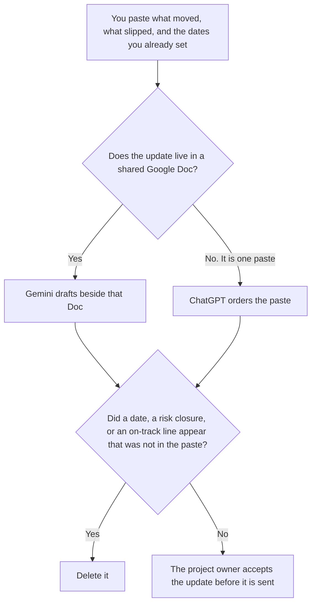

**Use Gemini when the project update already lives in a Google Doc the team shares, and you want the draft beside that file. Use ChatGPT when the update is one paste: what moved, what slipped, and the dates a person already wrote.** The model may order those fields. It may not invent a date, close a risk, or mark the project on track. The plan itself, which is the schedule rather than this week's movement, is [Gemini vs ChatGPT for project plans](/blog/gemini-vs-chatgpt-for-project-plans-2026/). The standing Friday recap is [ChatGPT vs Gemini for weekly updates](/blog/chatgpt-vs-gemini-for-weekly-updates-2026/).

The sentence shape, once you have the facts, is [how to write a status update with AI](/blog/how-to-write-a-status-update-with-ai-2026/). A coordinator's row is [best AI tools for project coordinators](/blog/best-ai-tools-for-project-coordinators-2026/).

Gemini's prices are from the directory page checked October 16, 2026, as recorded in [Gemini pricing explained](/blog/gemini-pricing-explained-2026/). ChatGPT's Plus price is the October 24, 2026 plan-page figure recorded in [ChatGPT pricing explained](/blog/chatgpt-pricing-explained-2026/). Notion is the October 16 directory card. Claude's prices are the October 24 read of claude.com/pricing recorded in [Claude pricing explained](/blog/claude-pricing-explained-2026/). Published October 24, 2026. We did not score projects. We did not mark one on track.

## Which update you are writing

| The update | Start here | First paid step | The limit |
|---|---|---|---|
| It already lives in a shared Google Doc | [Gemini](/tools/gemini/) | Google AI Pro is $19.99 a month | The Doc is the source. A slip you did not write stays out |
| One paste of what moved and what slipped | [ChatGPT](/tools/chatgpt/) | Plus is $20 a month | No date that was not in the paste |
| The page the next meeting will open | [Notion AI](/tools/notion-ai/) | Business is $20 a seat a month | Plus at $10 is not the full AI tier |
| A long note that must not soften a slip | [Claude](/tools/claude/) | Pro is $17 a month billed annually, or $20 monthly | The slip sentence stays the one you marked |

An update that says the launch is "back on track" has added a status. If you did not write the status, the line says Status not set. A slipped date stays the date you wrote. The model does not pick a new one to make the paragraph kinder.

The project-plan page is the schedule: milestones, owners, and dates. This page is the movement since the last note. A weekly update can cover several projects. This page is one project. Do not merge them into a single cheerful paragraph.

Google AI Plus is $4.99 a month on the October 16 card. Pro at $19.99 is the card's row with Gemini in Gmail and Docs. Confirm the Doc you mean is one that plan actually reaches before you promise the team the draft will see it. Free is a Google account, with the limits on that card. This page does not treat Free as the shared-Doc seat.

## What the update is allowed to say

What moved, what slipped, and the dates in the paste. An owner you did not name stays unnamed. A dependency nobody wrote stays out. The next ask, if you need one, is a sentence you already wrote. It is not a guess about what the sponsor wants.

**Gemini on AI Pro** is the Doc path. The invoice is [Gemini pricing explained](/blog/gemini-pricing-explained-2026/).

**ChatGPT Plus** is the paste. Go is $8 a month on the October 24 plan page. Plus is the seat for a saved update. The review is [ChatGPT review](/blog/chatgpt-review-2026/).

**Notion Business** stores the accepted update next to the plan page. The invoice is [Notion AI pricing explained](/blog/notion-ai-pricing-explained-2026/).

**Claude Pro** holds a slip sentence that several updates must repeat. The review is [Claude review](/blog/claude-review-2026/).

A prompt that holds the line:

"Draft the project update from what moved, what slipped, and the dates I pasted. If a status is missing, write Status not set. Do not close a risk. Do not mark the project on track. Do not change a date."

## What not to delegate

Do not ask whether the project is "healthy." Do not fill a blank milestone with a plausible date. Do not send the update because the Doc looks finished. The project owner accepts it.

## FAQ

### How is this different from Gemini vs ChatGPT for project plans?

That page is the plan: milestones, owners, and dates in a Doc or a paste. This page is the update: what moved and what slipped since the last note. A plan can be accepted with no update this week. An update that invents a milestone is editing the plan. Use that page for the schedule. Use this page for the movement.

### How is this different from a weekly update?

The weekly page is the standing Friday recap across the notes you already filed. This page is one project. A weekly note can point at this update. It should not rewrite the slip while it summarizes the week.

### How is this different from a coordinator's status row?

The coordinator page is the row, the meeting note, and a date a project manager already set. This page is the writing choice: the shared Doc, or one paste. The coordinator still does not close a risk. The tool still does not invent the date.

### Who may send the update?

The project owner. Status not set stays unset. A date in the paste stays that date. A formatted paragraph is not a new plan.

## Last verified

October 24, 2026 for ChatGPT's plan page and for Claude, via the posts cited above. October 16, 2026 for Gemini and Notion. Published October 24, 2026. No project was marked on track in this article.

**Sources:** [Google AI plans](https://gemini.google/subscriptions/), [ChatGPT and Codex pricing](https://learn.chatgpt.com/docs/pricing), [Notion pricing](https://www.notion.com/pricing), [Claude pricing](https://claude.com/pricing).

*Published by Andrew for [AI Tools Optimizer](https://aitoolsoptimizer.com).*

[Gemini](/tools/gemini/) is in the [chatbots and assistants directory](/tools/category/chatbots-assistants/). Directory pages may use affiliate links. A purchase through them may earn us a commission at no extra cost to you.
