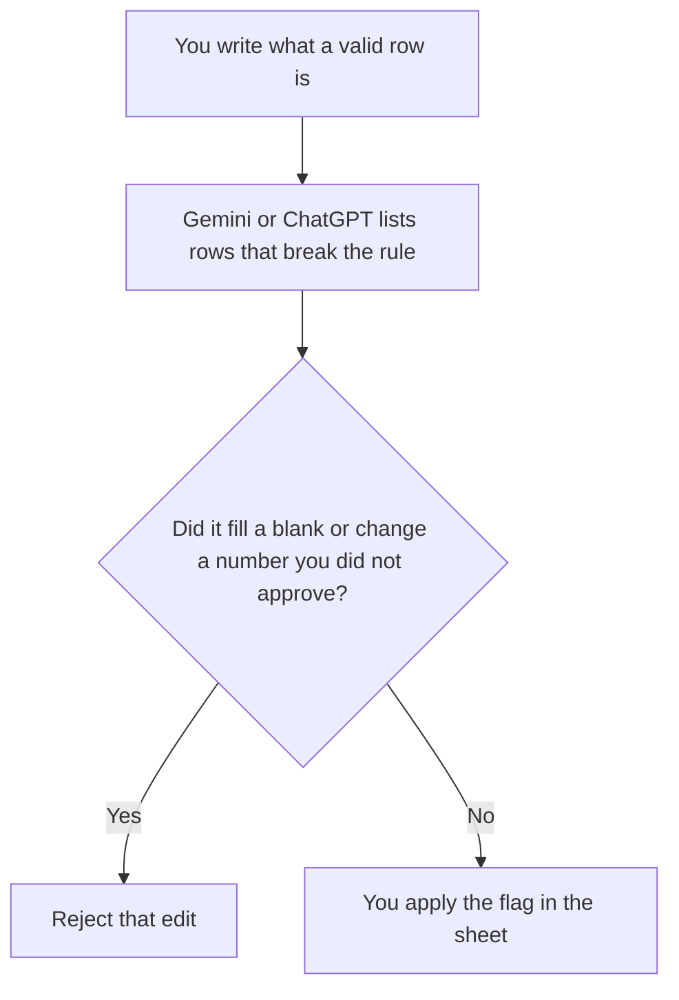

**Use Gemini or ChatGPT to flag rows that break rules you already wrote, then you fix the sheet.** A cleanup that fills blank cells with a plausible number has edited your books. We did not score which model finds more bad rows.

The Google-account choice, when the file lives in Drive, is [Gemini vs ChatGPT for Google Workspace](/blog/gemini-vs-chatgpt-for-google-workspace-2026/). A number the model inserts is [what an AI hallucination is](/blog/what-is-ai-hallucination-2026/). The person who accepts the edit is [what human-in-the-loop AI is](/blog/what-is-human-in-the-loop-ai-2026/).

Prices are US list prices excluding tax from directory pages checked October 16, 2026. Published October 24, 2026. This page is not accounting, tax, or audit advice. The sheet you export is still your record.

## Which seat matches the sheet

| The sheet you actually have | Start here | What you still do |
|---|---|---|
| A few hundred rows you can paste, and rules you can say | [ChatGPT](/tools/chatgpt/) Free, or [Gemini](/tools/gemini/) Free | Check every change against the rule. Reject filled blanks |
| The file lives in Google Drive and you want the draft next to it | Gemini. Google AI Plus is $4.99 a month. Pro is $19.99 | The Sheet is the record. The chat is a list of proposed edits |
| You want the rules saved as a project you will reuse | ChatGPT Plus at $20 a month | Swap the file. Do not reuse last month's "fixes" |
| You want a notebook built for tables, with a credit meter | [Julius](/tools/julius-ai/) Plus at $20 a month, or $16 billed annually, with 2,000 credits | Credits are the invoice. A cleanup can spend them. Read the meter |
| The rules themselves are a long policy PDF | [Gemini Notebook](/tools/gemini-notebook/), free with a Google account | Ask only from that file. Open the page before you apply a rule |

The directory says Google AI Pro includes Gemini in Gmail and Docs, plus 5 TB of storage. It does not list a separate Sheets price. This page does not invent one. If the button in your Google account offers Gemini inside the Sheet, that button is the feature. The $19.99 is the subscription, not a per-cell rate.

ChatGPT Business, at $20 a user a month billed annually with a two-user minimum, matters when the paste includes customer or employee rows and your policy forbids a personal account. A personal budget sheet can stay on Free.

## What the tools are for

**Gemini** is the path when you already live in the Google file. Plus at $4.99 is the small step if Free stops the pass. Pro at $19.99 is the higher usage tier and the one the card ties to Gemini in Gmail and Docs. Use Pro when you are already paying for the storage and the apps. Use Free when you will paste a sample and fix the sheet yourself.

**ChatGPT** can take a pasted table. Plus adds projects and expanded uploads, on the card. Go at $8 adds more uploads than Free and may include ads. Do not accept an ad as a formula. Pro at $100 and above is a capacity tier. A monthly cleanup of one workbook does not require it. The review is [ChatGPT review](/blog/chatgpt-review-2026/).

**Julius** is the dedicated table product on this shelf. Plus is $20 a month or $16 billed annually. Pro is $45 a month or $37 billed annually, with 5,000 credits. Business is $450 a month or $375 billed annually. Buy it when the sheet is the whole job and a chat paste is too clumsy. Do not buy it to avoid writing the rule.

A prompt that holds the line:

"Here are the rules for a valid row. List row numbers that break a rule, and quote the cell. Do not fill blanks. Do not change a number. If a rule needs a fact that is not in the sheet, write Missing. Do not add rows."

## What not to delegate

Do not ask the model to reconcile to a bank balance it cannot see. Do not paste a full customer export into a personal chat your policy would block at work. Do not accept a "cleaned" file you did not diff. The diff is the work. The model proposes. You accept.

If a second model should only restate the rules in plainer language, [Claude](/tools/claude/) Pro is $20 a month, or $17 billed annually. That is an edit of the rule text. It is not a second pass that gets to change cells. The long-file habit is [Gemini vs Claude for long PDFs](/blog/gemini-vs-claude-for-long-pdfs-2026/).

## FAQ

### Which one cleans better?

We did not measure that. Use the account that can see the file you will keep. If you will not diff the result, neither product has cleaned the sheet.

### Can it write the formulas?

It can draft a formula from a rule you stated. You test the formula on rows you already know are right and wrong. A formula you did not run is a suggestion.

### Is Pro required?

No. Free on Gemini and ChatGPT can flag a sample. Pay when the limit or the file location stops the pass. Julius is the paid table tool when a chat window is the wrong place for the file.

### What if the rules disagree with the sheet?

The rules you wrote win, or you change the rules on purpose. The model does not get to pick a third rule that makes more rows look valid. A silent rule change is how a cleanup becomes a new dataset.

## Last verified

October 16, 2026 for Gemini, ChatGPT, Julius, Gemini Notebook, and Claude. Published October 24, 2026.

**Sources:** [Google AI subscriptions](https://gemini.google/subscriptions/), [ChatGPT pricing](https://chatgpt.com/pricing/), [Claude pricing](https://claude.com/pricing).

*Published by Andrew for [AI Tools Optimizer](https://aitoolsoptimizer.com).*

[Julius](/tools/julius-ai/) is in the [data and analytics directory](/tools/category/data-analytics/). Directory pages may use affiliate links. A purchase through them may earn us a commission at no extra cost to you.
