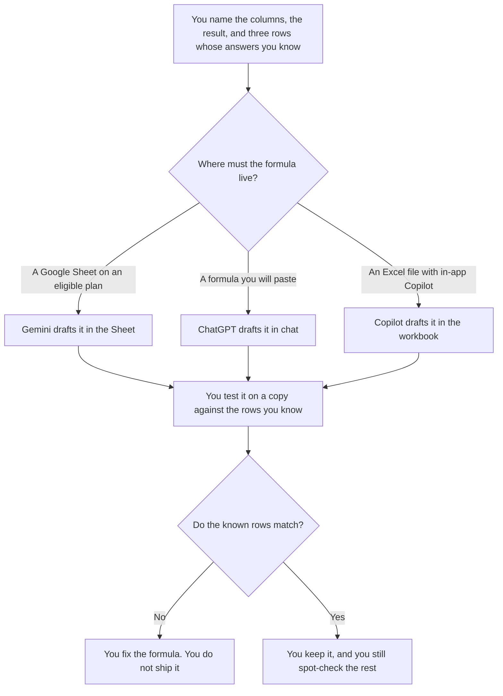

**Use Gemini when the formula should be drafted inside a Google Sheet on a plan that includes Gemini in Sheets. Use ChatGPT when you want a formula in chat that you will paste into a sheet and test on a copy.** Both can draft. Neither has checked your totals. A formula that "looks right" is not a result.

Cleaning rows that break a rule you wrote is a different job: [Gemini vs ChatGPT for spreadsheet cleanup](/blog/gemini-vs-chatgpt-for-spreadsheet-cleanup-2026/). The wider map, including Excel, is [best AI for Excel and Google Sheets](/blog/best-ai-for-excel-and-google-sheets-2026/). The Google subscription ladder is [Gemini pricing explained](/blog/gemini-pricing-explained-2026/).

Prices are US list prices excluding tax. Gemini and ChatGPT seat prices are from directory pages checked October 16, 2026. The Sheets and Excel behavior cited below was read from Google and Microsoft help, and from OpenAI's plans page, on October 24, 2026, and written up in the Excel and Sheets guide. Published October 24, 2026. We did not score formula accuracy. This page is not accounting advice.

## Which seat matches the formula

| The formula you actually need | Start here | What you still do |
|---|---|---|
| One formula, columns you can name | [ChatGPT](/tools/chatgpt/) Free or [Gemini](/tools/gemini/) Free | Type it into a copy and check the result on rows you know |
| The formula must be inserted in a Google Sheet | Gemini on an eligible Google AI or Workspace plan | Google's help says Ask Gemini can build formulas and insert them. Confirm the button in your account |
| You want the formula in chat, with a Sheets extension | ChatGPT Plus at $20 a month | OpenAI's plans page, read October 24, lists Google Sheets extensions as included on Plus |
| The file is Excel and Copilot is already in the workbook | [Microsoft Copilot](/tools/microsoft-copilot/) on a qualifying Microsoft 365 plan | Microsoft documents formula columns and single-cell formulas inside Excel. The invoice is a different card |
| You want a chart from an upload, not a formula in the grid | [Julius](/tools/julius-ai/) Plus at $20 a month, or $16 billed annually | That is analysis. It is not a cell formula |

Google AI Plus is $4.99 a month. Google AI Pro is $19.99 a month. The directory ties Pro to Gemini in Gmail and Docs and 5 TB. It does not list a separate Sheets price. The Sheets guide records that Gemini in Sheets requires an eligible Google AI or Workspace plan. If your account does not show the control, do not assume Pro turned it on. ChatGPT Go is $8 a month and may include ads. The plans page used for the Sheets guide lists Sheets extensions as limited on Free and Go. Plus is the first ChatGPT plan to treat as the spreadsheet companion.

## What the draft may contain

The columns you named and the result you described. It may show the formula and a one-line reading of what it references. It may not fill blanks, change stored numbers, or invent a column. If a column name you need is missing, the draft says Column missing.

**Gemini** is the path when the Sheet is the system of record and the account is eligible. The review is [Gemini review](/blog/gemini-review-2026/).

**ChatGPT Plus** is the path when you will paste and test, or when the extension is the reason for the seat. The review is [ChatGPT review](/blog/chatgpt-review-2026/).

**Microsoft Copilot** is the path when the file is Excel. Personal starts at $9.99 a month on the directory card. In-app editing has its own requirements, written up in [Microsoft Copilot pricing explained](/blog/microsoft-copilot-pricing-explained-2026/). Do not buy a Google seat to edit an .xlsx you will not convert.

A prompt that holds the line:

"Write one formula from the column names and the result I pasted. Do not add a column. Do not change any values. If a column is missing, write Column missing and stop."

## What not to delegate

Do not ask the model to "fix the sheet" in the same breath as the formula. Cleanup has its own page. Do not paste a payroll file into a personal account your company forbids. Do not enable a macro from a formula draft. Microsoft's Excel articles used for the Sheets guide document formulas and workbook edits. They do not document installing a VBA project as the feature.

## FAQ

### How is a formula different from cleanup?

A formula computes a result from columns you named. Cleanup flags rows that break a rule. A formula that overwrites source data has become an edit. Test it on a copy.

### Can I use the free plans?

Yes, for one formula you will type in yourself. Free Gemini can draft. ChatGPT Free can draft, with limited file tools. Move to Plus or an eligible Google plan when the formula has to live inside the file every week, and the free limits are the thing you hit.

### Which plan inserts the formula for me?

Google's help, as used in the Sheets guide, says Ask Gemini in Sheets can build formulas and insert them on an eligible plan. ChatGPT Plus is the plan whose Sheets extension the October 24 plans page lists as included. Copilot in Excel writes into the workbook when the Microsoft 365 plan includes that editing. If the button is missing, you still have a formula to paste. You do not have an insert.

### What do I check before I share the sheet?

The three rows whose answers you already know, then a sample of the rest, then anyone who owns the total. A formula that matches your sample and fails on blanks is still wrong. Say what should happen on a blank before you ask for the formula.

## Last verified

October 16, 2026 for Gemini, ChatGPT, Microsoft 365 Personal, and Julius seat prices. October 24, 2026 for the Sheets, Excel, and ChatGPT plan behavior summarized from the Excel and Sheets guide. Published October 24, 2026.

**Sources:** [Gemini in Google Sheets](https://support.google.com/docs/answer/14356410), [ChatGPT pricing](https://chatgpt.com/pricing/), [Google AI pricing](https://gemini.google/subscriptions/), [Microsoft Copilot](https://www.microsoft.com/microsoft-365/copilot).

*Published by Andrew for [AI Tools Optimizer](https://aitoolsoptimizer.com).*

[Gemini](/tools/gemini/) is in the [chatbots and assistants directory](/tools/category/chatbots-assistants/). Directory pages may use affiliate links. A purchase through them may earn us a commission at no extra cost to you.
