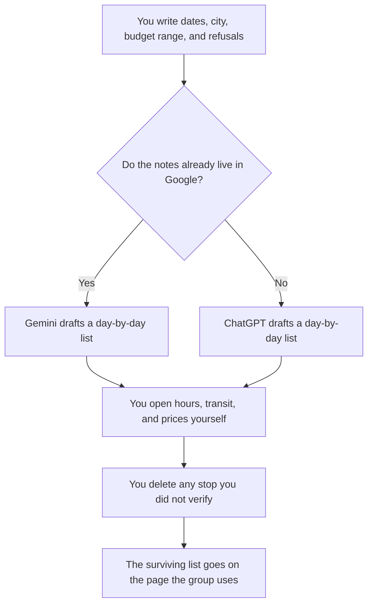

**Use Gemini when the trip notes already live in Gmail or a Google Doc. Use ChatGPT when you want one reusable itinerary template and you will paste the constraints each time.** Neither has visited the place for you. A museum hour, a train time, or a price the model invented is a plan you will miss. You bring the dates, the city, the budget range, and the things you refuse to do.

A fact you cannot open is [what an AI hallucination is](/blog/what-is-ai-hallucination-2026/). Checking a claim against a source you can click is [what AI grounding is](/blog/what-is-ai-grounding-2026/). A cited web pass, when you want links before a day-by-day plan, is [how to use Perplexity for market research](/blog/how-to-use-perplexity-for-market-research-2026/). Travel questions are not a market, but the rule is the same: open the page.

Prices are US list prices excluding tax from directory pages checked October 16, 2026. Published October 24, 2026. We did not score which itinerary is more pleasant. This page does not book anything.

## Which seat matches the trip

| The trip file you have | Start here | First paid step | What you still do |
|---|---|---|---|
| Dates, city, and a few constraints in a paste | [Gemini](/tools/gemini/) Free or [ChatGPT](/tools/chatgpt/) Free | Either free plan can format one trip | You check hours and transit before you rely on a morning |
| Notes already in Gmail or Docs | Gemini. Google AI Plus is $4.99 a month. Pro is $19.99 | Pro is the row that includes Gemini in Gmail and Docs, on the October 16 card | The inbox is context. It is not a confirmation |
| A template you reuse for every trip | ChatGPT Plus at $20 a month | Go is $8 and may include ads | Do not treat an ad as a restaurant |
| You want links you can open before you commit a day | [Perplexity](/tools/perplexity/) Free, or Pro at $17 a month billed annually | The link is the check. The itinerary comes after | A citation you did not open is not a reservation |
| The plan the group will actually follow | [Notion AI](/tools/notion-ai/) Business at $20 a seat a month | The page is the record | One page. A chat transcript is not the plan |

Gemini Ultra is $99.99 or $199.99 a month on the October 16 card. ChatGPT Pro starts at $100. A vacation outline does not need either. Google AI Pro at $19.99 bundles storage and Gemini in Google apps. Buy it when you already live in that inbox, not because a model claims to know a neighborhood.

## What the draft should contain

A day, a neighborhood or a city, and the constraint you named: walking limit, a kid's nap, a dietary line, a budget ceiling you wrote. It should not contain a restaurant "the locals love" with no page you opened. It should not contain a price, a ticket, or a train you did not look up. If a block is empty, the line says Unplanned. An empty afternoon is better than a fictional museum.

**Gemini** is the seat when the confirmation emails are already in Gmail and you want the draft beside them. Free is enough to test one city. The product review is [Gemini review](/blog/gemini-review-2026/).

**ChatGPT** is the seat when you keep a template: arrival day, one neighborhood a day, a rest block, a refusal list. Plus holds the project. The product review is [ChatGPT review](/blog/chatgpt-review-2026/).

A prompt that holds the line:

"Draft a day-by-day itinerary from the dates, city, budget range, and refusals I pasted. Do not invent opening hours, prices, or transit times. If you do not have a source I can check, write Unplanned. Do not add a stop I ruled out. Do not book anything."

## What not to delegate

Do not ask the model to pick a neighborhood it "knows." Do not let it spend the budget. Do not treat a generated list as travel insurance, a visa answer, or a safety briefing. Those are official sources and your own judgment. The model formats. You verify, then you go.

## FAQ

### Which one plans a better trip?

We did not travel on either draft. Pick Gemini when the emails and docs are already in Google. Pick ChatGPT when you want a reusable template. The better plan is the one whose hours you checked.

### Can it include restaurant reservations?

It can leave a blank where you will reserve, after you open the restaurant's page. It should not claim a table. A sentence that says "booked" is a false record.

### What about a price it states confidently?

Delete it unless you opened the fare or the ticket page and typed the number. Confidence is not a source. The grounding article is the longer version of that rule.

### Is the free plan enough?

For one trip, yes. Pay when the inbox integration or the saved template is the point. Ultra and the $100 ChatGPT tier are the wrong upgrade for a week of days and neighborhoods.

## Last verified

October 16, 2026 for Gemini, ChatGPT, Perplexity, and Notion AI. Published October 24, 2026.

**Sources:** [Gemini](https://gemini.google.com), [ChatGPT pricing](https://chatgpt.com/pricing/), [Perplexity](https://www.perplexity.ai), [Notion pricing](https://www.notion.com/pricing).

*Published by Andrew for [AI Tools Optimizer](https://aitoolsoptimizer.com).*

[Gemini](/tools/gemini/) is in the [chatbots and assistants directory](/tools/category/chatbots-assistants/). Directory pages may use affiliate links. A purchase through them may earn us a commission at no extra cost to you.
