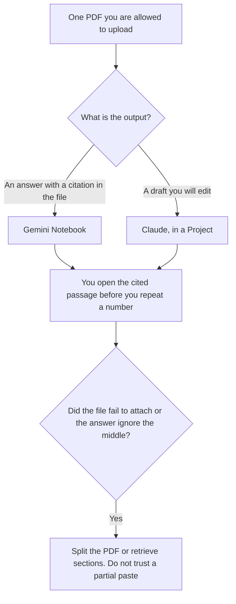

**Use Gemini Notebook when a long PDF must answer with citations you can open in the file you uploaded. Use Claude when you will revise a draft about that PDF in a Project, and you will check every figure yourself.** The wider choice, including Gmail and a folder of mixed files, is [Claude vs Gemini for long documents](/blog/claude-vs-gemini-for-long-documents-2026/). This page is one PDF: a contract, a paper, a report, a manual. A bigger chat window is not a page number.

The ceiling this directory has recorded for Claude is context windows of up to 1 million tokens, depending on the model, checked October 16, 2026. That is not a promise that your PDF fits, and it is not a figure this site has recorded for Gemini. The limit is [what a context window is](/blog/what-is-a-context-window-2026/). If the PDF is one file in a corpus you search by similarity, the failure mode when the index changes is [what embedding drift is](/blog/what-is-embedding-drift-2026/).

Prices are US list prices excluding tax from directory pages checked October 16, 2026. Published October 24, 2026. We did not score summary accuracy, and we did not count pages either product accepts.

## One PDF, two jobs

| The job | Start here | Why, on the card |
|---|---|---|
| Questions that must point at the source you uploaded | [Gemini Notebook](/tools/gemini-notebook/) | Source-grounded chat with citations. Free with a Google account |
| A memo you will rewrite, with the PDF attached | [Claude](/tools/claude/) | Files and Projects are on the product, including Free, with usage limits |
| The PDF already lives in Google Drive and you want higher notebook limits | Gemini Notebook on a Google AI plan | Plus is $4.99 a month. Pro at $19.99 lists about 5x more Audio Overviews and notebooks |
| You also need Gemini inside Docs for a different file | [Gemini](/tools/gemini/) on Google AI Pro | Pro lists Gemini in Gmail and Docs. That is not the notebook |
| The PDF is evidence in a literature table | [Elicit](/tools/elicit/), linked below | A different product. Do not force a chat to be a systematic review |

A number that was not on the page you opened is [a hallucination](/blog/what-is-ai-hallucination-2026/). The habit is [how to fact-check AI writing](/blog/how-to-fact-check-ai-writing-2026/).

## What you pay to stay with the file

**Gemini Notebook is free** with a Google account, in supported countries, on the directory card. **Google AI Plus at $4.99 a month** adds more Audio Overviews and notebooks. **Google AI Pro at $19.99 a month** offers about 5x more Audio Overviews, notebooks, and related limits on that card. A year of Pro is 12 × $19.99 = $239.88. Buy Pro when you hit the free limit on a notebook you still need, not because the PDF is long. Enterprise terms are a Workspace or Cloud conversation. The study habit is [how to study with Gemini Notebook](/blog/gemini-notebook-study-workflows/).

**Claude Free** includes file upload and up to five Projects, with usage limits. **Pro is $20 a month, or $17 billed annually.** That is the seat for a week of revision, not a prize for owning a long PDF. **Max at $100 or $200** is 5× or 20× Pro usage. A long file on a quiet week can fit on Pro. Fifty short questions in a day can blow a cap. The split is [Claude Pro vs Max](/blog/claude-pro-vs-max-2026/).

**[ChatGPT](/tools/chatgpt/) Plus at $20** can take a PDF upload too. It is a reasonable third seat if your notes already live there. It is not the citation product this page starts with. The three-way assistant choice is [ChatGPT vs Gemini vs Claude](/blog/chatgpt-vs-gemini-vs-claude-2026/).

Audio Overviews on Gemini Notebook turn sources into a listenable conversation. Useful for a first pass. Not a substitute for the page a number came from. Treat the audio as a tour. Treat the PDF as the record.

## When one PDF is the wrong shape

A stack of papers with extraction columns is [Elicit](/tools/elicit/). Pro is $39 a user a month billed annually and includes a systematic review workflow on the card. The invoice is [Elicit pricing explained](/blog/elicit-pricing-explained-2026/). The research pairing is [how to research with Elicit and Consensus](/blog/how-to-research-with-elicit-and-consensus-2026/).

A corpus that does not fit in a window, searched on every question, is retrieval. The method is [what RAG is](/blog/what-is-rag-explained-2026/). Do not paste chapter one and call it the report.

A contract you will sign is still a lawyer's document if the decision needs one. These tools draft and point. They do not execute the agreement. The summary workflow for legal memos is [Claude vs ChatGPT for legal summaries](/blog/claude-vs-chatgpt-for-legal-summaries-2026/).

## FAQ

### Which one handles more pages?

This directory does not record a page cap for either product. The Claude token ceiling above is not a page count. If the upload fails or the answer clearly skips the middle, split the file and ask about the section you named. Do not upgrade a plan to wish a limit away until you have seen the limit.

### Is Gemini chat the same as Gemini Notebook?

No. The notebook is the source-grounded product. Gemini in the assistant, including the Docs and Gmail line on Google AI Pro, is a different surface. The long-documents page covers that split. This page uses the notebook when the citation has to stay on the PDF.

### Can I trust a citation chip?

You can trust it enough to open it. You repeat the number only after you see it in the file. A chip that points at the wrong paragraph is a miss. Say so in the next question, with the page you meant, if you know it.

### Do I need both?

Not on day one. Pick the output. Citations: Notebook. A draft you will keep editing: Claude. Add the second when the first one's limit, not its reputation, is what blocked you.

## Last verified

October 16, 2026 for Gemini Notebook, Gemini, Claude, and ChatGPT. The 1 million token figure is the ceiling the directory recorded for Claude, depending on the model. Published October 24, 2026.

**Sources:** [Gemini Notebook plans](https://support.google.com/gemininotebook/answer/16213268?hl=en), [Google AI subscriptions](https://gemini.google/subscriptions/), [Claude pricing](https://claude.com/pricing).

*Published by Andrew for [AI Tools Optimizer](https://aitoolsoptimizer.com).*

[Gemini Notebook](/tools/gemini-notebook/) is in the [research and search directory](/tools/category/research-search/). Directory pages may use affiliate links. A purchase through them may earn us a commission at no extra cost to you.
