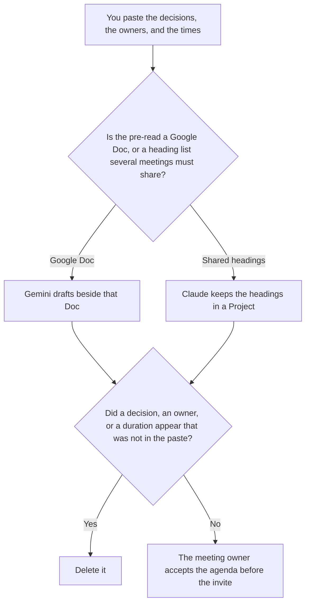

**Use Gemini when the pre-read already lives in a Google Doc and the agenda should be drafted beside that text. Use Claude when several recurring meetings must share the same decision headings, and only the owners and times you paste may change.** The model may order the items. It may not invent a decision, an owner, or a duration. The workflow is [how to create meeting agendas with AI](/blog/how-to-create-meeting-agendas-with-ai-2026/). The paste-versus-Doc split with ChatGPT is [ChatGPT vs Gemini for meeting agendas](/blog/chatgpt-vs-gemini-for-meeting-agendas-2026/).

The page that picks Claude or ChatGPT after the decisions exist is [Claude vs ChatGPT for meeting agendas](/blog/claude-vs-chatgpt-for-meeting-agendas-2026/). This page does not add ChatGPT as the winner. It picks Gemini or Claude.

Gemini's prices are the October 16, 2026 directory figures recorded in [Gemini pricing explained](/blog/gemini-pricing-explained-2026/). Claude's prices are the October 24, 2026 read of claude.com/pricing recorded in [Claude pricing explained](/blog/claude-pricing-explained-2026/). Notion and Grammarly prices are from directory pages checked October 16, 2026. Published October 24, 2026. We did not score meetings.

## Where the agenda has to match something

| The source | Start here | First paid step | The limit |
|---|---|---|---|
| A Google Doc the group already shares | [Gemini](/tools/gemini/) | Google AI Pro is $19.99 a month | No decision that was not in the Doc |
| Recurring meetings that must share headings | [Claude](/tools/claude/) | Pro is $17 a month billed annually, $200 up front, or $20 monthly | The Project holds the headings |
| The file the next meeting will copy | [Notion AI](/tools/notion-ai/) | Business is $20 a seat a month | Plus at $10 is not the full AI tier |
| A clarity pass that must not add a decision | [Grammarly](/tools/grammarly/) | Pro is $12 a member a month billed annually, or $30 monthly | Compare the decision lines before and after |

An agenda that says "decide the budget" when nobody put that decision in the paste has created a meeting. If the owner is missing, the line says Owner not set. If the duration is missing, it says Duration not set. It does not split sixty minutes into equal blocks the model prefers.

Google AI Plus is $4.99 a month on the October 16 card. Pro at $19.99 is the row that includes Gemini in Docs. Free can draft from a paste. The invoice is [Gemini pricing explained](/blog/gemini-pricing-explained-2026/).

Claude Free can format a short list. Pro is the seat with Projects. Team standard seats are $20 a seat a month billed annually, or $25 monthly, when the template is a company record, as recorded in [Claude Team pricing explained](/blog/claude-team-pricing-explained-2026/). The review is [Claude review](/blog/claude-review-2026/).

## What the agenda is allowed to contain

The decisions you named, the owners you named, and the times you named. A topic that was not in the paste stays out. A pre-read link that was not in the paste says Pre-read not attached. The owner can add it. The draft should not fetch a Doc and summarize a decision that was not marked as a decision.

**Gemini Pro** is the Doc path. The agenda sits next to the text the group will open. A line that is not in the Doc and not in your paste is the line you delete.

**Claude Pro** is the shared headings. Each meeting changes owners and times only. If two agendas disagree on a heading you marked shared, stop and fix the Project.

**Notion Business** stores the accepted agenda, the owner, and the date. The invoice is [Notion AI pricing explained](/blog/notion-ai-pricing-explained-2026/).

**Grammarly Pro** is the pass after the decisions are stable. Reject a suggestion that turns a question into a decision. The invoice is [Grammarly pricing explained](/blog/grammarly-pricing-explained-2026/).

A prompt that holds the line:

"Draft the agenda from the decisions, the owners, and the times I pasted. If an owner is missing, write Owner not set. Do not add a decision. Do not invent a duration. Do not reword a heading I marked shared."

## What not to delegate

Do not ask which topics will "make the meeting useful." Do not turn a status line into a decision. Do not send the invite because the agenda looks short. The meeting owner accepts it. A timed list is not a decision.

## FAQ

### How is this different from ChatGPT vs Gemini for agendas?

That page chooses ChatGPT when you paste a short list and Gemini when the pre-read is already a Doc or a Gmail thread. This page chooses Gemini for the Doc and Claude when several meetings must share headings. ChatGPT is not the seat this page recommends. Use that page when the other tool is ChatGPT.

### How is this different from Claude vs ChatGPT for agendas?

That page chooses Claude when the agenda follows a long pre-read in a Project, and ChatGPT when the agenda is a short clock you will reuse. This page chooses Claude when the headings themselves must match across meetings, and Gemini when the source is a Google Doc. Both pages refuse an invented decision.

### How is this different from the agenda how-to?

That page is the workflow: decisions first, then the clock. This page is which seat to use when the source is a Doc or a shared heading list. Both pages leave a missing owner as Owner not set. Use the how-to for the fields. Use this page for the tool.

### Who may send the agenda?

The meeting owner. Two recurring meetings do not get two versions of a heading you marked shared. A formatted Doc is not an invite.

## Last verified

October 16, 2026 for Gemini, Notion, and Grammarly. October 24, 2026 for Claude, via the pricing article. Published October 24, 2026.

**Sources:** [Gemini subscriptions](https://gemini.google.com), [Claude pricing](https://claude.com/pricing), [Notion pricing](https://www.notion.com/pricing), [Grammarly pricing](https://www.grammarly.com/plans).

*Published by Andrew for [AI Tools Optimizer](https://aitoolsoptimizer.com).*

[Gemini](/tools/gemini/) is in the [chatbots and assistants directory](/tools/category/chatbots-assistants/). Directory pages may use affiliate links. A purchase through them may earn us a commission at no extra cost to you.
