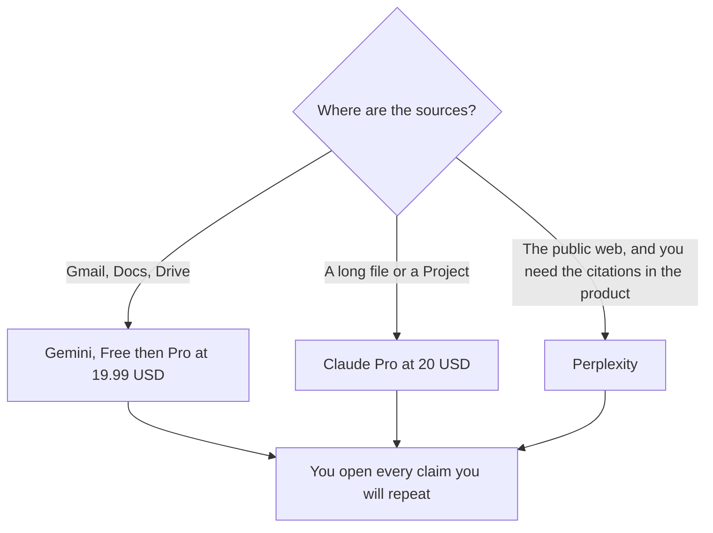

**Use Gemini when the research lives next to Gmail, Docs, and Drive and you want one Google plan. Use Claude when the research is a long file, a Project full of sources, or a draft you will keep editing in that chat.** If the job is a cited web answer as the product, neither of these is Perplexity. That comparison is [ChatGPT vs Perplexity for research](/blog/chatgpt-vs-perplexity-for-research-2026/).

The file-length version of Claude versus Gemini is [Claude vs Gemini for long documents](/blog/claude-vs-gemini-for-long-documents-2026/). The assistant overview is [ChatGPT vs Gemini vs Claude](/blog/chatgpt-vs-gemini-vs-claude-2026/).

Prices are US list prices excluding tax from directory pages checked October 16, 2026. Published October 24, 2026. We did not score citations or recall.

## Where the research sits

| The work | Start here | First paid step | A bad substitute |
|---|---|---|---|
| You are already in Google and the sources are Docs and mail | [Gemini](/tools/gemini/) | Free with a Google account. Google AI Pro is $19.99 a month | A second assistant you will not open |
| You upload a long report and ask questions against that file | [Claude](/tools/claude/) | Pro is $20 a month, or $17 billed annually | Free Gemini, if the file is the whole job and you keep hitting the cap |
| You need a cited sweep of the public web | [Perplexity](/tools/perplexity/) | Pro is $17 a month billed annually | Either chat, described as a research engine |
| You are reading academic papers | [Elicit](/tools/elicit/) or Consensus | Use the directory page before you quote a price | A general chat as a journal database |
| You want the same seat as coding and images | [ChatGPT](/tools/chatgpt/) Plus | $20 | This page, if you only needed the Google bundle |

## What each plan includes

**Gemini.** Free, with a Google account, includes the Flash-Lite model and 15 GB of storage. Google AI Plus is $4.99 a month. Google AI Pro is $19.99 and, on the directory card, adds higher usage, Gemini 4 Argon access, Gemini in Gmail and Docs, and 5 TB. Ultra is $99.99 or $199.99. The research reason to buy Pro is the Google bundle and the higher cap, not a claim that it cites better. The review is [Gemini review](/blog/gemini-review-2026/).

**Claude.** Free includes files and Projects, with limits. Pro adds more usage and the Project workflow most research drafts need. Max at $100 or $200 is for people who already run out on Pro. The directory does not print a Team dollar. A Project is where the sources live between sessions. The review is [Claude review](/blog/claude-review-2026/). The container is [Claude Projects vs ChatGPT Projects](/blog/claude-projects-vs-chatgpt-projects-2026/).

**Perplexity, when the citation is the point.** Pro at $17 a month billed annually adds higher limits and premium data sources such as PitchBook and Statista, on the directory card. Monthly costs more. The directory lists the annual figure and does not print the monthly dollar on that same line. Enterprise Pro is $40 a user a month. If your output is a memo with links a skeptic will click, start there and use Claude or Gemini to draft from the sources you kept. The worth-it page is [is Perplexity Pro worth it](/blog/is-perplexity-pro-worth-it-2026/).

**Papers.** A general assistant will summarize an abstract you paste. A literature tool is for finding the papers. The workflow is [how to research with Elicit and Consensus](/blog/how-to-research-with-elicit-and-consensus-2026/). The head-to-head with the cited-search product is [Perplexity vs Elicit for research](/blog/perplexity-vs-elicit-for-research-2026/).

## How to work

Paste the question and the sources you already trust. Ask for claims tied to a page or a paragraph you can open. Delete any claim that has no pointer. That pass is [how to fact-check AI writing](/blog/how-to-fact-check-ai-writing-2026/). A fluent paragraph with no source is [what an AI hallucination is](/blog/what-is-ai-hallucination-2026/).

A weekly digest is a habit on top of this choice: [how to build an AI research digest](/blog/how-to-build-an-ai-research-digest-2026/). A market scan with a search product is [how to use Perplexity for market research](/blog/how-to-use-perplexity-for-market-research-2026/).

Do not pay for Gemini Pro and Claude Pro in the same month until one of them has failed a real task. Free on both is enough to see which window you actually return to.

## FAQ

### Is Google AI Pro the research equivalent of Claude Pro?

They are close on the monthly sticker, $19.99 and $20. Pro on Google is a storage and app bundle with higher Gemini limits. Claude Pro is the file-and-Project seat. Buy the one whose sources you already have. The overlap is "help me read this." The non-overlap is Gmail versus a long Project.

### Which one hallucinates less?

This page did not measure that. The model, the sources you attached, and whether you open them matter more than the brand. Keep a note when a tool invents a citation. That note is your eval. The practice is [what AI eval testing is](/blog/what-is-ai-eval-testing-2026/).

### Can I use Gemini to search and Claude to write?

Yes. That split fails when you pay for both and only paste the same question twice. Use the free tier of the second tool for a check, and pay for the one that holds the draft.

### Does either replace a journal database?

No. For papers, use a tool built for that corpus, then bring the PDFs you are allowed to use into Claude or Gemini. Do not ask a chat window to invent a bibliography.

## Last verified

October 16, 2026 for Gemini, Claude, Perplexity, and ChatGPT prices named above. Published October 24, 2026.

**Sources:** [Google AI plans](https://one.google.com/about/google-ai-plans/), [Claude pricing](https://claude.com/pricing), [Perplexity](https://www.perplexity.ai).

*Published by Andrew for [AI Tools Optimizer](https://aitoolsoptimizer.com).*

[Gemini](/tools/gemini/) is in the [research and search directory](/tools/category/research-search/). Directory pages may use affiliate links. A purchase through them may earn us a commission at no extra cost to you.
