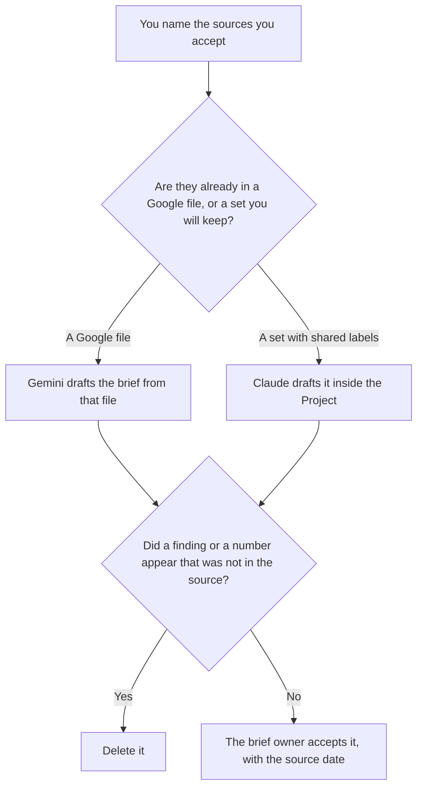

**Use Gemini when the sources for the brief are already in a Google Doc or Drive file you can point at. Use Claude when the brief is a set of files that must keep the same citation labels, and those labels live in a Project.** Either tool may order sections from sources you accepted. Neither may add a finding, a statistic, or a paper you did not provide. The wider research seat, which is not this one-page brief, is [Gemini vs Claude for research](/blog/gemini-vs-claude-for-research-2026/). A stack of papers you must open is [Perplexity vs Gemini for literature reviews](/blog/perplexity-vs-gemini-for-literature-reviews-2026/).

Google AI Plus and Pro prices are the October 16 directory card, and the same figures are recorded from gemini.google/subscriptions on October 24, 2026 in the Notebook pricing article. Claude's prices are from claude.com/pricing on October 24. Perplexity and Notion prices are from directory pages checked October 16, 2026. Published October 24, 2026. We did not score briefs.

## Which brief you are writing

| The sources | Start here | First paid step | The limit |
|---|---|---|---|
| A Doc or a Drive file you already have | [Gemini](/tools/gemini/) | Google AI Pro is $19.99 a month, the card that names Gemini in Docs | No finding that is not in the file |
| Several files that must share citation labels | [Claude](/tools/claude/) | Pro is $17 a month billed annually, or $20 monthly | The Project does not verify the source |
| A public page you still need to open | [Perplexity](/tools/perplexity/) | Pro is $17 a month billed annually | Open the citation before it enters the brief |
| The page the team reopens | [Notion AI](/tools/notion-ai/) | Business is $20 a seat a month | The brief's home is not a second research pass |

A brief that "fills gaps" is a brief that invented. If the file does not answer a question you asked, the section says Not in the source. Free Gemini can try a short paste. Pro at $19.99 is the row the October 16 card ties to Gemini in Gmail and Docs. Plus at $4.99 is the smaller usage row, and this page does not treat it as the Docs seat. The ladder is [Gemini pricing explained](/blog/gemini-pricing-explained-2026/). The review is [Gemini review](/blog/gemini-review-2026/).

Claude Free can hold a short file. Pro is the Project seat. The review is [Claude review](/blog/claude-review-2026/).

## What the brief is allowed to say

The question you wrote, the sources you named, the dates on those sources, and the findings that are quotes or close paraphrases of them. A recommendation is allowed only if you wrote it. Otherwise the brief stops at the findings.

**Gemini on Pro** is the path when the packet is already a Doc. Ask for a brief that cites the heading in that Doc. A paragraph with no heading to point at does not stay.

**Claude Pro** is the path when next month's brief must use the same labels as this month's. Change a label once.

**Perplexity Pro** is how you fetch a public page before it becomes a source. The citation is not in the brief until you have opened it. The review is [Perplexity review](/blog/perplexity-review-2026/).

**Notion Business** holds the accepted brief. Link the source date. The invoice is [Notion AI pricing explained](/blog/notion-ai-pricing-explained-2026/).

A prompt that holds the line:

"Write the research brief only from the sources I named. If a question is not answered there, write Not in the source. Do not add a statistic. Do not add a recommendation I did not write."

## What not to delegate

Do not ask for the state of the market. Do not paste a paywalled paper you do not have rights to drop into a personal account. Do not send the brief because the prose is smooth. The owner accepts it after checking that every finding has a source they opened.

## FAQ

### How is this different from the general research comparison?

That page is the ongoing research seat: Google versus a long file. This page is one brief, with a question and a source list you already bounded. The same person may use both. The brief does not become a research program because the draft is long.

### How is this different from a literature review?

A literature review is the papers you can open, and the claims you are willing to attach to them. A research brief is shorter: one question, for one reader, from sources you already accepted. A review can feed a brief. It is not the brief.

### Do I need Pro on both?

No. Use the seat where the sources already live. Paying for both and merging the paragraphs is how a number survives in one brief and changes in the other. File one accepted version.

### Who may add a source after the draft?

The brief owner, by naming it and the date they opened it. The model may not append a source. A link in a draft is a proposal until the owner accepts it.

## Last verified

October 16, 2026 for the Gemini, Perplexity, and Notion directory cards. October 24, 2026 for Claude, and for the Gemini subscription figures recorded in the Notebook pricing article. Published October 24, 2026.

**Sources:** [Google AI subscriptions](https://gemini.google/subscriptions/), [Claude pricing](https://claude.com/pricing), [Perplexity](https://www.perplexity.ai/), [Notion pricing](https://www.notion.com/pricing).

*Published by Andrew for [AI Tools Optimizer](https://aitoolsoptimizer.com).*

[Gemini](/tools/gemini/) is in the [chatbots and assistants directory](/tools/category/chatbots-assistants/). Directory pages may use affiliate links. A purchase through them may earn us a commission at no extra cost to you.
