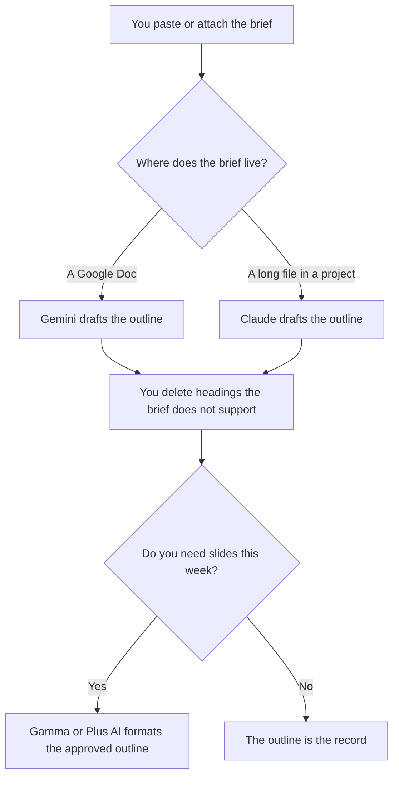

**Use Gemini when the brief already lives in a Google Doc. Use Claude when the brief is a long document the outline must not add to.** A slide outline is a list of headings, the point of each slide, and the proof you will put on it. It is not the deck. The tools that turn an approved outline into slides are a later purchase. A heading with no source in the brief is a slide you will have to defend with a sentence you do not have.

The board-deck comparison, which assumes the slides are the artifact, is [Gamma vs Plus AI for board decks](/blog/gamma-vs-plus-ai-for-board-decks-2026/). The narrative you build before a launch list is [how to write a go-to-market brief with AI](/blog/how-to-write-a-go-to-market-brief-with-ai-2026/). A confident line with no source is [what an AI hallucination is](/blog/what-is-ai-hallucination-2026/).

Prices are US list prices excluding tax from directory pages checked October 16, 2026. Published October 24, 2026. We did not score outlines or designs.

## Which seat matches the brief

| The brief you actually have | Start here | What you still do |
|---|---|---|
| A short paste | [Gemini](/tools/gemini/) Free or [Claude](/tools/claude/) Free | You delete any heading the brief does not support |
| The brief is a Google Doc | Gemini on Google AI Pro at $19.99 a month | The doc is the source. The outline quotes it |
| A lighter Google plan | Google AI Plus at $4.99 a month | The card lists 2x usage versus free. The source rule does not change |
| A long brief or a packet of notes | Claude Pro at $20 a month, or $17 billed annually | The Project holds the brief. The outline adds no slide it does not contain |
| You already approved the outline and need slides | [Gamma](/tools/gamma/) Plus at $9 a seat a month, or [Plus AI](/tools/plus-ai/) Basic at $10 a user a month billed annually | The outline is the input. The slide tool does not get to add a section |

Google AI Ultra starts at $99.99. Claude Max starts at $100. An outline from a brief you have does not need either. Gemini's free plan includes the assistant with a Google account. Claude's free plan can draft one outline from a paste. Pay when the brief is long enough, or repeated enough, that the free limits get in the way. The Gemini invoice, including the 4x usage line on Pro for the Gemini app, is [Gemini pricing explained](/blog/gemini-pricing-explained-2026/).

## What the outline should contain

The audience, the decision the meeting is for, one heading per slide, the claim on that slide, and the proof you already have. It should not contain speaker notes that smuggle in a new number. If a heading has no proof, the line says Proof missing, and the slide stays out until a person supplies it.

**Gemini** is the paid path when the file is already in Google. Google AI Plus at $4.99 is the 2x row on the Gemini card. Google AI Pro at $19.99 is the 4x row on that same card, and it is the plan the directory ties to Gemini in Gmail and Docs. The product page is [Gemini review](/blog/gemini-review-2026/).

**Claude Pro** is the paid path when the brief is a document you want attached, and the outline is a writing problem before it is a slide problem. The product page is [Claude review](/blog/claude-review-2026/).

**Gamma and Plus AI** come after the outline is honest. Plus AI has no permanent free plan. Basic is $10 a user a month billed annually. A year of that rate is $120. The invoice is [Plus AI pricing explained](/blog/plus-ai-pricing-explained-2026/). Gamma's seat is [Gamma pricing explained](/blog/gamma-pricing-explained-2026/).

A prompt that holds the line:

"Draft a slide outline from the brief I pasted. One heading per slide. Under each heading, copy the claim and the proof from the brief. If the proof is missing, write Proof missing. Do not add slides, statistics, or a recommendation the brief does not contain."

## What not to delegate

Do not ask for a "stronger" story than the brief supports. Do not let the slide tool add a section because the deck looked short. Do not present an outline you have not checked against the brief. The person who owns the meeting owns the headings.

## FAQ

### Which one makes a better outline?

We did not measure that. Pick Gemini when the brief is a Google file. Pick Claude when the brief is a long document you want held in a Project. The outline is only as good as the cut you make afterward.

### Should the outline include the design?

No. Design is the next tool, after the headings are true. Asking for colors and layouts at this step hides a missing proof inside a polished slide. Approve the outline, then open Gamma or Plus AI.

### What if we need a board deck, not an outline?

Use the board-deck comparison. That page is about the slides a board will see, and the figures on them have to be figures you pasted. This page stops at the headings.

### Can the model suggest a slide I did not ask for?

It can mark a gap: "the brief names a risk and the outline has no slide for it." It should not write the risk slide's claim. You decide whether the gap becomes a heading, and you supply the proof.

## Last verified

October 16, 2026 for Gemini, Claude, Gamma, and Plus AI. Published October 24, 2026.

**Sources:** [Gemini subscriptions](https://gemini.google/subscriptions/), [Claude pricing](https://claude.com/pricing), [Gamma pricing](https://gamma.app/pricing), [Plus AI pricing](https://plusai.com).

*Published by Andrew for [AI Tools Optimizer](https://aitoolsoptimizer.com).*

[Gemini](/tools/gemini/) is in the [chatbots and assistants directory](/tools/category/chatbots-assistants/). Directory pages may use affiliate links. A purchase through them may earn us a commission at no extra cost to you.
