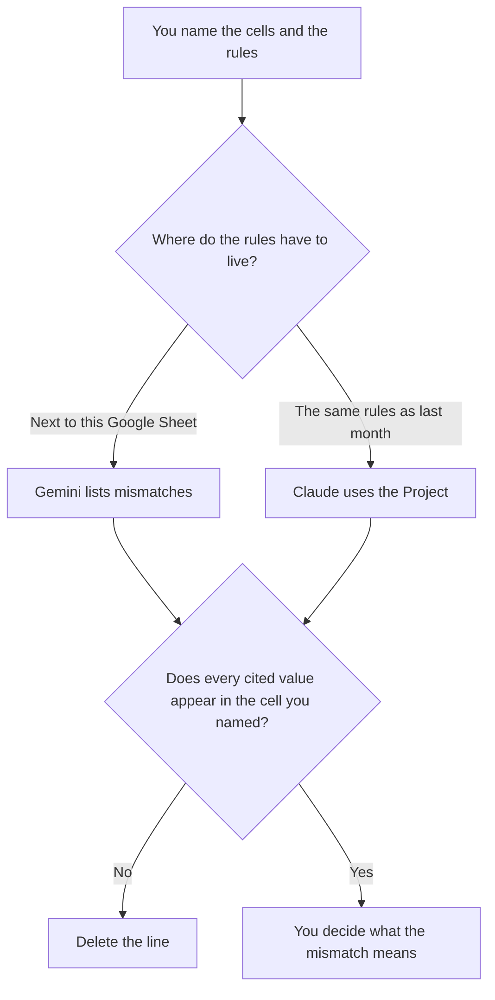

**Use Gemini when the audit is a Google Sheet you can open, and the check is whether the cells match rules you paste. Use Claude when those rules have to be the same rules as last month's audit, kept in a Project.** The model may point at a cell, repeat a value, and show arithmetic you asked for. It may not invent a total, a cause, or a "corrected" number. Cleaning messy text is [Gemini vs ChatGPT for spreadsheet cleanup](/blog/gemini-vs-chatgpt-for-spreadsheet-cleanup-2026/). Writing a formula is [Gemini vs ChatGPT for spreadsheet formulas](/blog/gemini-vs-chatgpt-for-spreadsheet-formulas-2026/). This page is the audit: the rules, the cells, and the mismatches.

Gemini and Julius prices are from directory pages checked October 16, 2026. Claude's prices are from claude.com/pricing on October 24, 2026. Hex's price is from the October 16 card. Published October 24, 2026. We did not score spreadsheets. This page is not an audit opinion.

## Which audit you are running

| The sheet | Start here | First paid step | The limit |
|---|---|---|---|
| A Google Sheet, rules you paste beside it | [Gemini](/tools/gemini/) | Google AI Plus is $4.99 a month. Pro is $19.99 | No number that is not in a cell you named |
| Rules that must match the last audit | [Claude](/tools/claude/) | Pro is $17 a month billed annually, $200 up front, or $20 monthly | The Project holds the rules. It does not own the sheet |
| A chart from a file you uploaded | [Julius AI](/tools/julius-ai/) | Plus is $16 a month billed annually, or $20 monthly | The chart cites the file. It does not replace the cell |
| A query the cell came from | [Hex](/tools/hex/) | Professional is $36 an editor a month | Paste the result. Do not ask the chat what last quarter "was" |

An audit line that says the revenue "should be" a different number has left the audit and written a forecast. If the rule is "flag totals that do not equal the sum of the rows," the draft shows the cell, the sum, and the difference. It does not explain why the business missed a target.

## What you are checking

**Gemini** is the Google Sheet path. Free exists with a Google account, on the October 16 card. Plus at $4.99 is the first paid step on that card. Pro at $19.99 is the higher seat. The invoice is [Gemini pricing explained](/blog/gemini-pricing-explained-2026/). The model still only knows the cells you gave it.

**Claude Pro** is the standing-rules path. Change the rule in the Project when the definition changes, then rerun. Do not keep a second definition in a chat from March. The review is [Claude review](/blog/claude-review-2026/).

**Julius Plus** is the upload when you want a chart of the mismatches you already listed. Free has a daily credit allowance on that card. The invoice is [Julius AI pricing explained](/blog/julius-ai-pricing-explained-2026/).

**Hex Professional** is the notebook when the number was calculated upstream. Community is free, with a smaller history, on that card. Cite the cell you checked, not a rounded cousin.

A prompt that holds the line:

"Audit this sheet against the rules I pasted. For each mismatch, cite the cell and the value. If a cell is empty, write Empty. Do not invent a replacement value. Do not explain the business cause."

## What not to delegate

Do not paste a payroll file into a personal account your policy forbids. Do not ask which rows "look wrong" without a rule. Do not let a chart title state a conclusion the cells do not state. The sample you would need before calling the audit done, if this is a model change rather than a sheet, is [what an AI eval sample size is](/blog/what-is-ai-eval-sample-size-2026/).

## FAQ

### Which one catches more errors?

We did not measure that. Gemini fits a Google Sheet and a rule you paste. Claude fits rules that must match last month. The audit is done when every mismatch cites a cell you can open.

### Can the model fix the sheet?

It can draft a list of cells that failed a rule you wrote. A person changes the sheet, or decides the rule was wrong. A model that overwrites the total has ended the audit.

### Do I need Julius or Hex?

Only if the picture or the upstream query is the thing you must show. The audit can be a list in the chat you then file. Two tools that both "round" the same cell will disagree. Cite one cell.

### Who signs the audit?

The person named on it. A clean list of mismatches is not a finding that the books are fine, and it is not a finding that they are not. This page is not an assurance engagement.

## Last verified

October 24, 2026 for Claude. October 16, 2026 for Gemini, Julius, and Hex. ChatGPT is not priced on this page. Published October 24, 2026.

**Sources:** [Gemini](https://gemini.google.com), [Claude pricing](https://claude.com/pricing), [Julius](https://julius.ai), [Hex pricing](https://hex.tech/pricing).

*Published by Andrew for [AI Tools Optimizer](https://aitoolsoptimizer.com).*

[Gemini](/tools/gemini/) is in the [chatbots and assistants directory](/tools/category/chatbots-assistants/). Directory pages may use affiliate links. A purchase through them may earn us a commission at no extra cost to you.
