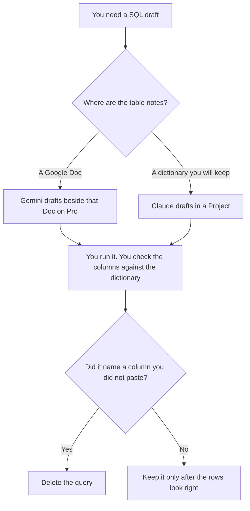

**Use Gemini when the table notes already live in a Google Doc and the draft should sit beside that text. Use Claude when the warehouse dictionary is long and should stay in a Project you will reuse next week.** The model may draft SQL from names you pasted. It may not invent a table, a column, or a filter. You run the query. You read the rows.

The other pair, when the choice is ChatGPT, is [ChatGPT vs Claude for SQL](/blog/chatgpt-vs-claude-for-sql-2026/). A spreadsheet formula, which is a different artifact, is [Gemini vs ChatGPT for spreadsheet formulas](/blog/gemini-vs-chatgpt-for-spreadsheet-formulas-2026/). The analyst's shelf is [best AI tools for data analysts](/blog/best-ai-tools-for-data-analysts-2026/). One field's definition, before anyone writes SQL, is [how to create a data dictionary entry with AI](/blog/how-to-create-a-data-dictionary-entry-with-ai-2026/).

Prices are US list prices excluding tax from directory pages checked October 16, 2026. A live fetch of vendor pricing pages on October 24, 2026 returned HTTP 401, so this page stays on the directory record. Published October 24, 2026. We did not score queries. The directory does not say Gemini executes SQL inside your warehouse.

## Where the schema already lives

| The material you have | Start here | First paid step | The limit |
|---|---|---|---|
| A Google Doc of tables and columns | [Gemini](/tools/gemini/) | Google AI Pro is $19.99 a month | The Doc is the source. The chat does not add a column |
| A long dictionary you will reuse | [Claude](/tools/claude/) | Pro is $20 a month, or $17 billed annually | You still run the SQL and read the result |
| A notebook the team already trusts | [Hex](/tools/hex/) | Professional is $36 an editor a month | The SQL in the notebook is the one that counts |
| A short query from a paste, in another product | [ChatGPT](/tools/chatgpt/) | Plus is $20 a month | That comparison is the other article |

Google AI Plus is $4.99 a month on the directory card. The card that names Gemini in Gmail and Docs is Pro, at $19.99. If the schema notes live in a Doc, Plus is the wrong quote. The invoice is [Gemini pricing explained](/blog/gemini-pricing-explained-2026/).

Claude Pro is the seat when the dictionary is too long for one paste and next week's question should see the same definitions. The review is [Claude review](/blog/claude-review-2026/).

## What the draft is allowed to contain

Tables and columns you pasted, the grain you named, and the filter you wrote. A join you did not describe is a guess. If a column's meaning is missing, the draft says Definition missing and stops. The dictionary entry is the place that meaning gets written, before the SQL.

**Gemini on Pro** is the Doc path. Ask beside the Doc the team already shares. Do not paste a production extract of customer rows into a personal chat so the model can "see the shape." Paste column names and types.

**Claude Pro** is the Project path. Pin the dictionary. Ask for one query. When the dictionary changes, you change the Project, then you ask again. You do not keep the old query because it ran once.

**Hex Professional** is the right home if analysts already publish notebooks there. Generate into the notebook. Community is free and includes an agent trial, on the directory card. A scheduled refresh is Team, at $75 an editor a month, and that is a different decision from a draft.

**ChatGPT** is the other article. Use it when you have already chosen that seat. Do not run all three and merge the SQL.

A prompt that holds the line:

"Draft one SQL query from the tables, columns, and filters I pasted. Do not add a column. If a join key is missing, write Join missing and stop. Do not invent a date range."

## What not to delegate

Do not ask the model which metric the business should use. Do not run a generated query against production as the first execution if a sample or a warehouse dev project exists. Do not treat a query that returns rows as proof the definition is right. The factual habit, when a sentence will quote the number, is [how to fact-check AI writing](/blog/how-to-fact-check-ai-writing-2026/).

## FAQ

### Which one writes correct SQL?

We did not measure that. Gemini fits a Doc you already have, on Pro. Claude fits a dictionary you will keep in a Project. Correct, on this page, means the names came from you and the rows survived your check.

### Do I need Google AI Pro?

You need Pro if the point is Gemini inside the Doc, on the directory card checked October 16, 2026. Plus at $4.99 is a usage step. The directory puts the Gmail and Docs line on Pro.

### How is this different from the spreadsheet article?

That article is a formula in a sheet. This article is SQL against tables you named. A formula that worked in a sheet is not a warehouse query. Read the one that matches the file you will run.

### Can the model see my warehouse?

Only if you have connected a tool you have reviewed, or you pasted the dictionary. This page assumes a paste or a Doc. A connection that can run SQL is a privilege decision, not a prompt decision.

## Last verified

October 16, 2026 for Gemini, Claude, Hex, and ChatGPT. Published October 24, 2026.

**Sources:** [Google AI subscriptions](https://gemini.google/subscriptions/), [Claude pricing](https://claude.com/pricing), [Hex pricing](https://hex.tech/pricing), [ChatGPT pricing](https://chatgpt.com/pricing/).

*Published by Andrew for [AI Tools Optimizer](https://aitoolsoptimizer.com).*

[Gemini](/tools/gemini/) is in the [chatbots and assistants directory](/tools/category/chatbots-assistants/). Directory pages may use affiliate links. A purchase through them may earn us a commission at no extra cost to you.
