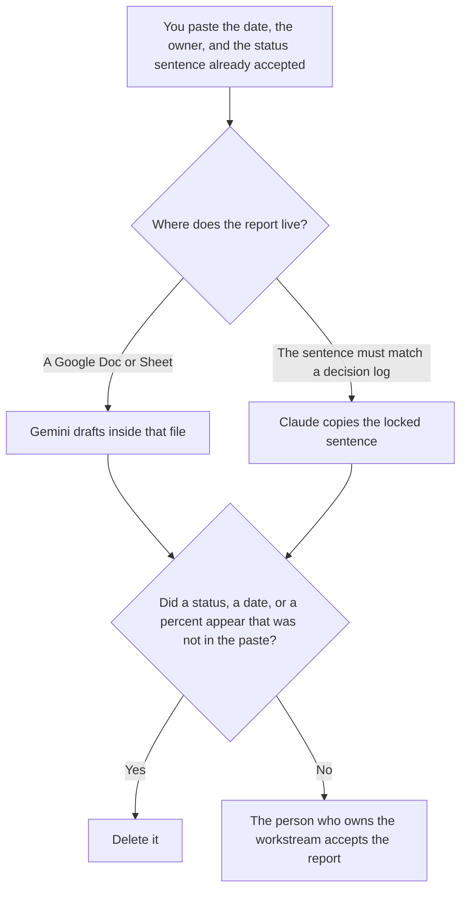

**Use Gemini when the status report is a Google Doc or a Sheet the team already keeps, and the draft must stay inside that file. Use Claude when one status sentence has to match a decision log you already accepted, and a softer verb would be a different status.** The model may format the date, the owner, and the sentence you pasted. It may not mark a workstream on track, late, or done.

A project update that is a ChatGPT-or-Gemini choice, rather than a decision-log choice, is [Gemini vs ChatGPT for project updates](/blog/gemini-vs-chatgpt-for-project-updates-2026/). The plan those dates came from is [Notion AI vs Claude for project plans](/blog/notion-ai-vs-claude-for-project-plans-2026/).

Gemini's prices are the October 16, 2026 directory card recorded in [Gemini pricing explained](/blog/gemini-pricing-explained-2026/). Claude's prices are the October 24 read of claude.com/pricing recorded in [Claude pricing explained](/blog/claude-pricing-explained-2026/). Notion is the October 16 directory card. ChatGPT's Plus price is the October 24 plan-page figure recorded in [ChatGPT pricing explained](/blog/chatgpt-pricing-explained-2026/). Published October 24, 2026. We did not score projects. Some Gemini features are limited by country on that card. These are the US figures.

## Which report you are filing

| The report | Start here | First paid step | The limit |
|---|---|---|---|
| A Doc or Sheet the team already updates | [Gemini](/tools/gemini/) | Google AI Pro is $19.99 a month, with Gemini in Docs on that card | Free is a Google account. It does not add a status you did not write |
| A sentence that must match the decision log | [Claude](/tools/claude/) | Pro is $17 a month billed annually, or $20 monthly | A paraphrase is a new status |
| The page that holds the log | [Notion AI](/tools/notion-ai/) | Business is $20 a seat a month | Plus at $10 is not the full AI tier |
| A one-off paragraph you will paste back | [ChatGPT](/tools/chatgpt/) | Plus is $20 a month | Use it when the file is not in Google and the sentence is not locked |

Google AI Pro at $19.99 is the card that lists Gemini in Gmail and Docs, plus 5 TB of storage, on the October 16 record. Plus at $4.99 is the 2x-usage row. Ultra at $99.99 or $199.99 is a larger usage multiple. You do not need Ultra to format a status sentence. You need the file, and the sentence a person already accepted. If the Doc is empty of facts, Gemini will still write. That paragraph is not a status.

Claude is the seat when last week's sentence said "blocked on the vendor" and this week's report is not allowed to say "moving ahead" unless you pasted that change. Put the locked sentence in a Project. If the new fact is missing, the line says Status not set.

The project-update comparison is about which assistant drafts the note. This page adds a constraint those posts do not: the decision log wins over a smoother verb.

## What the report is allowed to change

The order, the headings, and the names you pasted. The status word stays. A percent complete you did not write stays out. A risk the model inferred stays out. If the owner is missing, the line says Owner not set.

**Gemini on AI Pro** is the Doc. The invoice is [Gemini pricing explained](/blog/gemini-pricing-explained-2026/). The review is [Gemini review](/blog/gemini-review-2026/).

**Claude Pro** is the locked sentence. The review is [Claude review](/blog/claude-review-2026/).

**Notion Business** holds the decision log the sentence came from. The invoice is [Notion AI pricing explained](/blog/notion-ai-pricing-explained-2026/).

A prompt that holds the line:

"Draft the status report from the date, the owner, and the status sentence I pasted. If a status is missing, write Status not set. Do not mark anything on track. Do not change a locked verb."

## What not to delegate

Do not ask whether the project "sounds healthy." Do not let a Doc's comments become facts you did not paste. Do not send the report because the table is full. The workstream owner accepts it.

## FAQ

### How is this different from a project update comparison?

That page chooses between Gemini and ChatGPT for the update itself. This page chooses between a report that lives in a Google file and a sentence that must not drift from a decision log. You can use both pages. You still paste the status.

### How is this different from a project plan?

The plan is milestones and dates a person set. The status report says what those milestones are this week, in words you already accepted. A date can slip in the report only if you pasted the slip. The plan comparison is [Notion AI vs Claude for project plans](/blog/notion-ai-vs-claude-for-project-plans-2026/).

### Do I need Ultra to write a status report?

No. The October 16 card prices Ultra at $99.99 or $199.99 for higher usage multiples. A weekly status from facts you already have fits on Pro at $19.99 if you want Gemini in Docs, or on Claude Pro if the sentence must stay locked. Checkout in another country can differ. This page quotes the US figures.

### Who may send the report?

The person who owns the workstream. Status not set stays out of the email. A formatted Doc is not a status.

## Last verified

October 16, 2026 for Gemini and Notion, via the posts cited above. October 24, 2026 for Claude and for ChatGPT's plan page. Published October 24, 2026.

**Sources:** [Google Gemini subscriptions](https://gemini.google/subscriptions/), [Claude pricing](https://claude.com/pricing), [Notion pricing](https://www.notion.com/pricing), [ChatGPT and Codex pricing](https://learn.chatgpt.com/docs/pricing).

*Published by Andrew for [AI Tools Optimizer](https://aitoolsoptimizer.com).*

[Gemini](/tools/gemini/) is in the [chatbots and assistants directory](/tools/category/chatbots-assistants/). Directory pages may use affiliate links. A purchase through them may earn us a commission at no extra cost to you.
