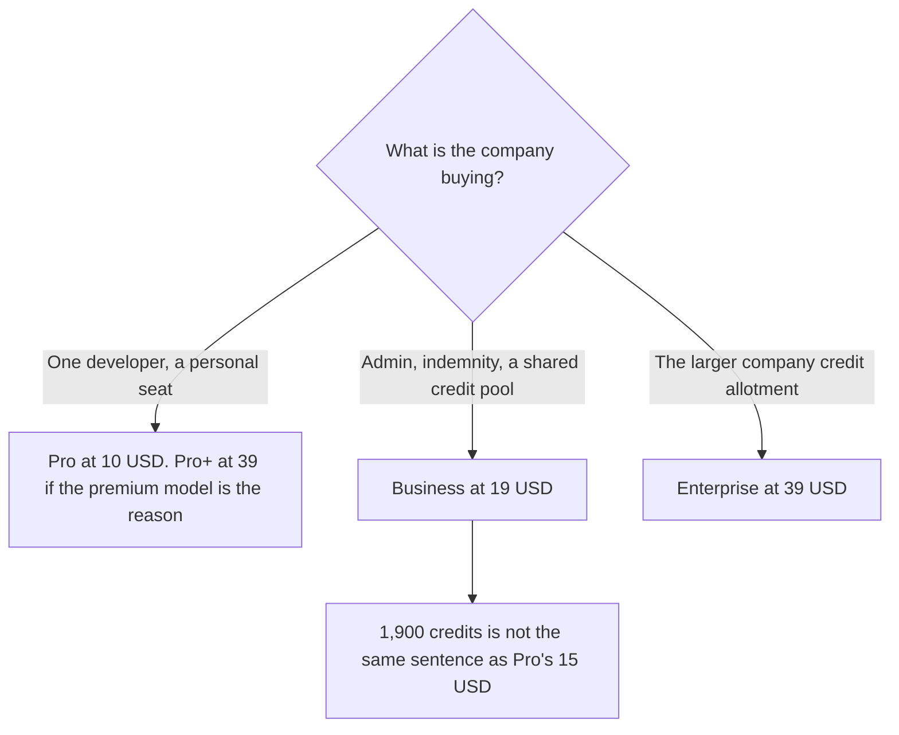

**GitHub Copilot Business is $19 a user a month on the directory card checked October 16, 2026. That card lists governance, IP indemnity, and 1,900 credits per user, and it describes the credits as pooled.** Business is the company seat. It is not a larger personal Pro. The full ladder, from Free through Max, is [GitHub Copilot pricing explained](/blog/github-copilot-pricing-explained-2026/).

Published October 24, 2026. We did not score pull requests. A refetch of the public plan page on October 24 did not return a new price table in that earlier article, so the dollars here stay on the October 16 card. If checkout shows a different number, checkout wins.

## Business next to the seats people confuse with it

| Plan | Price on the October 16 card | The reason to buy it |
|---|---|---|
| Pro | $10 a user a month | A person wants the cloud agent, code review, and $15 of monthly credits |
| Pro+ | $39 a user a month | Premium models and $70 of credits. A personal upgrade |
| Business | $19 a user a month | Admin, budget controls, IP indemnity, 1,900 credits per user |
| Enterprise | $39 a user a month | The company tier. The card says 1,900 credits plus 2,000 more per user |

The October 16 card says Pro includes $15 in monthly credits and Business includes 1,900 credits per user. Those units are printed differently. Do not divide $15 by 1,900 and call the result a rate. The earlier pricing article makes the same warning. This article repeats it because a Business forecast goes wrong in that cell.

The directory page says inline suggestions and predicted next edits are unlimited on Business plans. That sentence is about completions. It is not a sentence about the 1,900 credits. Quote it on its own, and do not invent a new completion integer to sit beside it.

## What the $19 is for

**Indemnity and admin.** The card lists access controls, budget controls, and IP indemnity on Business. Buy this row when counsel or IT asked for those controls. A developer who wanted a smarter autocomplete wanted Pro or Pro+, which is the personal ladder in the other article.

**A personal Pro seat on a company repo.** Pro is $10. It is a real product. It is not "basically Business" because the developer already uses GitHub. The indemnity line is on the Business card, not on the Pro card we used.

**Claude Code as a separate seat.** [Claude Code](/tools/claude-code/) is included with paid Claude plans. Pro is $17 a month billed annually, $200 up front, or $20 monthly, on claude.com/pricing fetched October 24, 2026. Copilot's paid plans can reach third-party agents, including Claude Code, on the October 16 card. That access draws on Copilot's credit story. It does not duplicate a Claude invoice you already pay. The Claude seat article is [Claude Code pricing explained](/blog/claude-code-pricing-explained-2026/).

**Cursor**, if the company is pricing an editor at the same time, is Plus at $8 a month or $80 a year on the October 16 card. The ladder is [Cursor pricing explained](/blog/cursor-pricing-explained-2026/). A Copilot Business rollout and a Cursor rollout are two decisions. The migration pairing is [Cursor vs Claude Code for migrations](/blog/cursor-vs-claude-code-for-migrations-2026/).

## What not to assume

Do not buy Business to escape the Free completion cap. Pro is the personal step off Free. Do not buy Max at $100 for every user because Business "feels small." Max is a personal credit pool on that card. Do not convert 1,900 credits into dollars with a ratio this card does not print. Do not assume an annual discount. The prices above are the monthly lists on the October 16 card.

## FAQ

### How much is GitHub Copilot Business?

$19 per user per month, on the directory card checked October 16, 2026. The card includes IP indemnity, admin and budget controls, and 1,900 credits per user. Enterprise on that card is $39.

### How is Business different from Pro?

Pro is $10 and lists a cloud agent, code review, model selection, third-party agents, and $15 in credits. Business is $19 and the new things are governance and indemnity, with a credit count printed as credits. A solo developer who wants a better model is reading Pro or Pro+, not this page.

### Are the 1,900 credits the same as Pro's $15?

The card does not give a conversion. Keep the units apart. Pro's allowance is in dollars. Business's allowance is in credits. A forecast that multiplies them together is not using this card.

### Does Business include Claude Code for free?

The card says paid Copilot plans include third-party agents such as Claude Code and Codex. That is access inside Copilot's meter. A direct Claude Code seat is a Claude plan, priced on claude.com. Using both is two relationships, even when one product can launch the other.

## Last verified

October 16, 2026, from the GitHub Copilot directory card. Claude comparison prices are from claude.com/pricing on October 24, 2026. Published October 24, 2026. The October 24 plan-page refetch recorded in the Copilot ladder article did not replace these figures.

**Sources:** [GitHub Copilot plans](https://github.com/features/copilot/plans), [GitHub Copilot](https://github.com/features/copilot), [Claude pricing](https://claude.com/pricing), [Cursor pricing](https://cursor.com/help/account-and-billing/pricing).

*Published by Andrew for [AI Tools Optimizer](https://aitoolsoptimizer.com).*

[GitHub Copilot](/tools/github-copilot/) is in the [coding directory](/tools/category/coding/). Directory pages may use affiliate links. A purchase through them may earn us a commission at no extra cost to you.
