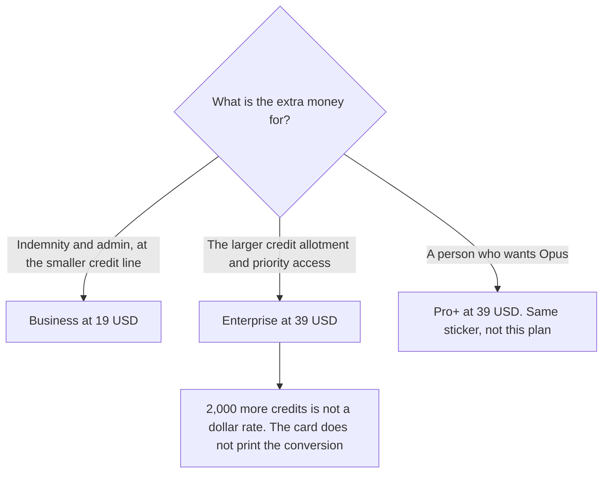

**GitHub Copilot Enterprise is $39 a user a month on the directory card checked October 16, 2026. That card describes the included usage as 1,900 credits plus 2,000 more per user, and it lists priority access to new features.** Business is $19 a user a month with 1,900 credits per user. Enterprise is not a larger personal Pro+. The company seat people confuse with this row is [GitHub Copilot Business pricing explained](/blog/github-copilot-business-pricing-explained-2026/). The full ladder is [GitHub Copilot pricing explained](/blog/github-copilot-pricing-explained-2026/).

Published October 24, 2026. We did not score pull requests. A live fetch of the public plan page returned HTTP 401 on October 24, 2026, so the dollars stay on the October 16 card. If checkout shows a different number, checkout wins.

## Enterprise next to the seats around it

| Plan | Price on the October 16 card | Usage that card prints | Why it is a different row |
|---|---|---|---|
| Pro | $10 a user a month | $15 of monthly credits | A person. Cloud agent and code review |
| Pro+ | $39 a user a month | $70 of monthly credits | The same dollar as Enterprise, a different product. Premium models, including Opus, on a personal seat |
| Business | $19 a user a month | 1,900 credits per user, described as pooled | Admin, budget controls, IP indemnity |
| Enterprise | $39 a user a month | 1,900 plus 2,000 credits per user | Priority access to new features, on that row |

Pro+ and Enterprise are both $39 on this card. They are not substitutes. Pro+ is a personal premium-model seat with $70 of credits. Enterprise is the company tier with a credit count written as 1,900 plus 2,000, and priority access to new features. A forecast that "standardizes on $39" without naming the row will buy the wrong product for half the seats.

Ten Business seats are 10 × $19 = $190 a month. Ten Enterprise seats are 10 × $39 = $390 a month. The difference is $200 a month on this card, before you know what the extra credits buy in model calls. The card does not print a dollars-per-credit rate. Do not divide $39 by 3,900 and call it one. Business prints 1,900 as credits. Pro prints $15 as dollars. Those units stay in different columns, as the Business article already warns.

The card says inline suggestions and predicted next edits are unlimited on Business plans. Read that sentence on the Business row. This article does not copy it onto Enterprise as a new integer. If the product includes it, the plan page you are buying from should say so. The October 16 Enterprise highlights are the credit line and priority access to new features.

## What the $39 is for

**The extra credits and the priority line.** [GitHub Copilot](/tools/github-copilot/) Enterprise is the row when you can point at the 1,900-credit line as the constraint, and you want the priority-access sentence on the same card. It is not the row for a developer who wanted a smarter autocomplete on a personal repo. That developer is on Pro at $10 or Pro+ at $39.

**Business, if the ask was indemnity.** The October 16 card lists IP indemnity, access controls, and budget controls on Business. It does not reprint that sentence on the Enterprise row. Do not assume a control written only on Business is missing from Enterprise, and do not assume it is included. Read checkout. The $19 article is the place those controls are quoted.

**Claude Code as a separate seat.** [Claude Code](/tools/claude-code/) is included with paid Claude plans. Pro is $17 a month billed annually, $200 up front, or $20 monthly, on claude.com/pricing fetched October 24, 2026. Copilot's paid plans can reach third-party agents, including Claude Code, on the October 16 card. That access draws on Copilot's credit story. It does not duplicate a Claude invoice. The article is [Claude Code pricing explained](/blog/claude-code-pricing-explained-2026/).

**Cursor**, if the company is pricing an editor at the same time. Plus is $8 a month or $80 a year on the October 16 card. The ladder is [Cursor pricing explained](/blog/cursor-pricing-explained-2026/).

## What not to assume

Do not buy Enterprise to escape the Free completion cap of 2,000 a month. Pro is the personal step off Free. Do not describe Enterprise as Pro+ with admin because the stickers match. Do not convert 3,900 credits into dollars with a ratio this card does not print. Do not assume an annual discount. The prices above are the monthly lists on the October 16 card.

## FAQ

### How much is GitHub Copilot Enterprise?

$39 per user per month on the October 16 card, with 1,900 credits plus 2,000 more per user, and priority access to new features. A live fetch of the plan page returned HTTP 401 on October 24, 2026. If checkout disagrees, checkout wins.

### How is Enterprise different from Business?

Business is $19 and 1,900 credits per user, with governance, budget controls, and IP indemnity on that card. Enterprise is $39 and adds 2,000 credits per user on top of 1,900, with priority access to new features. The indemnity sentence is printed on the Business row we used. Confirm on the order whether Enterprise includes it. This page will not assert either way beyond that card.

### How is Enterprise different from Pro+?

Both are $39. Pro+ includes $70 of monthly credits and premium models such as Opus, for a person. Enterprise is the organization credit line above. A personal Pro+ seat on a company repo is not "basically Enterprise."

### Does Enterprise include unlimited completions?

The card says unlimited inline suggestions and next edits on Business plans. It does not restate a completion integer on the Enterprise row. Quote the sentence you can point at. Do not invent a new cap, and do not invent "unlimited" for a row that did not say it.

## Last verified

October 16, 2026, from the directory card. Claude's comparison price is October 24, 2026. Cursor's comparison price is the October 16 card. Published October 24, 2026. The Copilot plan page returned HTTP 401 that day.

**Sources:** [GitHub Copilot plans](https://github.com/features/copilot/plans), [GitHub Copilot documentation](https://docs.github.com/en/copilot), [Claude pricing](https://claude.com/pricing).

*Published by Andrew for [AI Tools Optimizer](https://aitoolsoptimizer.com).*

[GitHub Copilot](/tools/github-copilot/) is in the [coding directory](/tools/category/coding/). Directory pages may use affiliate links. A purchase through them may earn us a commission at no extra cost to you.
