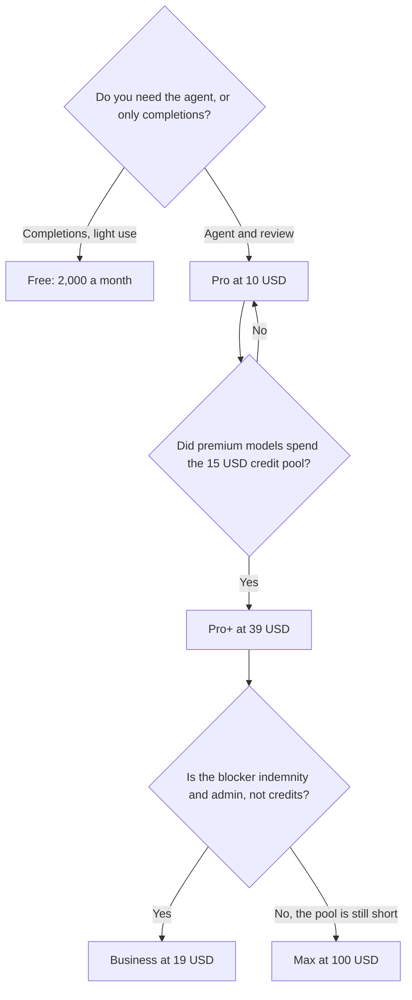

**GitHub Copilot pricing is a completion cap, then a $10 agent plan, then a credit pool for premium models.** Free is not a trial of Pro. Pro is not "unlimited [Claude](/tools/claude/)." Business is not a larger Pro. Each step adds a different control, and buying the next logo because the current week felt slow is how a $10 seat becomes a $100 seat.

Prices are US list prices excluding tax, from GitHub's plan pages as checked October 16, 2026. This explainer is published October 24, 2026. A live refetch of the pricing URL that day did not return numbers, so the table keeps the October 16 figures. The product review, which is not this bill, is [GitHub Copilot review](/blog/github-copilot-review-2026/). The editor comparison is [Cursor vs GitHub Copilot](/blog/cursor-vs-github-copilot-2026/).

## The ladder

| Plan | Monthly list | What is new versus the cheaper plan |
|---|---|---|
| Free | $0 | 2,000 completions a month. Access to models such as Haiku 4.5 and GPT-5 mini. No card |
| Pro | $10/user | Cloud agent, code review, model selection, third-party agents including [Claude Code](/tools/claude-code/) and [Codex](/tools/openai-codex/), and $15 of monthly credits |
| Pro+ | $39/user | Premium models, including Opus, audit logs, and $70 of monthly credits |
| Max | $100/user | Priority access to new models and $200 of monthly credits |
| Business | $19/user | Admin controls, budget controls, IP indemnity, and 1,900 credits per user. Completions are not the Free cap |
| Enterprise | $39/user | The company tier. GitHub's plan summary describes it as 2,000 more credits per user than the Business comparison |
| Student | A verified-student plan exists | We do not have a separate public price in the pages we checked. Use the student offer in your GitHub account |

Business can be the right plan at a lower price than Pro+ because the thing you are buying is indemnity and administration, not Opus. Do not "upgrade" from Pro to Business for a smarter autocomplete. Read the row.

## How to read the credits

Pro includes $15 of credits. Pro+ includes $70. Max includes $200. Business includes 1,900 credits per user, which GitHub counts as credits rather than as a dollar voucher in the summary we used. Those units are not the same sentence. Do not divide $15 by 1,900 and call it a rate. The docs have to say the conversion, and the page we used did not give us one clean ratio to reprint.

What you can do instead:

1. Use Pro for a normal week with the models you already accept.
2. Open the usage view and see whether the $15 moved.
3. If it did not, stay on Pro. The cloud agent and code review are already on that plan.
4. If a premium model is what you are selecting every hour, Pro+ is the plan that lists those models and a larger credit amount.
5. Max is the plan for a person who can point at a month where $70 was not enough. It is not a team default.

Third-party agents are included on the paid plans. They draw on the same idea of a meter. Turning on Claude Code or Codex inside Copilot does not mint a second, unlimited subscription to those products. If you live in the terminal, compare a direct [Claude Code](/tools/claude-code/) plan, which rides on Claude Pro at $20/month or $17 annual, with the credit line above. The primer is [Claude Code for beginners](/blog/claude-code-for-beginners-2026/).

## Four buyers

**A developer in VS Code who accepts completions and rarely chats.** Free, until 2,000 completions is the wall. Then Pro. Not Pro+.

**A developer who wants a pull request from an issue.** Pro at $10. That is the plan that lists the cloud agent and code review. Measure credits before you add $29 to reach Pro+.

**A developer whose team standard is a premium model.** Pro+ at $39, after a week of evidence, not on the day you read a model announcement. Max at $100 when the $70 credit line is the constraint you can show.

**A company that asked for IP indemnity.** Business at $19 per user. Enterprise at $39 when you need the extra credit allotment and the enterprise controls in the same contract. Pair this with the admin guide your counsel already has. A personal Pro seat on a company repo is a different risk decision, and it is not "basically Business."

Students should use the student plan if the account is eligible, and Free if it is not. We will not invent a $0 or $10 student price the pages did not print.

## The mistakes that change the bill

- **Paying for Pro+ to escape the Free completion cap.** Pro removes that cap's reason for existing. Pro+ is the premium-model tier.
- **Buying Max for the whole team.** Max is a personal credit pool at $100. Business at $19 is the seat with admin and indemnity. They solve different problems, and Max is not the volume discount.
- **Ignoring Cursor's bundle.** [Cursor](/tools/cursor/) Plus is $8 on The X Subscription and includes [Grok](/tools/grok/). If you are about to pay for Copilot Pro and a separate chat seat and an editor migration, price the bundle once. The daily-coding choice is the comparison linked above.
- **Assuming annual discounts we did not see.** The individual prices above are the monthly lists GitHub published in the summary we used. If a yearly toggle appears in your account, read that number in the account. Do not apply another vendor's "save 20%" habit to this table.
- **Counting a third-party agent as free Claude.** Credits are the meter. Watch them.

## FAQ

### How much is GitHub Copilot Pro?

$10 per user per month. It includes the cloud agent, code review, model selection, third-party agents, and $15 in monthly credits.

### Is GitHub Copilot free?

Yes. Free includes 2,000 completions a month and a smaller set of models. It is a real plan with a real cap. Verified students may have a separate student plan. Check the account for that offer.

### What is the difference between Pro+ and Max?

Pro+ is $39 and includes premium models such as Opus, audit logs, and $70 in credits. Max is $100 and includes $200 in credits plus priority access to new models. Move to Max when the credit pool, not the model list, is what ran out.

### Is Business worth it for a solo developer?

Usually no. Business is $19 and the new things are governance, budget controls, and IP indemnity, with 1,900 credits. A solo developer who wanted a better model wanted Pro or Pro+, not an admin console.

## Last verified

October 16, 2026. Published October 24, 2026. The plan page did not return a fresh fetch that day. Credit units on Business are printed as credits. Dollar credits on Pro, Pro+, and Max are printed as dollars. Do not merge those units in a spreadsheet without GitHub's current rate card.

**Sources:** [GitHub Copilot plans](https://github.com/features/copilot/plans), [GitHub Copilot documentation](https://docs.github.com/en/copilot).

[GitHub Copilot](/tools/github-copilot/) is in the [coding directory](/tools/category/coding/). Directory pages may use affiliate links. A purchase through them may earn us a commission at no extra cost to you.
