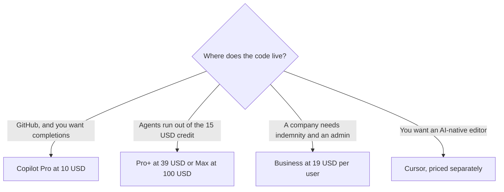

**[GitHub Copilot](/tools/github-copilot/) is GitHub's coding assistant: completions in the editor, chat, and agents that can work from an issue to a pull request.** Pro is $10 a month. The number that surprises people is not $10. It is the credit meter on chat and agents. Completions on a paid plan do not spend those credits.

Individual prices, the credit rule, and the Business and Enterprise headings were read from GitHub's plans page on October 24, 2026. One GitHub AI Credit is $0.01. We did not benchmark Copilot against Cursor. The map of the rest of the shelf is [best AI coding assistants](/blog/best-ai-coding-assistants-2026/).

## The seats

| Plan | Price on the plans page | Allowance the page states |
|---|---|---|
| Free | $0 | 2,000 completions a month, and limited chat and agent use |
| Pro | $10/month | $15 of GitHub AI Credits a month. Cloud agent, code review, model choice |
| Pro+ | $39/month | $70 of credits. Premium models, including Opus on the plan materials |
| Max | $100/month | $200 of credits |
| Business | $19 per user / month | 1,900 credits per user. Org controls and IP indemnity are on this tier |
| Enterprise | $39 per user / month | Org plan. Read the credit line on the page before you quote a pool |

The seat card is [GitHub Copilot pricing explained](/blog/github-copilot-pricing-explained-2026/).

GitHub's FAQ says you spend credits when you chat and when you work with agents, including agent mode, code review, Copilot in the cloud, the CLI, and the Copilot app. Code completions and next-edit suggestions do not use credits, and they stay unlimited on every paid plan. A lightweight question costs a fraction of a credit. A long agent session on a frontier model costs more. There is no "one credit equals one chat" rate.

The plans page also shows a flex allotment that can change, listed separately from the base credits. Do not add the flex line to the base line and call it a guarantee. If you hit the allowance, GitHub says you can set a budget for more usage, at $0.01 a credit, or switch to a cheaper model. On Business and Enterprise, admins decide whether extra paid usage is allowed.

## What to use it for

Copilot fits a developer who already works in GitHub and in VS Code, Visual Studio, a JetBrains IDE, Xcode, Neovim, or the other editors GitHub lists. The cloud agent is the feature that makes Pro more than autocomplete: assign work, review the pull request, merge it yourself. An agent that opens a pull request has not replaced the reviewer.

Paid plans also advertise access to third-party agents, including Claude Code and Codex. That can double-pay if you already subscribe to Claude or ChatGPT for the same agent. Check whether the agent you want is inside the Copilot seat before you stack bills. The terminal-first version of Claude's agent is [Claude Code for beginners](/blog/claude-code-for-beginners-2026/). The three-way editor choice is [Cursor vs Claude Code vs Codex](/blog/cursor-vs-claude-code-vs-codex-2026/).

Students: GitHub's materials describe a Copilot Student plan for verified students. We did not record that plan's limits on October 24. Confirm them before you tell a class it is "Pro for free."

## Who should pay

**Stay on Free** while 2,000 completions a month cover the work. **Pay for Pro** when you want unlimited completions, a cloud agent, and $15 of agent credits, and the repo is on GitHub. **Pay for Pro+ or Max** when the credit page, not the marketing name, says the smaller pool stopped a task. **Pay for Business** when the company needs the admin controls and the IP indemnity, at $19 per user. **Do not buy Copilot** to avoid owning the code. Prompt-to-app tools are a different job, compared in [Lovable vs Bolt vs Replit](/blog/lovable-vs-bolt-vs-replit/).

## FAQ

### Is GitHub Copilot free?

Yes. Free includes 2,000 completions a month and limited chat and agent use. GitHub says no credit card is required to start.

### Do completions spend credits?

Not on a paid plan. GitHub says completions and next-edit suggestions stay unlimited and do not use GitHub AI Credits. Chat and agents do.

### How much is Copilot Business?

$19 per user per month on the plans page we read, with 1,900 credits per user listed on that tier. Enterprise is $39 per user per month. Confirm the credit pool on the Enterprise card before you send a quote.

## Last verified

October 24, 2026, from GitHub's Copilot plans page. Model names on that page change. The $10 Pro price and the $0.01 credit are the stable facts to recheck first.

**Sources:** [GitHub Copilot plans](https://github.com/features/copilot/plans), [GitHub Copilot documentation](https://docs.github.com/en/copilot).

[GitHub Copilot](/tools/github-copilot/) is in the [coding directory](/tools/category/coding/). Directory pages may use affiliate links. A purchase through them may earn us a commission at no extra cost to you.
