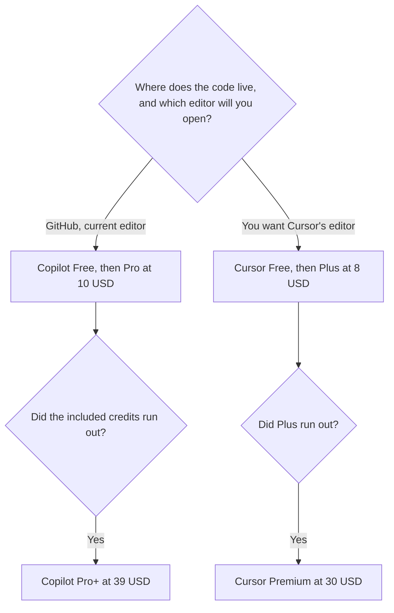

**New individuals choose Copilot Pro at $10 a month when the code is already in GitHub and the editor can stay, or [Cursor](/tools/cursor/) Plus at $8 a month ($80 a year) when they want Cursor's editor on The X Subscription.** The stickers are close. The products are not interchangeable, and many people will only need one. The feature comparison is [Cursor vs GitHub Copilot](/blog/cursor-vs-github-copilot-2026/). The separate invoices are [GitHub Copilot pricing explained](/blog/github-copilot-pricing-explained-2026/) and [Cursor pricing explained](/blog/cursor-pricing-explained-2026/).

Prices are US list prices excluding tax from directory pages checked October 16, 2026. Copilot's card lists monthly prices and does not print an annual discount. Cursor's new plans list both. Published October 24, 2026. We did not score completions.

## The ladders

| Need | GitHub Copilot | Cursor, new customers |
|---|---|---|
| Try it | Free: 2,000 completions a month | Free: Agent, Chat, and Tab, limited |
| First paid seat | Pro, $10, with $15 in monthly credits | Plus, $8 a month or $80 a year |
| Heavier individual use | Pro+, $39, with $70 in credits | Premium, $30 a month or $300 a year, listed as 4 times Plus |
| The top individual tier | Max, $100, with $200 in credits | Super is $100 or $1,000 a year, 15 times Plus. Ultra is $200 or $2,000 a year, 50 times Plus |
| A company seat | Business, $19, with 1,900 credits, governance, and IP indemnity. Enterprise is $39 | Teams seats at $30, $100, or $200 a month, matching Premium, Super, or Ultra usage |

A year of Copilot Pro at the printed monthly price is 12 × $10 = $120. A year of Cursor Plus on the annual card is $80. The $40 gap is real and small next to an engineer's time. It is not a reason to switch editors if the $10 seat is the one people already use. Cursor Premium annual is $300. Copilot Pro+ at $39 × 12 = $468. Those are both "heavier than the first seat" tiers. They are not matched feature for feature. Cursor's usage is described as a multiple of Plus. Copilot's is described as a credit pool. Do not convert one into the other.

## What the first seat includes

**Copilot Pro** adds the cloud agent, code review, third-party agents including [Claude Code](/tools/claude-code/) and [Codex](/tools/openai-codex/), model selection, and $15 in monthly credits. Free stays on a completion cap and a smaller model list, including Haiku 4.5 and GPT-5 mini on the directory card. Students can get a student plan. The review is [GitHub Copilot review](/blog/github-copilot-review-2026/).

**Cursor Plus** is the entry on The X Subscription, which also covers Grok and X. Premium is the plan the directory calls comparable to the legacy Pro at $20. Existing customers can keep legacy plans: Hobby, Pro at $20, Pro+ at $60, Ultra at $200, Teams Standard at $40, and Teams Premium at $120. Switching from a legacy plan to The X Subscription is optional and permanent once you switch. The review is [Cursor review](/blog/cursor-review-2026/).

If you are an existing Cursor Pro subscriber at $20, your comparison is not "Plus at $8." Read the help center before you move. The $8 price is the new-customer entry, not a silent discount on a legacy invoice.

## When one seat is enough

Use Copilot alone when the team lives in GitHub and VS Code, Visual Studio, or Xcode, and governance or IP indemnity is on the requirements list. Business at $19 is the seat that names indemnity. A personal Pro seat does not become a company control plane because you expensed it.

Use Cursor alone when you want the agent inside that editor and you are willing to be on The X Subscription. Plus at $8 is enough until the limit stops the day. Premium at $30 is the next question, not Ultra.

Pay for both only when you can name the hour each one covers. A person who accepts completions in VS Code and also runs Cursor on the same repo is paying $10 + $8 = $18 a month at the first paid tiers, or $120 + $80 = $200 a year. That is reasonable if both get used. It is a habit tax if one window stays closed.

A terminal agent on a Claude seat is a third bill. [Claude](/tools/claude/) Pro is $20 a month, or $17 billed annually, and includes Claude Code. There is no Claude Code on Free. The map is [Cursor vs Claude Code vs Codex](/blog/cursor-vs-claude-code-vs-codex-2026/). A refactor-sized choice is [Claude vs Cursor for refactors](/blog/claude-vs-cursor-for-refactors-2026/). The shelf is [best AI coding assistants](/blog/best-ai-coding-assistants-2026/).

## FAQ

### Is Cursor Plus cheaper than Copilot Pro?

On the stickers, yes: $8 versus $10, and $80 a year versus $120 if you pay Copilot's monthly price for twelve months. Copilot does not list an annual discount on the card this site recorded. Cheaper does not mean the same completion in the same editor.

### Does Copilot Business include Cursor?

No. They are different products. Copilot Business is $19 a user on GitHub's plan. Cursor Teams is $30, $100, or $200 a seat on the new card, depending on the usage tier.

### What if we still have Cursor legacy Teams at $40?

Keep it if it still fits, and read the note that a move to The X Subscription is permanent. Do not put $8 on a budget slide for a team that is on a legacy contract. The $8 figure is Plus for a new individual plan.

### Which one should a new hire get?

The editor the team already standardized. A new hire with Copilot Free can learn whether 2,000 completions are enough. A new hire with Cursor Free can learn the agent. Buy the first paid seat when the free cap, not a blog, says so.

## Last verified

October 16, 2026 for GitHub Copilot, Cursor, and Claude prices named above. Published October 24, 2026.

**Sources:** [GitHub Copilot](https://github.com/features/copilot), [Cursor pricing](https://cursor.com/help/account-and-billing/pricing), [Claude pricing](https://claude.com/pricing).

*Published by Andrew for [AI Tools Optimizer](https://aitoolsoptimizer.com).*

[GitHub Copilot](/tools/github-copilot/) is in the [coding directory](/tools/category/coding/). Directory pages may use affiliate links. A purchase through them may earn us a commission at no extra cost to you.
