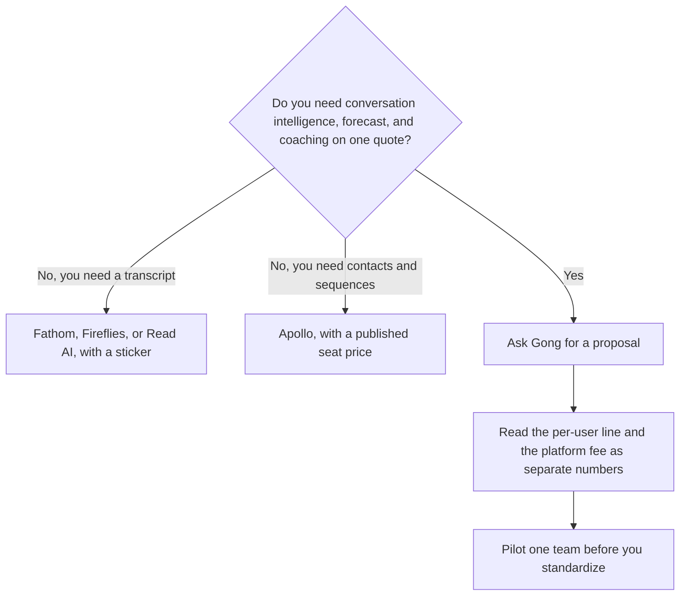

**Gong does not publish a price.** The directory records a custom quote: licenses priced per user, plus a platform fee based on the number of users supported, and a note that integrating your existing tech stack is free. There is no free plan. There is no dollar on the card. This page will not invent one, and it will not repeat an unsourced street price from a blog. If you need a number, you ask Gong for a proposal for your team size, and that proposal is the price.

What the product is for, in the directory's words, is a revenue platform that records and analyzes calls, email, and meetings, then helps teams forecast, coach, and follow up. The modules named on the card are Gong Engage, Gong Forecast, Gong Enable, a Revenue Graph, and AI agents. Those names are features. They are not a rate card.

A public-priced notetaker, if you only needed the transcript, is [Fathom pricing explained](/blog/fathom-pricing-explained-2026/). The bot comparison is [Otter vs Fireflies vs Fathom](/blog/otter-vs-fireflies-vs-fathom-2026/). The sales shelf is [best AI tools for sales teams](/blog/best-ai-tools-for-sales-teams-2026/).

Prices for the neighboring tools are US list prices excluding tax from directory pages checked October 16, 2026. Gong's own page, checked the same day, did not list a dollar. Published October 24, 2026. We did not score forecast accuracy. A vendor case study is not a measurement from this site.

## What the quote is allowed to contain

| Component | What the directory says | What this page will not add |
|---|---|---|
| Licenses | Priced per user | A dollar per seat |
| Platform fee | Based on the number of users supported | A formula that turns headcount into a fee |
| Integrations | Free for your existing tech stack, according to Gong | A claim that every future connector stays free |
| Free plan | None | A trial length we did not record |
| Who it fits | Sizable B2B sales, success, and revenue-operations teams | A startup price that is not on the card |

Ask the proposal to split the license and the platform fee, to name the minimum user count, and to say what happens if you shrink the team. A blended "per user" that hides the platform fee will not match the renewal. Get both numbers in writing. The person who signs is [what human-in-the-loop AI is](/blog/what-is-human-in-the-loop-ai-2026/).

## What you can budget without a Gong dollar

**A transcript and a summary, with a published price.** [Fathom](/tools/fathom/) Premium is $16 a month billed annually, or $20 monthly. The free plan lists unlimited recordings and transcriptions. Team is $15 a user a month annually with a two-user minimum. Business is $25 a user a month annually. That is a notetaker. It is not Gong Forecast. The invoice is [Fathom pricing explained](/blog/fathom-pricing-explained-2026/).

**Search across recorded calls.** [Fireflies](/tools/fireflies-ai/) Pro is $10 a user a month billed annually, or $18 monthly. The invoice is [Fireflies pricing explained](/blog/fireflies-pricing-explained-2026/).

**A lighter meeting seat.** [Read AI](/tools/read-ai/) Pro is $15 a user a month billed annually. Free lists 5 meeting transcripts a month. The review is [Read AI review](/blog/read-ai-review-2026/).

**Contacts and outbound, which is a different job.** [Apollo](/tools/apollo-io/) Basic is $49 a seat a month billed annually. Professional is $79. Organization is $119 with a three-seat minimum. Free includes 900 credits a seat a year. Apollo does not become Gong because both sit near a CRM. The seat price is on the [Apollo](/tools/apollo-io/) directory page, checked the same day.

If the artifact you needed was a win/loss write-up from notes you already have, you do not need a custom platform to draft it. That workflow is [how to write a competitive win-loss report with AI](/blog/how-to-write-a-competitive-win-loss-report-with-ai-2026/).

## What to ask before you sign

Confirm call-recording consent with your own counsel before a rollout. A platform that captures customer conversations needs a policy, not only a budget. Confirm whether the quote includes Engage, Forecast, and Enable or only one of them. The directory lists them as parts of the platform. Your quote might not include every name.

Do not convert a Gong quote in another currency into USD on this page. Do not average a colleague's old invoice into a "typical" price. Their seat count and their year are not yours.

The record of the proposal belongs in a file with a date. That habit is [what a system of record for AI is](/blog/what-is-a-system-of-record-for-ai-2026/).

## FAQ

### How much does Gong cost?

The public card does not say. Licenses are per user. A platform fee depends on the number of users supported. Integrations of your existing stack are described as free. Request a proposal. Any specific dollar you see elsewhere needs a date and a source. This directory does not have one as of October 16, 2026.

### Is there a free plan or a self-serve checkout?

No free plan is recorded. The path on the card is a custom proposal. A notetaker with a free tier is a different product. Fathom's free plan is the one in this directory with unlimited recordings listed.

### Is Gong only for sales calls?

The directory describes sales, customer success, enablement, and revenue operations, and it names coaching, forecasting, deal risk, and handoffs. If you only wanted interview notes, this is the wrong quote. The interview comparison is [Otter vs Granola for interviews](/blog/otter-vs-granola-for-interviews-2026/).

### Can I estimate the platform fee as a percent of seats?

No. The card says the fee is based on users supported. It does not give a percent. Leave the cell as Quote required. A generated range is worse than a blank.

## Last verified

October 16, 2026. Gong's pricing page, as recorded in the directory, lists a custom model and no dollar. Fathom, Fireflies, Read AI, and Apollo use the same October 16 directory check for the public prices named above. Published October 24, 2026.

**Sources:** [Gong pricing](https://www.gong.io/pricing), [Fathom pricing](https://www.fathom.ai/pricing), [Apollo pricing](https://www.apollo.io/pricing).

*Published by Andrew for [AI Tools Optimizer](https://aitoolsoptimizer.com).*

[Gong](/tools/gong/) is in the [sales directory](/tools/category/sales/). Directory pages may use affiliate links. A purchase through them may earn us a commission at no extra cost to you.
