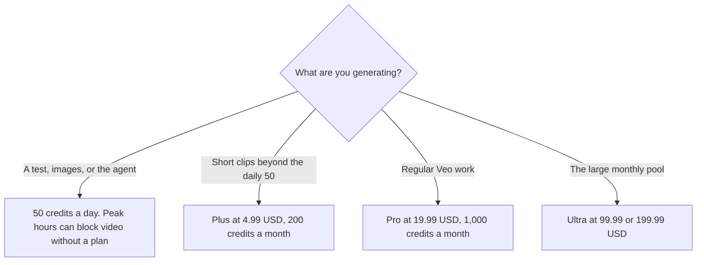

**Google Flow gives every account 50 credits a day. Unused daily credits do not roll over. Google AI Plus adds 200 credits a month, Pro adds 1,000, and the Ultra tiers add 10,000 or 25,000.** Those allotments are from Google's Flow help page on October 24, 2026. The plan prices that unlock them are from gemini.google/subscriptions the same day: Plus is $4.99 a month, Pro is $19.99, and Ultra is $99.99 or $199.99. The help page labels the Ultra credit buckets "Ultra $100" and "Ultra $200," which match those two stickers rounded to the dollar.

The product page is [Google Flow](/tools/google-flow/). The assistant bundle is [Gemini pricing explained](/blog/gemini-pricing-explained-2026/). An avatar video is a different product: [Synthesia pricing explained](/blog/synthesia-pricing-explained-2026/).

Published October 24, 2026. We did not score clip quality. Credit costs can change. The help page is the table to re-read before a shoot.

## The allotment, then the per-clip cost

| Plan on October 24 | Price | Flow credits the help page lists |
|---|---|---|
| No subscription | $0 | 50 a day. They do not roll over. Video generation may be unavailable in peak hours, about 2 PM to 5 PM UTC |
| Google AI Plus | $4.99 a month | 200 extra a month, on top of the daily 50 |
| Google AI Pro | $19.99 a month | 1,000 extra a month |
| Google AI Ultra | $99.99 a month | 10,000 extra a month. The help page calls this the $100 tier |
| Google AI Ultra | $199.99 a month | 25,000 extra a month. The help page calls this the $200 tier |

Monthly Flow credits refresh at the start of the billing cycle and do not roll over, on that help page. Subscribers in supported regions, except Japan, can buy more AI credits. The plan manager is who can buy credits or change the subscription. Family sharing of AI credits is described on the page. This article does not restate every family rule.

## What one generation cost that day

The October 24 help table, credits per generation:

| Model | Who | Credits |
|---|---|---|
| Veo 3.1 Lite, lower priority | Ultra subscribers and family plan managers | 0 |
| Veo 3.1 Lite, lower priority | Everyone else | Not available |
| Veo 3.1 Lite | Non-Ultra | 10 |
| Veo 3.1 Lite | Ultra | 5 |
| Veo 3.1 Fast | Non-Ultra | 20 |
| Veo 3.1 Fast | Ultra | 10 |
| Veo 3.1 Quality, 8-second videos | All users | 100 |
| Gemini Omni Flash, 720p | All users | 7, 10, 12, or 15 for 4, 6, 8, or 10 seconds |
| Gemini Omni Flash, 360p | All users | 4, 5, 6, or 7 for those lengths |
| Gemini Omni Flash edit | All users | 40 |
| 1080p upscaling | Plus, Pro, and Ultra | 0. Not available to non-subscribers |
| 4K upscaling | Ultra | 50. Not available to non-Ultra |

A Quality clip at 100 credits spends a tenth of Pro's monthly 1,000, before the daily 50. Ten Quality clips and the monthly bucket is gone. Lite at 10 credits for a non-Ultra subscriber is the volume path. The October 16 directory card had a shorter version of this table. Where it disagrees, this page uses the October 24 help table.

## What you are comparing it with

**Runway** Standard is $12 a month billed annually on the October 16 directory card, with a separate credit system. The invoice is [Runway pricing explained](/blog/runway-pricing-explained-2026/). Do not add Flow credits and Runway credits into one balance.

**Synthesia** Starter is $29 a month billed monthly on the October 24 Synthesia page, for a presenter-style lesson. Flow is a generative clip studio. A policy training avatar is the Synthesia or HeyGen article, not this credit table.

**Gemini** itself is the subscription. Paying for Pro to get Gmail and 5 TB, which the subscriptions page lists on Pro, also buys the 1,000 Flow credits. If you only wanted the storage, the Flow credits are still part of that bill. If you only wanted Flow, you are still buying the Google AI plan.

## What not to assume

Do not treat 50 daily credits as a balance you can save for a Friday shoot. They do not roll over. Do not quote Ultra at $100 flat if the subscriptions page says $99.99. Do not assume a free account can generate video at 3 PM UTC. The help page says peak hours can block video for non-subscribers, while images and the Flow Agent remain available. Do not invent a per-second price. The table above is the one we read.

## FAQ

### How much does Google Flow cost?

The studio is available with 50 credits a day at no Flow subscription of its own. More monthly credits come with Google AI Plus at $4.99, Pro at $19.99, or Ultra at $99.99 or $199.99, on the October 24 pages. You can also buy AI credits in supported regions if you already subscribe.

### Do credits roll over?

Daily credits do not. Monthly credits do not, on the help page. Purchased AI credits can expire. The help page points at Google One for that activity log. This article does not invent an expiry date.

### How many Quality clips are in Pro?

Pro lists 1,000 monthly credits, and Quality lists 100 credits a generation. That is 10 Quality generations from the monthly bucket, plus whatever the daily 50 still covers, if you have not spent them. Extend and extra generations can cost more. The help page says some features create more than one generation. Read the estimate in the product before you render.

### Is Flow included with Gemini Notebook?

They are different products that can share a Google AI plan. Notebook limits are [Gemini Notebook pricing explained](/blog/gemini-notebook-pricing-explained-2026/). Flow credits are this table. Do not subtract a notebook from your Flow balance.

## Last verified

October 24, 2026, from Google's Flow credit help page and gemini.google/subscriptions. Runway's figure is from the directory page checked October 16, 2026. Published October 24, 2026.

**Sources:** [Manage your Google Flow credits](https://support.google.com/flow/answer/16526234), [Google AI subscriptions](https://gemini.google/subscriptions/), [Google Flow](https://labs.google/flow).

*Published by Andrew for [AI Tools Optimizer](https://aitoolsoptimizer.com).*

[Google Flow](/tools/google-flow/) is in the [video directory](/tools/category/video/). Directory pages may use affiliate links. A purchase through them may earn us a commission at no extra cost to you.
