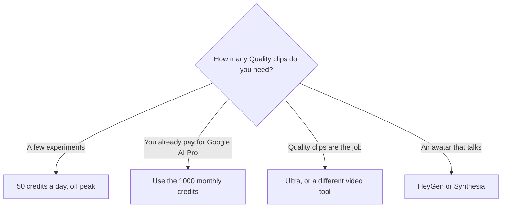

**[Google Flow](/tools/google-flow/) is Google's studio for short AI video and images, at labs.google/flow.** Everyone gets 50 Flow credits a day. Google AI subscribers get a monthly bonus on top. A Veo 3.1 Quality clip is 100 credits. That is the number that decides whether Pro's 1,000 monthly credits are a week of work or a month of it.

Credit rules were read from Google Flow Help on October 24, 2026. Plan prices were read from the United States view of Google's AI subscriptions page the same day: Plus $4.99, Pro $19.99, Ultra $99.99 or $199.99. Other countries can differ. Google says limits can change, and the prompt box has a settings control for the latest cost. We did not score clips against Runway. The video shelf is [best AI video generators](/blog/best-ai-video-generators-2026/).

## Credits, then prices

| Access | US plan price | Flow credits |
|---|---|---|
| No subscription | $0 | 50 a day. Unused daily credits do not roll over |
| Google AI Plus | $4.99/month | 50 a day, plus 200 a month |
| Google AI Pro | $19.99/month | 50 a day, plus 1,000 a month |
| Google AI Ultra | $99.99/month | 50 a day, plus 10,000 a month |
| Google AI Ultra | $199.99/month | 50 a day, plus 25,000 a month |

| Generation | Credits, from Flow Help |
|---|---|
| Veo 3.1 Lite | 10 for non-Ultra. 5 for Ultra. A lower-priority Lite mode is 0 for Ultra subscribers and family plan managers, and is not offered to everyone else |
| Veo 3.1 Fast | 20 for non-Ultra. 10 for Ultra |
| Veo 3.1 Quality, 8 seconds | 100 for all users |
| Gemini Omni Flash, 720p | 7, 10, 12, or 15 credits for a 4, 6, 8, or 10 second clip |
| Edit an uploaded or generated video | 40 |
| 4K upscale | 50, Ultra only |

The credit math is [Google Flow pricing explained](/blog/google-flow-pricing-explained-2026/).

Costs are per generation, not per click. Google says one request can create more than one generation. Non-subscribers may be unable to generate video during peak hours, about 2 PM to 5 PM UTC. Images and the Flow Agent still work then. Monthly subscriber credits refresh with the billing cycle and do not roll over. Subscribers in supported regions, except Japan, can buy more AI credits. The plan manager is the person who can buy them.

## What 1,000 credits buys

Ten Veo 3.1 Quality generations are 1,000 credits, before a second generation on the same click. Pro's monthly bonus is that budget, plus the daily 50, which is another Quality clip every other day if you spend the daily credits that way. Lite and Fast are the way to sketch. Quality is the way to spend the month in an afternoon. Ultra's 10,000 credits are 100 Quality generations, and Ultra also cuts the Lite and Fast rates.

Flow is a strong extra if you already pay for [Gemini](/tools/gemini/). It is a weak reason to buy Ultra if you wanted a timeline editor. [CapCut](/tools/capcut/) and [Descript](/tools/descript/) are editors. [Runway](/tools/runway/) and [Kling](/tools/kling-ai/) are the other generative video seats, compared in [Runway vs Kling vs Veo](/blog/runway-vs-kling-vs-veo-2026/) and the [Runway review](/blog/runway-review-2026/). Avatar presenters are [HeyGen](/tools/heygen/) and [Synthesia](/tools/synthesia/). The Gemini plan itself is the [Gemini review](/blog/gemini-review-2026/).

## Who should pay

**Use the daily 50** before you subscribe for Flow alone. **Stay on a Google AI plan you already bought** and spend its Flow credits. **Move up a Google AI tier** only when the credit log says the lower pool stopped a clip you needed. **Skip Flow** for long edits and for a talking-head avatar.

## FAQ

### Is Google Flow free?

Yes. Everyone gets 50 credits a day. Without a subscription, video generation may be unavailable in the peak window, about 2 PM to 5 PM UTC.

### How many credits is a Veo clip?

Lite is 10 credits for non-Ultra subscribers and 5 for Ultra. Fast is 20 or 10 on that same split. Quality is 100 for everyone. A request can spend more than one generation.

### Do credits roll over?

No. Unused daily credits and unused monthly plan credits do not roll over. Purchased AI credits can expire on their own terms.

## Last verified

October 24, 2026, from Google Flow Help and the United States view of Google's AI subscriptions page. Google says generation costs can change. Use the in-product settings control before a large batch.

**Sources:** [Manage your Google Flow credits](https://support.google.com/flow/answer/16526234), [Google AI subscriptions](https://gemini.google/subscriptions/), [Google Flow](https://labs.google/flow).

[Google Flow](/tools/google-flow/) is in the [video directory](/tools/category/video/). Directory pages may use affiliate links. A purchase through them may earn us a commission at no extra cost to you.
