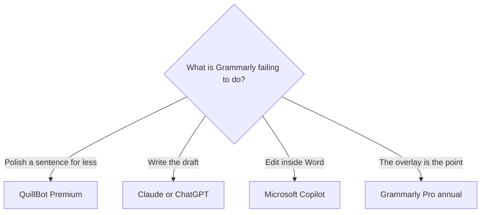

**Leave Grammarly when the job is a first draft, a paraphrase with a lower published seat, or an editor that already sits inside Microsoft 365.** Stay when the job is a proofread everywhere you type and you will use the rewrite on the annual price. Grammarly does not invent the brief. It edits sentences you already wrote.

[Grammarly](/tools/grammarly/) Pro is $12 per member per month billed annually ($144 a year), $60 per member per quarter, or $30 per member per month. Free covers basic corrections. The worth-it math is [is Grammarly Pro worth it](/blog/is-grammarly-pro-worth-it-2026/). The product page is [Grammarly review](/blog/grammarly-review-2026/).

Prices are US list prices excluding tax from directory pages checked October 16, 2026. Published October 24, 2026. We did not score prose.

## Pick by the miss

| The miss | Try | First paid step |
|---|---|---|
| You want a lower published price for paraphrase and grammar | [QuillBot](/tools/quillbot/) | Premium is $8.33/month billed annually. The directory row does not list a month-to-month price |
| You are writing the piece, not polishing a sentence | [Claude](/tools/claude/) or [ChatGPT](/tools/chatgpt/) | Claude Pro is $20/month or $17 annual. ChatGPT Plus is $20. Go is $8 |
| You live in Word and Outlook | [Microsoft Copilot](/tools/microsoft-copilot/) | Free with a Microsoft account. Microsoft 365 Personal is $9.99/month. Premium is $19.99 |
| You speak, and the draft should appear as text | [Wispr Flow](/tools/wispr-flow/) | $12 per user per month billed annually, from the October 24, 2026 review |
| You want Grammarly's browser overlay | Stay | Pro annual at $12, if you will use more than the free corrections |

The writing aisle is [best AI writing assistants](/blog/best-ai-writing-assistants/). The draft comparison is [ChatGPT vs Claude for writing](/blog/chatgpt-vs-claude-for-writing-2026/).

## What you give up when you leave

**QuillBot is the paraphrase seat.** Free includes 100-word paraphrasing, two modes, and basic grammar. Premium at $8.33 a month billed annually lists unlimited modes, advanced grammar, and a plagiarism check. A team plan is listed as contact-the-page. QuillBot is a fit when the sentence exists and you want another wording. It is a weak fit when you needed Grammarly's suggestion inside every text field in the browser. Try both on one real email before you cancel.

**Claude and ChatGPT write from a source you provide.** Paste the notes and the audience. The method is [how to write a blog post with Claude](/blog/how-to-write-a-blog-post-with-claude-2026/). A $20 chat seat is the wrong purchase if the only pain was a comma in Gmail, and it is the right purchase if you are asking Grammarly to invent a post. The instruction pattern is [what prompt engineering is](/blog/what-is-prompt-engineering-2026/).

**Copilot is the suite switch.** Personal at $9.99 includes Copilot with higher usage than the free tier, inside the Microsoft 365 apps. If the company already pays for Microsoft 365, ask the admin what Copilot SKU the tenant has before you add Grammarly Pro for every seat. Two editors on the same paragraph is a process problem.

**Wispr Flow is dictation.** The October 24, 2026 review records $12 per user per month billed annually. It turns speech into text. It does not replace a grammar overlay. Use it when the bottleneck is getting words down, then edit. The review is [Wispr Flow review](/blog/wispr-flow-review-2026/).

## The price trap on Grammarly itself

Monthly Pro at $30 is two and a half times the annual monthly equivalent of $12. Quarterly at $60 per member per three months sits between them. If you have already decided to keep Grammarly, the annual card is the one to compare with QuillBot's $8.33. A one-month test can use the $30 card, and then you should switch or cancel with the renewal price in view.

Free Grammarly remains a real spellcheck. Pay for Pro when you want the full-sentence rewrite and the tone shifts, and you will run them often enough that $144 a year is cheaper than the time. A fiction project is a different tool: [Sudowrite](/tools/sudowrite/) starts at $10 a month on its review. That is a creative writing credit plan, and it is the wrong alternative for a work email.

## FAQ

### What is the cheapest Grammarly alternative with a published price?

QuillBot Premium at $8.33 a month billed annually is the lower published writing seat in this set. Microsoft Copilot's free tier is $0 with a Microsoft account, with usage limits. Cheaper is the seat. It is a different editor.

### Is ChatGPT a replacement for Grammarly?

ChatGPT replaces the drafting step. Grammarly replaces the last pass in the browser. Many people keep free Grammarly and a chat seat, and skip Pro. Read [is Grammarly Pro worth it](/blog/is-grammarly-pro-worth-it-2026/) before you stack both paid plans.

### Does Microsoft 365 include Grammarly?

No. Microsoft 365 includes Copilot on the plans above. Grammarly is a separate membership. Pick the editor that appears in the window where you actually fix sentences.

### Will an alternative catch plagiarism?

QuillBot Premium lists plagiarism prevention on the directory page. Grammarly's plans and a chat assistant are not a substitute for a source you can open. A clean sentence can still be a borrowed claim. Check the claim.

## Last verified

October 16, 2026 for Grammarly, QuillBot, Claude, ChatGPT, and Microsoft 365 prices. Wispr Flow's annual price is from the October 24, 2026 review. Published October 24, 2026.

**Sources:** [Grammarly plans](https://www.grammarly.com/plans), [QuillBot](https://quillbot.com/), [Microsoft 365](https://www.microsoft.com/microsoft-365).

*Published by Andrew for [AI Tools Optimizer](https://aitoolsoptimizer.com).*

[Grammarly](/tools/grammarly/) and [QuillBot](/tools/quillbot/) are in the [writing directory](/tools/category/writing/). Directory pages may use affiliate links. A purchase through them may earn us a commission at no extra cost to you.
