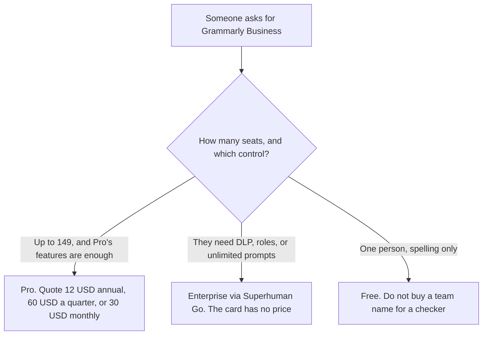

**Grammarly does not list a Business price on the directory card checked October 16, 2026. That card says Pro replaced the old Business plan and supports up to 149 seats.** Pro is $12 a member a month billed annually, which is $144 a year, or $60 per quarter, or $30 billed monthly. Enterprise, delivered through Superhuman Go, is contact sales. The full ladder, including what Free covers, is [Grammarly pricing explained](/blog/grammarly-pricing-explained-2026/).

Whether the annual seat is the right buy for one writer is [is Grammarly Pro worth it](/blog/is-grammarly-pro-worth-it-2026/). The product page is [Grammarly review](/blog/grammarly-review-2026/).

A live fetch of grammarly.com/plans and grammarly.com/business returned HTTP 401 on October 24, 2026, so this page stays on the October 16 card. Published October 24, 2026. Prices are USD as that card records them. We did not score writing. This page does not invent a Business dollar from the Pro seat.

## What to buy when someone asks for Business

| What they asked for | What the October 16 card actually lists | What you may quote |
|---|---|---|
| A team seat, under 150 people | Pro, which replaced Business | $12 a member a month billed annually, $60 a quarter, or $30 monthly |
| Rewrites, tone, and a prompt cap | Pro | 2,000 generative AI prompts. Not unlimited |
| Roles, permissions, data loss prevention, unlimited prompts | Enterprise, via Superhuman Go | No dollar. Ask sales. Do not multiply $12 by a headcount and call it Enterprise |
| One person who only needs grammar | Free | $0. Business is the wrong name for that job |

Grammarly is part of Superhuman, with Superhuman Go, Coda, and Superhuman Mail, on that card. Enterprise Grammarly is delivered through Superhuman Go. A bundle that includes Mail or Coda is a different checkout. Do not quote the $12 writing seat as the price of the suite. The support article the directory cites is the Pro cost page. It is not a Business rate card.

A year of monthly Pro is 12 × $30 = $360. A year of annual Pro is $144. Four quarters at $60 would be $240. The card prints "$60 per quarter." It does not print a "$20 a month" quarterly equivalent. Quote $60. The base pricing article walks that arithmetic for one member. This article exists so a procurement line labeled Business does not get a fictional SKU.

## What Pro is, once Business is off the form

**The seat.** [Grammarly](/tools/grammarly/) Pro is the plan the card tells you to buy for a team up to 149. It adds full-sentence rewrites, tone adjustment, and 2,000 AI prompts on top of Free. It does not follow a draft into a long-form studio. [Claude](/tools/claude/) Pro is $17 a month billed annually, $200 up front, or $20 monthly, on claude.com/pricing fetched October 24, 2026, when the job is the draft. The invoice is [Claude pricing explained](/blog/claude-pricing-explained-2026/).

**The page the style guide lives on.** [Notion AI](/tools/notion-ai/) Business is $20 a seat a month on the October 16 card. That is Notion's Business plan. It is not Grammarly Business. The names collide. The invoice is [Notion AI pricing explained](/blog/notion-ai-pricing-explained-2026/).

**One editing pass from a paste.** [ChatGPT](/tools/chatgpt/) Plus is $20 a month on the October 24 plan page. It is not a Grammarly seat. The ladder is [ChatGPT pricing explained](/blog/chatgpt-pricing-explained-2026/).

## What not to assume

Do not put "Grammarly Business" on a quote with a dollar this card does not print. Do not describe Pro's 149 seats as an admin console with data loss prevention. Those controls are on the Enterprise line, and that line has no price here. Do not convert a euro, pound, or rupee checkout into these dollars. The card says regional pricing exists at checkout. Use the currency the buyer will be charged. Do not treat 2,000 prompts as unlimited because the team is small.

## FAQ

### Is there a Grammarly Business plan?

Not as a priced SKU on the October 16 card. Pro replaced the old Business plan and supports up to 149 seats. If a sales rep uses the old name, ask which current SKU the quote maps to, and match it to Pro or to Enterprise. Do not accept a third price that neither row lists.

### How much is Grammarly for a team?

Pro is $12 a member a month billed annually, $60 per quarter, or $30 monthly, up to 149 seats, on that card. Multiply only after you know the billing cycle. A 10-person team on annual Pro is 10 × $144 = $1,440 a year. The same team on monthly Pro is 10 × $30 = $300 a month, which is $3,600 a year. Those are the same features. Enterprise is not a volume discount on this arithmetic. It is a different product with no list price here.

### What does Enterprise add?

The card says unlimited AI prompts, roles and permissions, and data loss prevention, delivered through Superhuman Go. It says contact sales. A security review that asks for those controls is not answered by buying more Pro seats.

### Does this page replace the main pricing article?

No. That article is Free, the three Pro cycles, and the prompt cap. This article is the Business name: what to order when a form still says Business, and what not to invent when the seat count crosses 149.

## Last verified

October 16, 2026, from the directory card. Claude and ChatGPT comparison prices are from October 24, 2026 plan pages. Notion is the October 16 card. Published October 24, 2026. Live fetches of the Grammarly plans and business URLs returned HTTP 401 that day.

**Sources:** [Grammarly Pro cost](https://support.grammarly.com/hc/en-us/articles/115000090011-How-much-does-Grammarly-Pro-cost), [Grammarly](https://www.grammarly.com), [Claude pricing](https://claude.com/pricing).

*Published by Andrew for [AI Tools Optimizer](https://aitoolsoptimizer.com).*

[Grammarly](/tools/grammarly/) is in the [writing directory](/tools/category/writing/). Directory pages may use affiliate links. A purchase through them may earn us a commission at no extra cost to you.
