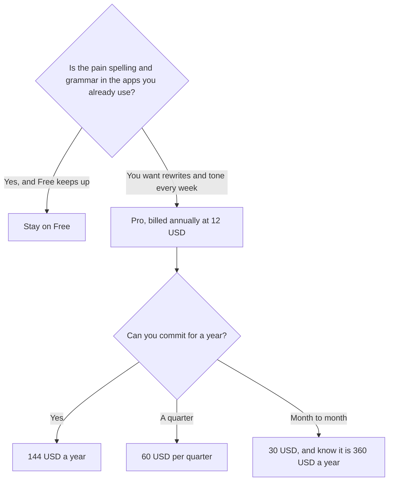

**Grammarly pricing is a free correctness checker, then Pro, and the billing cycle is the decision.** Pro is $12 a member a month billed annually, which is $144 a year, or $60 per quarter, or $30 billed monthly. Pro adds full-sentence rewrites, tone adjustment, and 2,000 AI prompts. Free covers grammar and spelling. Monthly Pro is the expensive way to buy the same seat.

The product page is [Grammarly review](/blog/grammarly-review-2026/). Whether to pay is [is Grammarly Pro worth it](/blog/is-grammarly-pro-worth-it-2026/). The editor comparison is [Grammarly vs ChatGPT for editing](/blog/grammarly-vs-chatgpt-for-editing-2026/).

Prices are USD from Grammarly's support page, as recorded in the directory on October 16, 2026. Published October 24, 2026. We did not score writing. Enterprise does not have a dollar on that card.

## The plans

| Plan | What you pay | What you crossed up for | What you did not get |
|---|---|---|---|
| Free | $0 | Grammar and spelling for mistake-free writing | Full-sentence rewrites, tone, the 2,000 prompts |
| Pro, annual | $12 a member a month, $144 a year | Rewrites, tone, 2,000 generative AI prompts | A long-form drafting studio |
| Pro, quarterly | $60 per quarter | The same Pro features on a shorter commitment | A cheaper month than annual |
| Pro, monthly | $30 a month | The same features, cancel sooner | A sensible year. $30 × 12 is $360 |
| Enterprise | Sales, via Superhuman Go | Unlimited AI prompts, roles and permissions, data loss prevention | A price this page can quote |

Grammarly Pro replaces the old Business plan and supports up to 149 seats. A team does not need a differently named plan to add seats, up to that count. Past that, the directory points at Enterprise. Grammarly is part of Superhuman, with Superhuman Go, Coda, and Superhuman Mail. Enterprise Grammarly is delivered through Superhuman Go. The directory does not print an Enterprise price. Ask sales. Do not invent one from the Pro seat.

## What the 2,000 prompts are not

Two thousand generative AI prompts is the Pro cap the directory records. It is not "unlimited writing." If you are drafting a blog, a case study, or a spec from notes, a chat seat is the tool. [Claude](/tools/claude/) Pro is $20 a month, or $17 billed annually. [ChatGPT](/tools/chatgpt/) Plus is $20. Go is $8. Grammarly is the pass after the draft exists. The method is [how to write a blog post with Claude](/blog/how-to-write-a-blog-post-with-claude-2026/). The fact pass is [how to fact-check AI writing](/blog/how-to-fact-check-ai-writing-2026/).

Grammarly will not notice a wrong price, a wrong name, or a policy you did not mean. It will notice a comma. Run it after the facts are stable. Suggestions can also flatten a voice you wanted to keep. Reject those. The house style, if you need one stored, is [how to create a brand voice with AI](/blog/how-to-create-a-brand-voice-with-ai-2026/).

[QuillBot](/tools/quillbot/) Premium is $8.33 a month billed annually. Free paraphrases up to 100 words in two modes. Buy QuillBot when the job is paraphrase, not when the job is a red underline in every app. The alternatives roundup is [Grammarly alternatives](/blog/grammarly-alternatives-2026/).

[Notion AI](/tools/notion-ai/) is the other confusion. Business is $20 a seat for AI on the Notion workspace. It does not follow you into Gmail. The head-to-head is [Notion AI vs Grammarly](/blog/notion-ai-vs-grammarly-2026/).

## Who should pay

Pay annual Pro when you rewrite sentences every week and Free's underlines are not enough. The jump from $144 to $360 is the monthly toggle. Use monthly only when you truly might cancel inside a month. Quarterly at $60 is $180 a year if you pay all four, which is still more than $144 and less than $360. The directory prints "$60 per quarter." It does not print a "$20 a month" quarterly equivalent. Quote $60.

Students can live on Free for a long time. A student who needs a cited reading tool does not need Pro for that. The stack is [best AI tools for students](/blog/best-ai-tools-for-students-2026/). A student who was using Perplexity as a writing tutor needs a different page: [Perplexity alternatives for students](/blog/perplexity-alternatives-for-students-2026/).

Do not buy Pro to generate the document. Two thousand prompts will go quickly if each one is "write the post," and the post will still need a source. That limit is a feature of the plan, not a defect you should route around by pasting the same draft into a second account.

## FAQ

### Is Grammarly free?

Yes. Free covers grammar and spelling. Pro is the rewrite, tone, and prompt tier.

### Is monthly ever the right toggle?

When you are testing Pro for a few weeks and will cancel. At $30, a year of forgetting to cancel is $360. Annual is $144. The directory's review says to avoid monthly billing. The arithmetic is the reason.

### Does Pro include a team admin console?

Pro supports up to 149 seats and replaces the old Business plan. Enterprise, via Superhuman Go, is where the directory puts roles, permissions, and data loss prevention. If a security review asks for those, Pro's seat price is not the answer. The dollar for Enterprise was not on the card.

### Will Pro write a case study?

It will edit one. The draft comes from notes and approved quotes, in a chat or in the doc. The workflow is [how to write a case study with AI](/blog/how-to-write-a-case-study-with-ai-2026/).

## Last verified

October 16, 2026 for Grammarly, QuillBot, Claude, ChatGPT, and Notion prices named above. Published October 24, 2026.

**Sources:** [Grammarly Pro cost](https://support.grammarly.com/hc/en-us/articles/115000090011-How-much-does-Grammarly-Pro-cost), [Grammarly](https://www.grammarly.com), [Claude pricing](https://claude.com/pricing).

*Published by Andrew for [AI Tools Optimizer](https://aitoolsoptimizer.com).*

[Grammarly](/tools/grammarly/) is in the [writing directory](/tools/category/writing/). Directory pages may use affiliate links. A purchase through them may earn us a commission at no extra cost to you.
