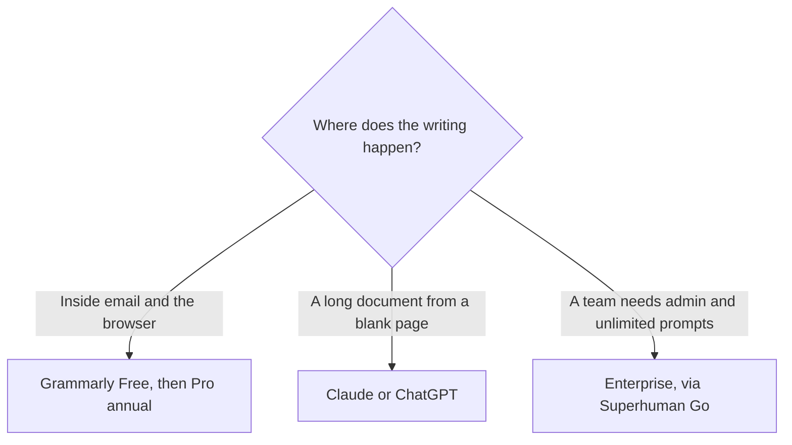

**[Grammarly](/tools/grammarly/) is a writing editor that sits in the browser, the desktop, and the apps where you already type.** Pro adds rewrites, tone, and generative prompts. The company is now part of Superhuman. The short question of whether the annual price beats the monthly price is [is Grammarly Pro worth it](/blog/is-grammarly-pro-worth-it-2026/). This review is what the product is, and what a $20 assistant still does better.

Prices were re-read on Grammarly's support article on October 24, 2026. The default currency is the US dollar. Checkout can show euros, pounds, or rupees. Tax is separate. The 2,000-prompt figure is from Grammarly's plan materials checked October 16, 2026. The October 24 support article confirms price, seats, and Superhuman. It does not restate the prompt cap. We did not score suggestions against Claude.

## Where the money goes

| Plan | Price Grammarly Support lists | What you are paying for |
|---|---|---|
| Free | $0 | Grammar and spelling across the extension |
| Pro, annual | $144/member/year ($12/month on average) | Rewrites, tone, and generative AI. Plan materials listed 2,000 prompts |
| Pro, quarterly | $60/member for three months | The same Pro features, at $20 a month |
| Pro, monthly | $30/member/month | The same Pro features |
| Enterprise | Contact sales, through Superhuman Go | Unlimited prompts, roles, and data-loss prevention, in the materials we checked |

The invoice is [Grammarly pricing explained](/blog/grammarly-pricing-explained-2026/).

Pro allows up to 149 seats. Extra seats are prorated. There is no lifetime plan and no gift plan. Cards, PayPal, Apple Pay, and Google Pay are accepted. Personal checks are not.

## What Superhuman changes, and what it does not

Grammarly's support note says Grammarly is now part of Superhuman, a suite that includes Superhuman Go, Grammarly, Coda, and Superhuman Mail. Enterprise Grammarly is delivered through Superhuman Go. For one person, the practical meaning is:

- You still buy Grammarly Pro at the prices above.
- You are not automatically buying Superhuman Mail.
- [Fathom](/tools/fathom/), the meeting notetaker, is also part of Superhuman. A Grammarly seat does not include Fathom Premium. Meeting notes are [best AI meeting notetakers](/blog/best-ai-meeting-notetakers/).

The product's job is the underline. You write in Gmail, a doc, or a social box, and Grammarly marks grammar, clarity, and tone. Pro is the version that rewrites the sentence and drafts from a prompt. It is a poor place to outline a report you have not started. [Claude](/tools/claude/) and [ChatGPT](/tools/chatgpt/) are built for that blank page. The writing comparison is [best AI writing assistants](/blog/best-ai-writing-assistants/) and [ChatGPT vs Claude for writing](/blog/chatgpt-vs-claude-for-writing-2026/).

[QuillBot](/tools/quillbot/) is the other paraphrasing tool in the directory. Stacking it on Pro is two editors on the same sentence. Pick one.

Students should follow their school's AI policy. An editor that rewrites a sentence is still an AI tool. Grammarly does not make a citation for you. Research tools are a different category.

## Who should pay

**Use Free** if spelling and grammar in the browser are the whole job. **Pay for Pro annual** if you want rewrites in the apps you already use and you will keep the seat for a year. The worth-it article is the place for the $12 versus $30 comparison. **Do not pay monthly** at $30 for the same features unless the year is uncertain. **Talk to sales for Enterprise** if you need unlimited prompts and admin controls. **Skip Pro** if the work is a long draft and the editor is only there to catch commas. A chatbot plus Free covers that.

## FAQ

### How much does Grammarly Pro cost?

$30 per member per month, $60 per member per quarter, or $144 per member per year. The annual plan averages $12 a month. Enterprise is contact sales.

### Is Grammarly the same as Superhuman Mail?

No. Grammarly is part of the Superhuman suite. The support article does not say a Pro subscription includes Superhuman Mail or Fathom.

### Does Pro have unlimited AI prompts?

The plan materials we checked in October 16 listed 2,000 prompts on Pro and unlimited prompts on Enterprise. Confirm the cap on the plans page. The October 24 price article does not restate it.

## Last verified

October 24, 2026, for prices, seat rules, and the Superhuman note, from Grammarly Support. The prompt cap is from plan materials checked October 16, 2026.

**Sources:** [How much does Grammarly Pro cost?](https://support.grammarly.com/hc/en-us/articles/115000090011-How-much-does-Grammarly-Pro-cost), [Grammarly plans](https://www.grammarly.com/plans).

[Grammarly](/tools/grammarly/) is in the [writing directory](/tools/category/writing/). Directory pages may use affiliate links. A purchase through them may earn us a commission at no extra cost to you.
