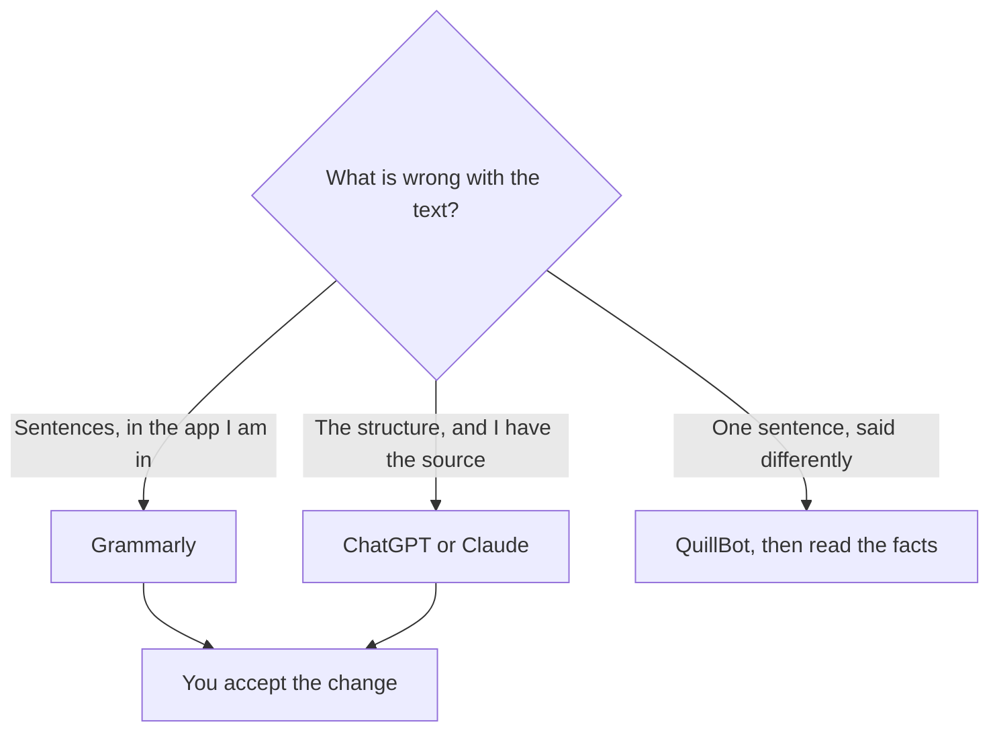

**Use Grammarly to repair sentences in the app where you are already writing. Use ChatGPT when the draft needs a new structure and you will paste a source.** Grammarly is an editor that follows you. ChatGPT is a drafting room you visit. Paying for both makes sense when one person proofreads all day and also rewrites long pieces. Paying for both to fix a comma does not.

[Grammarly](/tools/grammarly/) Pro is $12 per member per month billed annually ($144 a year), $60 per member per quarter, or $30 per member per month. Free covers basic corrections. Pro adds full-sentence rewrites, tone adjustments, and 2,000 AI prompts. [ChatGPT](/tools/chatgpt/) Plus is $20 a month. Go is $8. The wider switch list is [Grammarly alternatives](/blog/grammarly-alternatives-2026/). Whether the annual Grammarly seat pays off is [is Grammarly Pro worth it](/blog/is-grammarly-pro-worth-it-2026/).

Prices are US list prices excluding tax from directory pages checked October 16, 2026. Published October 24, 2026. We did not score writing quality.

## What kind of edit this is

| The edit | Use | You pay | You still do |
|---|---|---|---|
| Grammar, spelling, and a tone nudge in Gmail or a doc | Grammarly, including Free for the basics | Pro at $12 annual when you want sentence rewrites and the prompt pool | Accept or reject each suggestion |
| "Rewrite this section for a customer, using only these facts" | ChatGPT | Plus at $20, or Go at $8 | Paste the facts, then check that the rewrite kept them |
| A paraphrase at a lower published seat | [QuillBot](/tools/quillbot/) | Premium is $8.33/month billed annually | A paraphrase can still change a number. Read it |
| A long draft in a careful voice | [Claude](/tools/claude/) | Pro is $20/month, or $17 billed annually | The writing comparison is [ChatGPT vs Claude for writing](/blog/chatgpt-vs-claude-for-writing-2026/) |
| A stored brand voice for several marketers | [Jasper](/tools/jasper/) | Pro is $59/seat/month yearly | Jasper is a system. It is a heavy editor for one email |

A rewrite can introduce a fact. The check is [how to fact-check AI writing](/blog/how-to-fact-check-ai-writing-2026/). Grammarly's suggestions can also smooth a sentence into a claim you did not make. Accepting a highlight is still a decision.

## The bills, side by side

Grammarly Free is the right tool if your problem is mistakes. Pro's annual price, $144 a year, is the plan that adds rewrites and 2,000 AI prompts. Monthly Pro at $30 is $360 a year, which is $216 more than annual for the same seat. If you know you will proofread all year, the annual card is the one to read at checkout. Enterprise, through Superhuman Go on the directory card, is the plan that lists unlimited AI prompts and admin controls. Pro supports up to 149 seats and replaced the old Business plan.

ChatGPT Plus at $20 a month is $240 a year if you stay month to month. There is no separate "editing plan." You are buying the assistant, and editing is one use. Go at $8 is the lighter entry. The directory notes that Go may include ads. Business at $20 per user per month billed annually is the team plan, with a two-user minimum, and it does not train on business data by default.

A person who lives in email and docs and rarely asks for a full rewrite should start with Grammarly Free, then Pro annual if the sentence-level rewrites are what they accept every day. A person who rewrites posts from a brief should start with ChatGPT or Claude and add Grammarly only when the last pass has to happen inside other apps. Stacking Pro and Plus is $12 + $20 a month on those rates, $32, for two different edits. Name which edit happens in which tool so you do not run the same paragraph through both and blend the suggestions.

## Where each one flattens the voice

Grammarly's clarity suggestions pull sentences toward a standard. That is the product. If the voice is the point, reject the suggestions that sand it off, or put the voice rules in a brand tone on a team plan. ChatGPT will also flatten a voice when the prompt says "make it professional" and nothing else. Show one paragraph you like. That pattern is [what few-shot prompting is](/blog/what-is-few-shot-prompting-2026/).

QuillBot Premium at $8.33 a month annually is the cheaper paraphrase. It is the wrong tool when you need Grammarly's everywhere-you-type underline, and the wrong tool when you need ChatGPT to restructure a section against a source.

## FAQ

### Is Grammarly Pro better than ChatGPT for grammar?

For catching mistakes in the box where you are typing, Grammarly is the tool built for that pass. ChatGPT will copyedit text you paste. It will not underline the sentence in your email client. Use Grammarly at the point of writing. Use ChatGPT when you are willing to leave the draft and come back with a new version.

### Does Grammarly Free make Pro unnecessary?

Free covers the mistake-free basics on the plan we recorded. Pro is the sentence rewrite, the tone controls, and the 2,000-prompt pool. If you only accept spelling fixes, stay on Free. If you accept full-sentence rewrites all week, price the annual seat.

### Can I paste a Grammarly draft into ChatGPT?

Yes. Do it when the structure is still wrong after the sentences are clean. Bring the facts in the same paste. A clean sentence can still say the wrong thing.

### Which one should a company standardize on?

Grammarly for the people whose job is email and documents in many apps. ChatGPT or Claude for the people whose job is a draft from a brief. A company-wide Grammarly Pro rollout at $12 annual is a different budget from a company-wide Plus rollout at $20. Match the seat to the edit, and skip the seat for people who will not open it.

## Last verified

October 16, 2026 for Grammarly, ChatGPT, QuillBot, Claude, and Jasper prices. Published October 24, 2026.

**Sources:** [Grammarly Pro price](https://support.grammarly.com/hc/en-us/articles/115000090011-How-much-does-Grammarly-Pro-cost), [OpenAI ChatGPT pricing](https://openai.com/chatgpt/pricing/), [QuillBot Premium](https://quillbot.com/premium).

*Published by Andrew for [AI Tools Optimizer](https://aitoolsoptimizer.com).*

[Grammarly](/tools/grammarly/) is in the [writing directory](/tools/category/writing/). [ChatGPT](/tools/chatgpt/) is in the [chatbots directory](/tools/category/chatbots-assistants/). Directory pages may use affiliate links. A purchase through them may earn us a commission at no extra cost to you.
