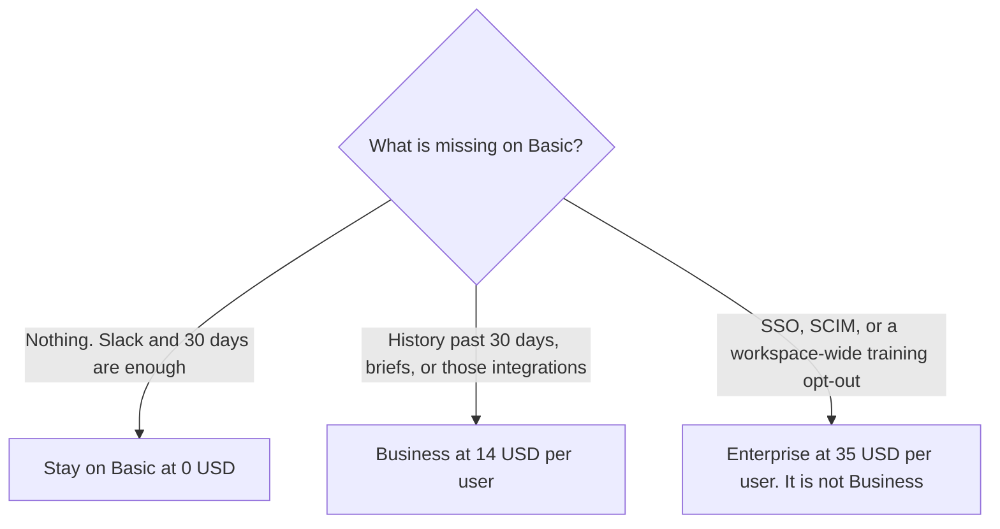

**Granola Business is $14 per user per month.** On the pricing page read October 24, 2026, that seat removes the 30-day history cap and adds pre-meeting briefs, follow-up emails, model selection, and the integrations on the compare table: Notion, Zapier, HubSpot, Attio, Affinity, plus API access and centralized billing. Basic, at $0, already includes AI notes, chat, shared folders, templates, recipes, Slack, and a personal training opt-out. Enterprise, at $35 per user per month, is the admin row. The full three-card ladder is [Granola pricing explained](/blog/granola-pricing-explained-2026/). This page is the $14 seat only.

The product page is [Granola review](/blog/granola-review-2026/). The no-bot comparison is [Granola vs Fathom](/blog/granola-vs-fathom-2026/). A long internal meeting against a bot is [Otter vs Fathom for all-hands](/blog/otter-vs-fathom-for-all-hands-2026/).

Those prices are US list prices from [Granola's pricing page](https://www.granola.ai/pricing), read October 24, 2026. The page we read does not show a separate annual discount. Tax can still apply at checkout. Published October 24, 2026. We did not score notes. We did not receive a custom quote.

## What $14 adds, and what it does not

| Plan | Price on the October 24 page | History | The line that is or is not Business |
|---|---|---|---|
| Basic, for contrast | $0 per user per month | 30 days | AI notes, chat, Slack, a personal training opt-out. Not briefs |
| Business | $14 per user per month | Unlimited | Briefs, follow-up emails, model selection, Notion, Zapier, HubSpot, Attio, Affinity, API access, centralized billing |
| Enterprise | $35 per user per month | Unlimited | SSO, SCIM, HIPAA-compliant workspaces, admin-enforced sharing, Salesforce-class integrations, audit API, workspace-wide training opt-out. Not a larger Business seat |

A 10-person Business workspace is 10 times $14, which is $140 a month. A year at that monthly list is 12 times $140, which is $1,680. The October 24 page does not list a cheaper annual Business rate. Do not invent one. If checkout shows a different cycle, checkout wins.

Billing is per active member of the workspace, and every member is on the same plan, as the base article records. A contractor who should keep a searchable archive is a seat. You cannot put five people on Business and five on Basic in one workspace and call the quiet half free.

Slack is on Basic. Buying Business only for Slack pays $14 for a row you already have. Briefs and follow-up emails are the Business lines on that compare table. Chat across meetings on Basic is "auto" only. Business adds model selection. MCP access on Business is personal and public workspace notes. Basic is personal notes from the last 30 days. The admin-configurable MCP is Enterprise.

## The invoice people mislabel

**The archive.** [Granola](/tools/granola/) Business is the seat when a decision from last quarter has to remain in the app. Audio is deleted after transcription on every plan, according to the compare table. That retention fact is not an Enterprise feature. SOC 2 Type II is marked on all three cards in the base article. HIPAA is the Enterprise line.

**A CRM seat, which this is not.** [Fathom](/tools/fathom/) Business is $25 per user per month billed annually, or $34 monthly, with a two-user minimum, for CRM field sync. Granola's $14 does not include that sync. Salesforce-class integrations are on Granola Enterprise, not on Business. HubSpot is the Business example on the compare table. Confirm the connector before you promise it. The Fathom invoice is [Fathom Business pricing explained](/blog/fathom-business-pricing-explained-2026/).

**A minute pool, if finance wants a cap in writing.** [Otter](/tools/otter-ai/) Business is $19.99 per user per month billed annually, or $30 monthly, with a 4-hour conversation cap. Granola's Business card, as the base article reads it, does not publish that kind of per-call minute cap. The invoice is [Otter Business pricing explained](/blog/otter-business-pricing-explained-2026/).

**The wiki the notes land in.** [Notion AI](/tools/notion-ai/) Business is $20 a seat a month on the October 16 card. The page holds the kept lines. It is not a Granola seat. The invoice is [Notion AI pricing explained](/blog/notion-ai-pricing-explained-2026/).

Bot-free capture is on Basic. You do not pay $14 to keep the bot out of the call. You pay $14 when 30 days is too short, or when you need the briefs, the model picker, or the integrations on that card.

## What not to assume

Do not quote Enterprise as "Business, plus a few dollars." The gap is $21 a user a month at list, and the controls are SSO, SCIM, a workspace-wide training opt-out, and the admin lines above. Do not describe a personal opt-out as the company switch. The personal opt-out is already on Basic and Business. Do not convert a non-USD checkout into $14. Quote the currency the buyer will be charged.

## FAQ

### How much is Granola Business for 10 people?

At the October 24 list, ten users are 10 times $14, which is $140 a month. A year at that monthly figure is $1,680. The page we read does not show a separate annual discount. Tax can be extra. Every member of the workspace is on the same plan.

### Does Business include SSO?

No. SSO, SCIM, HIPAA-compliant workspaces, admin-enforced sharing, and a workspace-wide training opt-out are on Enterprise at $35 per user per month. Business is the archive, the briefs, the model picker, and the integrations named above.

### Does Business include a meeting bot?

No. Granola's design, on every card, is device audio and notes. A bot the whole company can see is a different product. Read the Fathom and Otter articles before you buy Business to solve a bot problem it does not have.

### Does this page replace the main Granola pricing article?

No. That article is Basic, Business, and Enterprise on one ladder. This article is the $14 row: what it adds over Basic, the ten-seat arithmetic, and the controls that stay on the $35 card.

## Last verified

October 24, 2026, from Granola's pricing page, matching the base pricing article. The October 16 directory had described Enterprise as "from $35." The October 24 page shows $35 as the card price. Published October 24, 2026.

**Sources:** [Granola pricing](https://www.granola.ai/pricing), [Granola](https://www.granola.ai).

*Published by Andrew for [AI Tools Optimizer](https://aitoolsoptimizer.com).*

[Granola](/tools/granola/) is in the [meetings directory](/tools/category/meetings-transcription/). Directory pages may use affiliate links. A purchase through them may earn us a commission at no extra cost to you.
