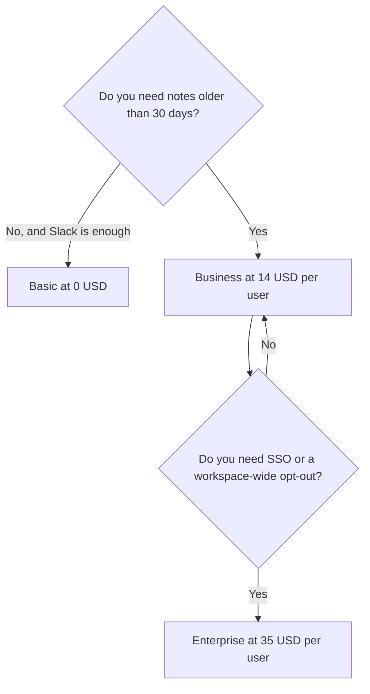

**Granola pricing is three per-user cards: Basic at $0, Business at $14 per user per month, and Enterprise at $35 per user per month.** Basic keeps meeting history for 30 days. Business removes that cap and adds the integrations and the model choice. Enterprise adds the admin controls, SSO, and a workspace-wide training opt-out. The page we read does not show a separate annual discount. Budget the monthly figure until checkout shows a different cycle.

Those prices are US list prices from [Granola's pricing page](https://www.granola.ai/pricing), read October 24, 2026. Tax can still apply at checkout. The product story is [Granola review](/blog/granola-review-2026/). The no-bot comparison is [Granola vs Fathom](/blog/granola-vs-fathom-2026/).

## The three cards

| Plan | Price on the page | History | What you crossed a paywall to get |
|---|---|---|---|
| Basic | $0 per user per month | 30 days | AI notes, chat, shared folders, templates, recipes, Slack, multi-language, a personal training opt-out |
| Business | $14 per user per month | Unlimited | Pre-meeting briefs, follow-up emails, model selection, Notion, Zapier, HubSpot, Attio, Affinity, API access, centralized billing |
| Enterprise | $35 per user per month | Unlimited | SSO, SCIM, HIPAA-compliant workspaces, admin-enforced sharing, Salesforce-class integrations, audit API, workspace-wide training opt-out, org-wide auto-deletion |

A 10-person Business workspace is $140 a month at the list price. A 10-person Enterprise workspace is $350 a month. Billing is per active member of the workspace, and every member is on the same plan. A contractor who should keep a searchable archive is a seat. A person who sits in on one call is a prompt to check whether they need a seat before you add them.

The October 16 directory page had described Enterprise as "from $35." The October 24 pricing page shows $35 per user per month as the card price. Use $35 unless your quote says otherwise.

## What Basic already includes

Basic is a real notepad, and it is bot-free: Granola captures computer audio on Zoom, Meet, Teams, and other calls. The compare table on the October 24 page includes AI meeting notes, speaker tags, templates, recipes, shared folders, Slack, and desktop plus iOS, Android, and Apple Watch apps. Chat across meetings on Basic is "auto" only. Business adds model selection.

History is the cliff. Thirty days means a decision from last quarter is gone from the app even if the meeting felt important. If you are the system of record, Business is the plan. If you paste the kept lines into a doc the same day, Basic can be enough.

Pre-meeting briefs and follow-up emails are Business features on that compare table. Buying Business only for Slack is unnecessary. Slack is on Basic.

## What Business does not include

**SSO and a company-wide training switch.** Those are Enterprise. A personal opt-out exists on Basic and Business. Enterprise makes the opt-out workspace-wide and adds SCIM, an audit API, and HIPAA-compliant workspaces. A startup that only needs the archive can stay at $14. A company that needs the security review in writing is looking at $35.

**A meeting bot, a video recording, or talk-time analytics.** Granola's design is device audio and notes. If you need a bot the whole company can see, unlimited recordings on a free tier, or CRM field sync, read [Fathom pricing explained](/blog/fathom-pricing-explained-2026/). [Fathom](/tools/fathom/) Premium is $16 a month billed annually. Fathom Business, at $25 per user per month billed annually with a two-user minimum, is the CRM-sync tier in that set. [Otter](/tools/otter-ai/) is the bot with a published minute cap. [Fireflies](/tools/fireflies-ai/) Pro is $10 per user per month annually for search across calls. That invoice is [Fireflies pricing explained](/blog/fireflies-pricing-explained-2026/).

**Salesforce on Business.** The compare table puts advanced integrations such as Salesforce on Enterprise. HubSpot, Notion, Zapier, Attio, and Affinity are the Business integration examples. Confirm the specific connector on the live table before you promise it to sales.

MCP access scales with the plan: personal notes from the last 30 days on Basic, personal and public workspace notes on Business, and an admin-configurable version on Enterprise. API access starts on Business.

## How this sits next to a notes subscription

Granola is the capture. [Notion AI](/tools/notion-ai/) Business at $20 per seat per month is a wiki. [ChatGPT](/tools/chatgpt/) Plus at $20 is a rewrite of text you paste. The split is [Notion AI vs ChatGPT for notes](/blog/notion-ai-vs-chatgpt-for-notes-2026/). Paying $14 for Granola Business plus a wiki is coherent. Paying $14 so a chatbot can "hear" the meeting is the wrong job. The capture choice is [how to summarize meetings with AI](/blog/how-to-summarize-meetings-with-ai-2026/).

Audio is deleted after transcription on every plan, according to the compare table. That is a retention fact to hand a security reviewer, along with SOC 2 Type II, which the table marks included on all three cards. HIPAA is the Enterprise line.

## FAQ

### How much does Granola cost per user?

Business is $14 per user per month. Enterprise is $35 per user per month. Basic is $0, with 30 days of history. The October 24 page shows those as monthly per-user prices.

### Is there an annual discount?

The pricing page we read on October 24, 2026 does not list a separate annual rate. Budget $14 and $35 until the billing screen shows something else. A discount that appears only at checkout is a checkout fact, and this article will not invent one.

### Does the free plan include AI notes?

Yes. Basic includes AI meeting notes and chat, with history limited to 30 days, and no daily transcription cap was listed on the card. Integrations beyond Slack, briefs, and unlimited history are the Business step.

### Do I need Business for a bot-free notetaker?

No. Bot-free capture is on Basic. You need Business when 30 days is too short, or when you need the briefs, the model picker, or the integrations on that card.

## Last verified

October 24, 2026, from Granola's pricing page. Fathom and Fireflies comparison prices are from their pricing articles dated October 24, 2026, which cite earlier recorded cards where noted there. Notion and ChatGPT prices are from directory pages checked October 16, 2026.

**Sources:** [Granola pricing](https://www.granola.ai/pricing), [Granola billing help](https://docs.granola.ai/help-center/managing-your-account/subscriptions-and-billing).

*Published by Andrew for [AI Tools Optimizer](https://aitoolsoptimizer.com).*

[Granola](/tools/granola/) is in the [meetings directory](/tools/category/meetings-transcription/). Directory pages may use affiliate links. A purchase through them may earn us a commission at no extra cost to you.
