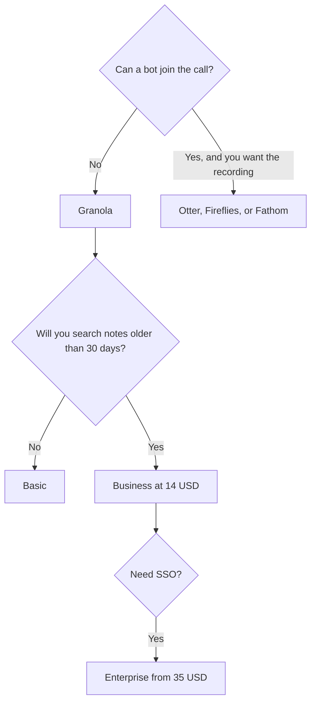

**[Granola](/tools/granola/) transcribes from your computer's audio and rewrites the notes you typed.** No bot joins the call. Basic is free, with AI notes and chat, and only 30 days of note history in the app. Business is $14 per user per month, with unlimited history, manual model choice, and integrations such as Zapier, Notion, Slack, and Attio. Enterprise starts at $35 per user per month, with SSO, admin controls, and policy management.

Prices are US dollars from Granola's pricing page and help center, recorded October 16, 2026. Billing is per workspace: one seat per active member, and every member is on the same plan. Enterprise is the tier that mentions an annual option. We did not score note quality against a human minute-taker.

The field guide is [best AI meeting notetakers](/blog/best-ai-meeting-notetakers/). Free options that do put a bot in the room are in [best free AI note takers](/blog/best-free-ai-note-takers-2026/).

## The cliff is the price

Granola's free plan is usable in a way many "free" AI notetakers are not: there is no daily transcription cap in the materials we checked. The limit is time. After 30 days, that note leaves the app's history. A founder who can remember which call mattered last week can live on Basic. A team that will search "what did we promise this account in March" cannot.

| Plan | Price | History | Integrations | Admin |
|---|---|---|---|---|
| Basic | $0 | 30 days in the app | Slack | Shared plan, private notes by default |
| Business | $14/user/month | Unlimited | Zapier, Notion, Slack, Attio, and the rest of the set Granola lists | Same workspace billing |
| Enterprise | From $35/user/month | Unlimited | Business set, plus admin | SSO, policy management, annual billing option |

The invoice is [Granola pricing explained](/blog/granola-pricing-explained-2026/).

A five-person workspace on Business is 5 × $14 = $70 a month, because empty-looking "viewers" still count if they are active members on the workspace plan. Remove people who should not be seats before you invite the whole company.

## What happens in the meeting

Granola runs on macOS and Windows, and on iPhone, Android, and Apple Watch. The mobile apps are free to use. It works with Zoom, Google Meet, Teams, and other apps because it listens to computer audio rather than joining as a participant. You type rough notes. After the call it combines those notes with the transcript.

That is a different product from a full recording library. Granola does not sell itself as a video archive. If the artifact you need is a clip to send a customer, [Fathom](/tools/fathom/) or [tl;dv](/tools/tl-dv/) match that job more closely. Fathom's free plan includes unlimited recordings.

Before external meetings, Granola can prepare a brief: who is attending, what you discussed last time, and what matters now. Chat works inside one meeting and across meetings. Paid plans let you pick the model. Notes are private by default. Shared folders, templates, and recipes exist on all plans. Free includes Slack. The wider integration list is Business and Enterprise.

You still tell people the conversation is being transcribed. "No bot on the participant list" is a product fact. It is not a substitute for consent. Rules differ by country.

## When the other reviews are the ones to read

| You need | Open this |
|---|---|
| A visible notetaker with a published minute cap | [Otter.ai review](/blog/otter-ai-review-2026/) |
| Dialer calls and AskFred across a team archive | [Fireflies.ai review](/blog/fireflies-ai-review-2026/) |
| Notes that live inside a Notion workspace, on the Business plan | [Notion AI review](/blog/notion-ai-review-2026/) |
| Unlimited free recordings and a bot | [Fathom](/tools/fathom/) |

## Fit score

| Question | Basic | Business $14 | Enterprise from $35 |
|---|---|---|---|
| Transcribe without adding a participant | Yes | Yes | Yes |
| Keep notes past 30 days | No | Yes | Yes |
| Push notes to Notion or Zapier | No | Yes | Yes |
| Choose the model | No | Yes | Yes |
| SSO and admin policy | No | No | Yes |
| Store a video of the call | No | No | No |

This scores the published plan. It does not score how well the enhanced notes match what you would have written.

## A first week

1. Install Granola and connect the calendar.
2. On the next call, type only names, numbers, and objections. Let the transcript carry the sentences.
3. Enhance the note. If it promoted a detail you do not trust, fix it before anyone else sees it.
4. On day 31, look for the first note. If you needed it, Business is the upgrade. If you did not, Basic did its job.
5. For a company workspace, confirm SSO on Enterprise before you put customer calls in a tool the IT team has not approved.

## FAQ

### Is Granola free?

Yes. Basic includes AI notes, chat, and no daily transcription cap in the docs we used. History in the app is 30 days.

### How much does Granola cost?

Business is $14 per user per month. Enterprise starts at $35 per user per month. You pay for each active member of the workspace.

### Does a bot join the meeting?

No. Granola uses device audio. Participants will not see a Fireflies- or Otter-style guest unless you add one.

### Which devices are supported?

macOS, Windows, iOS, Android, and Apple Watch.

## Last verified

October 16, 2026.

**Sources:** [Granola pricing](https://www.granola.ai/pricing), [Subscriptions and billing](https://docs.granola.ai/help-center/managing-your-account/subscriptions-and-billing), [Granola](https://www.granola.ai).

[Granola](/tools/granola/) is in the [meetings directory](/tools/category/meetings-transcription/). Directory pages may use affiliate links. A purchase through them can earn us a commission at no extra cost to you.
