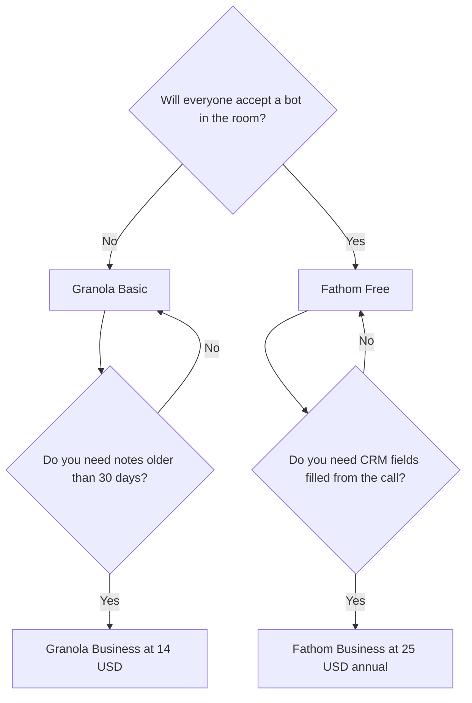

**Choose Granola when a bot in the participant list would change the meeting. Choose Fathom when you want unlimited recordings for free and the other people can be told a bot is there.** Granola transcribes your computer's audio and rewrites notes you typed. Fathom joins Zoom, Google Meet, and Microsoft Teams and sends a summary when the call ends. They are not two prices for the same capture method.

The wider shelf, including [Otter](/tools/otter-ai/) and [Fireflies](/tools/fireflies-ai/), is [best AI meeting notetakers](/blog/best-ai-meeting-notetakers/). The bot-only decision is [Otter vs Fireflies vs Fathom](/blog/otter-vs-fireflies-vs-fathom-2026/). Prices are US list prices excluding tax, last verified October 16, 2026. We did not compare transcript accuracy.

## The split that decides it

| Question | Granola | Fathom |
|---|---|---|
| Does a bot join? | No. It captures computer audio | Yes. It joins as a participant |
| Free plan | Basic: AI notes, chat, Slack, 30 days of history in the app | Unlimited recordings, transcripts, instant summaries, clips, and search |
| First paid individual step | Business, $14/user/month, and every workspace member is on that plan | Premium, $16/month billed annually, or $20 monthly |
| What the paid individual plan adds | Unlimited history, model choice, the rest of the integrations | Advanced summaries and AI action items |
| Team admin | Enterprise from $35/user/month: SSO, admin controls, policy management | Team $15/user/month annual ($19 monthly), 2-user minimum. Business $25 annual ($34 monthly) for CRM field sync and Deal View |
| Where notes start | From the rough notes you type | From the recording, summarized after the call |
| Apps | macOS, Windows, iPhone, Android, Apple Watch | The meeting platforms it joins |

The product pages are [Granola review](/blog/granola-review-2026/) and [Fathom review](/blog/fathom-review-2026/).

## Granola: you still take the notes

Granola's pitch is an enhanced notepad. You jot keywords. It uses the transcript to expand them. Notes are private by default. Shared folders and templates exist on the plans we checked. There is no bot tile for a client to ask about, which is why founders and managers use it on external calls.

The free cliff is history. Basic keeps 30 days in the app. Business at $14 per user per month removes that cliff and adds model choice and the broader integration list, including Zapier, Notion, Slack, and Attio on the review we published from the same sources. Billing is per workspace. Every member is on the same plan. You cannot leave one person on Basic inside a Business workspace. Enterprise, from $35 per user per month, is the SSO and policy tier.

You still have to tell people you are capturing audio. "No bot" is not "no recording." This article is not legal advice.

## Fathom: the bot is the free product

Fathom Free is the rare notetaker plan that documents unlimited recordings. That is the reason to try it before Granola Business or any Otter seat. The cost is social and, in some places, legal: a bot joins, and participants should be told.

Premium at $16 a month on annual billing is a small step if you want the advanced summary and action items and you do not need a team workspace. Team at $15 a user, with a two-person minimum, is the shared folder plan. Business at $25 a user on annual billing is the sales plan: CRM field sync and Deal View. Annual prices are the ones Fathom leads with, and the page says annual saves 25% or more versus monthly. Team plans include a trial and a 90-day guarantee.

A recruiting team that wants to search past interviews is a use case Fathom's own directory page names. The stack around that job is [best AI tools for recruiters](/blog/best-ai-tools-for-recruiters-2026/). A sales team that needs the CRM writeback is in [best AI tools for sales teams](/blog/best-ai-tools-for-sales-teams-2026/).

## Two people, two calendars

**A founder in back-to-back external meetings.** Granola Basic. The bot is the thing those meetings will not tolerate. Upgrade to Business only when a note you needed aged out at 30 days, or when a specific integration is on the paid list.

**A sales rep who already says "this call is recorded."** Fathom Free. Move to Business when the CRM fields are the work, not when the summary feels short. Premium is the stop in between if you are a single user who wants action items and does not need Deal View.

**A manager who wants both.** Use Granola on the calls where a bot would be unwelcome, and Fathom on internal or sales calls where the bot is announced. Two free plans cover that test. Paying for both Business tiers is a later decision, after you see which archive you actually search.

Pushing either archive into a doc tool is optional. [Notion AI](/tools/notion-ai/) is the wiki if the notes should land in Notion. Granola Business lists a Notion integration. Fathom's path into a CRM is the Business plan, not a Notion seat.

## FAQ

### Is Granola or Fathom better for free?

Fathom Free stores unlimited recordings. Granola Basic stores 30 days of history. If you can accept a bot, Fathom's free plan is the larger archive. If you cannot accept a bot, Granola's limit is the one you live with until Business at $14 a user.

### Does Granola work on Zoom?

Yes. It listens to computer audio, so Zoom, Meet, Teams, and other apps on the machine do not need a bot participant. You type during the call. It enhances those notes afterward.

### How much is Fathom Premium versus Granola Business?

Fathom Premium is $16 a month billed annually for one person. Granola Business is $14 per user per month, and the whole workspace moves together. They buy different things: richer Fathom summaries, versus Granola history and integrations without a bot.

### What if I need a live transcript I can read during the call?

That is Otter's documented strength, with a minute cap on the lower plans. It is a bot. See [Otter vs Fireflies vs Fathom](/blog/otter-vs-fireflies-vs-fathom-2026/).

## Last verified

October 16, 2026.

**Sources:** [Granola pricing](https://www.granola.ai/pricing), [Fathom pricing](https://www.fathom.ai/pricing).

[Granola](/tools/granola/) and [Fathom](/tools/fathom/) are in the [meetings directory](/tools/category/meetings-transcription/). Directory pages may use affiliate links. A purchase through them may earn us a commission at no extra cost to you.
