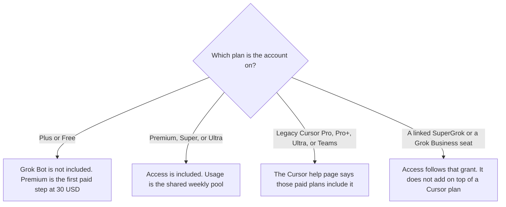

**Grok Bot does not have a separate list price on the docs we read on October 24, 2026. On The X Subscription it is included on Premium, Super, and Ultra. Plus at $8 a month does not include it.** Premium is $30 a month or $300 a year. Super is $100 a month or $1,000 a year. Ultra is $200 a month or $2,000 a year. Those list prices are from docs.x.ai/x-subscription/pricing, last updated October 11, 2026, fetched October 24. The page says prices exclude sales tax.

The chat assistant people confuse with the Bot is [Grok pricing explained](/blog/grok-pricing-explained-2026/). A different always-on agent, inside ChatGPT plans, is [OpenAI Dots pricing explained](/blog/openai-dots-pricing-explained-2026/). The editor seat is [Cursor pricing explained](/blog/cursor-pricing-explained-2026/).

x.ai/bot returned HTTP 403 on October 24. The product behavior below is from docs.x.ai/grok-bot/overview, last updated October 22, 2026, and from cursor.com/help/grok-bot/plans fetched the same day. Published October 24, 2026. We did not run a Bot for this article.

## The list prices, and whether the Bot is included

| Plan | Monthly | Annual, as the page prints it | Grok Bot on that page |
|---|---|---|---|
| Free | $0 | $0 | Not included |
| Plus | $8 | $80 a year ($7 a month) | Not included |
| Premium | $30 | $300 a year ($25 a month) | Included. Usage draws from the shared weekly pool |
| Super | $100 | $1,000 a year ($84 a month) | Included. Larger pool than Premium |
| Ultra | $200 | $2,000 a year ($167 a month) | Included. Larger pool than Super |
| Teams | $30, $100, or $200 per seat | The page lists those seat prices without a separate annual teams column in the section we read | Every paid seat on Premium, Super, or Ultra. Plus is not a team seat |

The pricing page says new self-serve customers choose The X Subscription, and existing [Cursor](/tools/cursor/), SuperGrok, and X Premium plans continue. Switching is optional. Bot usage on The X Subscription draws from the seat's shared weekly pool, which also covers [Grok](/tools/grok/) models across Grok and Cursor. Third-party models in Cursor are not in that included pool, on that page. They use additional-usage credits from the first use.

Team plans are Premium at $30 a seat, Super at $100, and Ultra at $200. The page says each seat includes the same usage as the matching individual tier, and that members of one team can mix tiers. Plus is not available for teams.

## The other doors the help page lists

The Grok Bot overview says access is included with every paid individual Cursor plan and with Cursor Teams, or by linking an individual SuperGrok, SuperGrok Plus, or SuperGrok Heavy subscription, or by signing in with a self-serve Grok Business seat. Usage resets weekly. The Cursor help page fetched the same day adds X Premium+ as a link that grants usage, and says a link does not stack with a Cursor plan. The Bot uses whichever grant is larger. SuperGrok Lite does not include Grok Bot, on that help page.

The October 16 directory card's starting price is $30 a month, which matches Premium. It also says the Bot is not on the $8 Plus plan. That card and the October 24 docs agree on the door that matters for a new X Subscription: Premium and above.

Legacy Cursor prices on the October 16 directory card, for people who have not switched, are Pro at $20, Pro+ at $60, Ultra at $200, Teams Standard at $40 a user, and Teams Premium at $120 a user. The help page says legacy Pro, Pro+, Ultra, and self-serve Teams include the Bot, with different weekly allowances. Enterprise is "ask your account executive," on that page. This article does not invent an Enterprise dollar figure.

**[OpenAI Dots](/tools/openai-dots/)** sit on ChatGPT plans, not on this bill. Do not add a $30 Premium seat and a ChatGPT Pro seat and call the sum a Grok Bot price.

## What not to assume

Do not budget Plus at $8 and expect the Bot. Do not describe annual Premium as $25 and forget the $300 charge. The page prints both: $300 a year, shown as $25 a month. Do not add a SuperGrok link on top of Premium and double the pool. The help page says they do not stack. Do not expect a separate Grok Bot invoice line. The docs we read do not list one.

## FAQ

### How much does Grok Bot cost?

There is no separate price on the October 24 docs. On The X Subscription, Premium at $30 a month, or $300 a year, is the cheapest plan that includes it. Super and Ultra include larger shared weekly pools. Plus does not include it.

### Is it included with Cursor?

On legacy paid Cursor individual plans and legacy self-serve Teams, the October 24 help page says yes. On The X Subscription, it is included on Premium, Super, and Ultra, including team seats at those tiers, and not on Plus or Free. Third-party model usage in Cursor is billed as additional usage, on the pricing page.

### What is the annual discount?

The page prints Plus at $80 a year ($7 a month), Premium at $300 ($25 a month), Super at $1,000 ($84 a month), and Ultra at $2,000 ($167 a month). Those parenthetical monthly figures are the page's, alongside the annual charge.

### Does the free trial make it free?

The help page describes a Grok Bot free trial as a usage credit with a 7-day window as well. It does not print a dollar credit in the section we used. Read the plan screen before a long job. A trial is not the same thing as the Free plan, which does not include the Bot.

## Last verified

October 24, 2026, from docs.x.ai/x-subscription/pricing (page last updated October 11), docs.x.ai/grok-bot/overview (last updated October 22), and cursor.com/help/grok-bot/plans. x.ai/bot returned HTTP 403. The directory card was checked October 16, 2026. Published October 24, 2026.

**Sources:** [X Subscription pricing](https://docs.x.ai/x-subscription/pricing), [Grok Bot on The X Subscription](https://docs.x.ai/x-subscription/grok-bot), [Grok Bot overview](https://docs.x.ai/grok-bot/overview), [Grok Bot plans and billing](https://cursor.com/help/grok-bot/plans).

*Published by Andrew for [AI Tools Optimizer](https://aitoolsoptimizer.com).*

[Grok Bot](/tools/grok-bot/) is in the [automation and agents directory](/tools/category/automation-agents/). Directory pages may use affiliate links. A purchase through them may earn us a commission at no extra cost to you.
