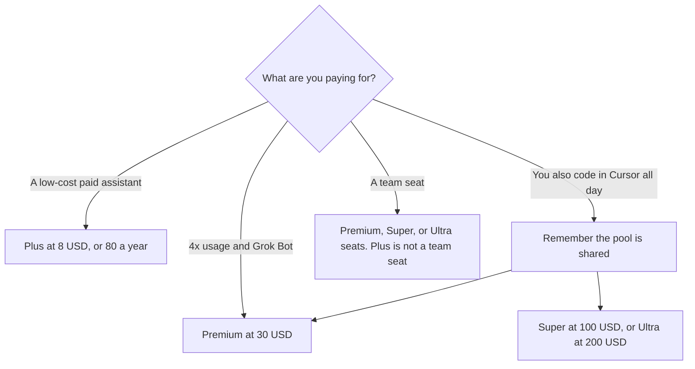

**Grok Plus is $8 a month, or $80 a year. Premium is $30 a month, or $300 a year. Super is $100 a month, or $1,000 a year. Ultra is $200 a month, or $2,000 a year.** Free exists, with limited usage. Those paid plans are The X Subscription, which the directory describes as one subscription across Grok, [Cursor](/tools/cursor/), and X. The usage multiples on the card are 4x on Premium, 15x on Super, and 50x on Ultra, relative to Plus. The multiples are a usage label. They are not a quality score.

The product page is [Grok review](/blog/grok-review-2026/). The editor that draws on the same pool is [Cursor pricing explained](/blog/cursor-pricing-explained-2026/). A general chat seat that is not this bundle is [ChatGPT review](/blog/chatgpt-review-2026/).

Prices are US list prices excluding tax from xAI's X Subscription docs as recorded in the directory on October 16, 2026. A live fetch of that pricing page returned HTTP 401 on October 24, 2026, so this page stays on the directory record. Published October 24, 2026. We did not score answers.

## The plans

| Plan | Monthly | Annual | What the card says about usage |
|---|---|---|---|
| Free | $0 | $0 | Limited |
| Plus | $8 | $80 | Base |
| Premium | $30 | $300 | 4x Plus |
| Super | $100 | $1,000 | 15x Plus |
| Ultra | $200 | $2,000 | 50x Plus |

A year of Plus at the monthly rate is 12 × $8 = $96, against $80 billed annually. The difference is $16. A year of Premium at the monthly rate is 12 × $30 = $360, against $300. The difference is $60. A year of Super is 12 × $100 = $1,200, against $1,000. The difference is $200. A year of Ultra is 12 × $200 = $2,400, against $2,000. The difference is $400. Those are the published pairs. The directory also rounds some annual rates to a monthly equivalent. This page quotes the billed totals, not the rounded month.

## What you are choosing besides the dollar

**Plus** is the inexpensive paid step. Grok Bot is not on Plus. It is on Premium, Super, and Ultra, drawing from the same weekly usage pool, on the directory card.

**The shared pool** covers Grok models across Grok and Cursor. Third-party models inside Cursor use additional credits. The directory does not print that credit price, so this page does not. If you live in Cursor, read [Cursor vs GitHub Copilot for refactors](/blog/cursor-vs-github-copilot-for-refactors-2026/) before you assume Plus is only a chat seat.

**Team seats** are $30, $100, or $200 a month, matching Premium, Super, and Ultra. Plus is not a team seat. The directory does not print a separate annual team discount, so this page does not invent one. Mixed tiers are allowed on the card.

**Top-ups** exist, with spending caps and alerts. The directory does not print a top-up dollar. Use the figure in the cart.

**Existing plans.** The directory says existing Cursor, SuperGrok, and X Premium plans continue unless you change or cancel them, and that switching cancels eligible plans with a prorated refund. Read that sentence before you click a migration. Cursor's own help text says a switch off a legacy Cursor plan is permanent.

[ChatGPT](/tools/chatgpt/) Plus is $20 a month. [Claude](/tools/claude/) Pro is $20 a month, or $17 billed annually. Those seats do not include this X and Cursor bundle. Compare them when you do not want the bundle. Do not compare a $8 Plus seat with a $20 seat as if the products were the same list of apps.

## What not to assume

Do not quote $7 as Plus. $80 a year is the annual price. A rounded monthly equivalent is not the line item. Do not assume Ultra's 50x label means fifty times better answers. Do not put a teammate on a personal Plus login to avoid a $30 seat. The card is per seat for teams. Do not add a Grok API price this directory page does not list.

## FAQ

### Is Grok free?

Yes. The free tier has limited usage. Paid plans through The X Subscription raise usage and add the bundle the card describes, including X Premium benefits when you connect an X account.

### Do I have to buy Cursor separately?

New Grok paid plans are The X Subscription, and the directory says included usage covers Grok models in Cursor. Third-party models in Cursor are extra credits. If you only want Cursor's legacy Pro at $20, that is an existing-subscriber plan, not the new Plus card. Read the Cursor article before you switch.

### What is Grok Bot?

A bot on Premium and above, on the same usage pool. Plus does not include it. If the bot is the reason for the upgrade, the step is Premium at $30, not a larger chat habit on Plus.

### Are the usage multiples a promise I can audit?

They are the labels on the October 16 card: 4x, 15x, and 50x relative to Plus. The directory does not publish a request count under those labels. Judge the plan by the invoice you can see after a week of your own work, and keep the spending cap on before you enable top-ups.

## Last verified

October 16, 2026, from xAI's X Subscription pricing docs as recorded in the directory. Published October 24, 2026. A live fetch returned HTTP 401.

**Sources:** [The X Subscription pricing](https://docs.x.ai/x-subscription/pricing), [Grok](https://grok.com).

*Published by Andrew for [AI Tools Optimizer](https://aitoolsoptimizer.com).*

[Grok](/tools/grok/) is in the [chatbots and assistants directory](/tools/category/chatbots-assistants/). Directory pages may use affiliate links. A purchase through them may earn us a commission at no extra cost to you.
