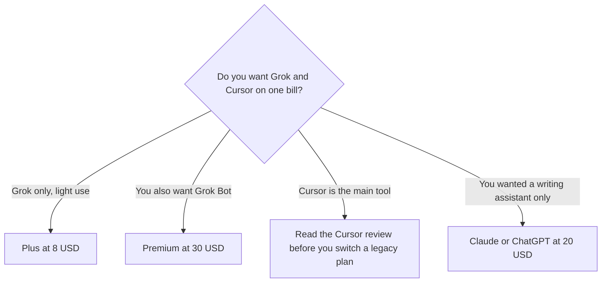

**[Grok](/tools/grok/) is xAI's assistant, on grok.com, in its apps, and inside X.** Paid access for new self-serve customers is The X Subscription, which also covers [Cursor](/tools/cursor/) and X. Plus is $8 a month, or $80 a year. That price is a base usage pool, not a promise of a specific number of answers.

List prices were read from xAI's X Subscription pricing doc on October 24, 2026. The doc was last updated October 11, 2026. Prices exclude sales tax. Where tax applies, it is added at checkout. We did not score Grok against ChatGPT. The subscription map is [which AI subscription is worth paying for](/blog/which-ai-subscription-is-worth-paying-for/).

## The plans

| Plan | Monthly | Annual | Included usage, as published |
|---|---|---|---|
| Free | $0 | $0 | Limited. Includes standard X |
| Plus | $8 | $80 ($7/month) | Base. Does not include Grok Bot |
| Premium | $30 | $300 ($25/month) | 4×. Includes Grok Bot |
| Super | $100 | $1,000 ($84/month) | 15×. Includes Grok Bot |
| Ultra | $200 | $2,000 ($167/month) | 50×. Includes Grok Bot |

The invoice is [Grok pricing explained](/blog/grok-pricing-explained-2026/).

Paid individual plans include X Premium benefits when you connect an X account. The included usage pool covers Grok models in Grok and in Cursor, and Grok Bot on the tiers that include it. Bot usage draws from that seat's weekly pool. It is not a second pool. Third-party models inside Cursor are not included. They spend extra credits from the first use. Top-ups buy more usage, with spending caps available.

Team seats are Premium at $30, Super at $100, and Ultra at $200 per seat. Plus is not a team seat. Members can mix tiers. Existing Cursor, SuperGrok, and X Premium plans continue unless you switch. Switching is optional. xAI says a switch cancels the old plan and refunds unused time on a prorated basis, and that a switch off a legacy plan is the new subscription immediately. App Store billing is the exception the doc calls out: xAI cannot cancel an Apple subscription for you.

## What the subscription is doing

Grok is a general assistant with a live connection to X, plus image and video through Grok Imagine. The reason the price looks low next to a $20 chatbot is that Plus is the base pool, shared if you also use Cursor. A person who lives in Cursor on a non-Grok model will spend credits the $8 sticker does not mention. Read the [Cursor review](/blog/cursor-review-2026/) before you treat Plus as a coding plan. The editor comparison is [Cursor vs Claude Code vs Codex](/blog/cursor-vs-claude-code-vs-codex-2026/).

Grok Bot is on Premium, Super, and Ultra, not on Plus. If the bot is the feature you saw in a demo, Plus is the wrong card.

Free is enough to see the assistant. It is not the team plan, and Plus is not either. A company buys seats at $30 and up.

[ChatGPT](/tools/chatgpt/) and [Claude](/tools/claude/) remain the assistants to compare when the work is a document and you do not want the usage pool tied to Cursor and X. Those reviews are [ChatGPT](/blog/chatgpt-review-2026/) and [Claude](/blog/claude-review-2026/).

## Who should pay

**Stay on Free** if limited use is enough. **Pay for Plus** if you want the base pool and you do not need Grok Bot. Annual is $80, which is $16 less than twelve months at $8. **Pay for Premium** if you want the bot, or if a week of Plus ran out and 4× is the published next step. **Do not buy Super or Ultra from the name.** Buy them when the usage page says the smaller pool is the blocker. **Do not switch a legacy Cursor plan** unless you accept that the move is the new subscription.

## FAQ

### How much is Grok?

New self-serve plans are The X Subscription. Plus is $8 a month or $80 a year. Premium is $30 or $300 a year. Super is $100. Ultra is $200. Tax is extra.

### Does Plus include Cursor?

The subscription covers Grok and Cursor. Included usage is for Grok models. Third-party models in Cursor use additional credits. Plus does not include Grok Bot.

### Can I keep an old SuperGrok or X Premium plan?

Yes, until you change or cancel it. Switching is optional. The pricing doc says eligible monthly and annual plans are cancelled when you switch, with a prorated refund.

## Last verified

October 24, 2026, from xAI's X Subscription pricing doc (last updated October 11, 2026). Usage multiples are not a count of messages. Recheck x.ai/pricing if a checkout disagrees.

**Sources:** [X Subscription pricing](https://docs.x.ai/x-subscription/pricing), [Grok](https://grok.com).

[Grok](/tools/grok/) is in the [chatbots directory](/tools/category/chatbots-assistants/). Directory pages may use affiliate links. A purchase through them may earn us a commission at no extra cost to you.
