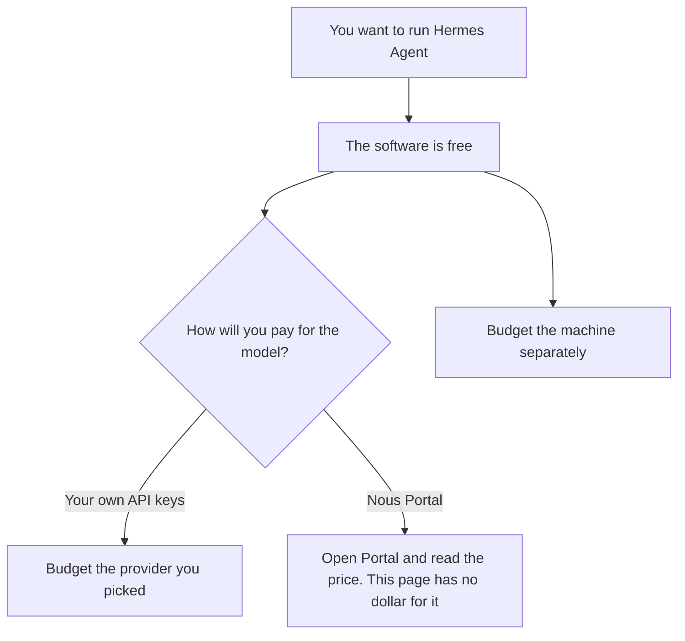

**Hermes Agent, the software, is free and MIT licensed. You still pay the model provider you connect, and you still pay for the machine it runs on.** Nous Portal is the setup the directory calls the easiest, and the directory could not verify a Nous Portal price on an official page. A live fetch of the Hermes quickstart and portal.nousresearch.com on October 24, 2026 returned HTTP 401. This page does not invent a subscription dollar.

The product page is [Hermes Agent](/tools/hermes-agent/). Another free agent with the same shape of bill, software at $0 and a model you bring, is [OpenClaw](/tools/openclaw/). A coding seat with a published price is [Cursor pricing explained](/blog/cursor-pricing-explained-2026/). The place a tool is allowed to run is [what an AI tool sandbox is](/blog/what-is-ai-tool-sandbox-2026/).

The directory was checked October 16, 2026. Published October 24, 2026. We did not score agents. Nous Research's claim, recorded on that page, that the agent can run on a $5 VPS is their claim about hosting. It is not a price this site sells, and it is not a quote from a VPS vendor we checked.

## What you pay, and what you do not

| Item | Dollar this page will print | Why |
|---|---|---|
| Hermes Agent software | $0 | MIT license, on the October 16 directory record |
| Nous Portal subscription | Not verified | The official pricing page was not accessible on October 16, and the October 24 fetch returned HTTP 401 |
| The model | The provider's bill | API keys, or whatever Portal bills, are not a number Hermes publishes as the software price |
| The machine | Your host's bill | Local, Docker, a VPS, or a serverless account you already pay for |

The directory says the quickstart recommends Nous Portal: an OAuth login, a model, and Tool Gateway tools, billed to that subscription. Until you can read portal.nousresearch.com, the honest line in a budget is "Portal price unknown," next to a model line you can read from the provider you would use instead.

OpenClaw's directory record is the same shape: free MIT software, no hosted tier, model usage billed by the provider you connect. Pick Hermes or OpenClaw for the product behavior, not because one of them has a secret cheaper model. Neither directory page prints the model bill.

## What a priced seat looks like instead

**[Claude](/tools/claude/) Pro** is $20 a month, or $17 billed annually, and the directory says Claude Code is included. That is a published seat. It is not Hermes. If you wanted a terminal agent and a price you can put on a slide without an asterisk, read [Claude review](/blog/claude-review-2026/) and price Pro. Max starts at $100 a month.

**[Cursor](/tools/cursor/) Plus** is $8 a month, or $80 a year, when the work is a repository you review. Hermes can touch a repo, on the directory's use cases. Cursor is the editor with a sticker. Do not add both on day one and call the sum "the agent budget" without saying which one is allowed to merge.

**Zapier Professional** is $19.99 a month billed annually when the job is a no-code workflow between apps you already use. The invoice is [Zapier pricing explained](/blog/zapier-pricing-explained-2026/). Hermes is a self-hosted agent. Zapier is a workflow product. The directory lists both as alternatives for different readers.

## What not to assume

Do not write Hermes down as $0 in a budget that will also call a frontier model. The software line is $0. The model line is not. Do not copy a $5 VPS into a finance sheet as if this site verified it. Do not assume Portal is free because the software is free. Do not skip the sandbox article and then give the agent a production token because the README made install look short.

## FAQ

### Is Hermes Agent free?

The software is free and MIT licensed, on the October 16 directory record. The model is not free unless the provider you choose is giving you a free tier, and that tier is the provider's terms. Hosting is yours.

### How much is Nous Portal?

This page does not know. The directory said the official pricing page was not accessible. The October 24 fetch returned HTTP 401. Read the price inside the account before you subscribe. If you cannot read it, use your own API keys and price that provider.

### How is this different from OpenClaw?

Both are free software with a separate model bill, on their directory pages. Hermes is Nous Research's agent, with the learning-loop claims on that page. OpenClaw's directory page says it offers no hosted tier. Compare the products on behavior and operations. Do not compare them on a Portal price nobody published here.

### Does the MIT license cap my model spend?

No. The license is about the software. A loop that calls a model all night will bill the provider. Put a budget on the provider key. The related control, for a different meter, is [what an AI request budget is](/blog/what-is-ai-request-budget-2026/).

## Last verified

October 16, 2026, from the Hermes Agent directory page, which cites the GitHub repository and the official quickstart. A live fetch of the quickstart and portal.nousresearch.com on October 24, 2026 returned HTTP 401. Published October 24, 2026.

**Sources:** [Hermes Agent](https://hermes-agent.nousresearch.com/docs/getting-started/quickstart), [NousResearch/hermes-agent](https://github.com/NousResearch/hermes-agent).

*Published by Andrew for [AI Tools Optimizer](https://aitoolsoptimizer.com).*

[Hermes Agent](/tools/hermes-agent/) is in the [automation and agents directory](/tools/category/automation-agents/). Directory pages may use affiliate links. A purchase through them may earn us a commission at no extra cost to you.
