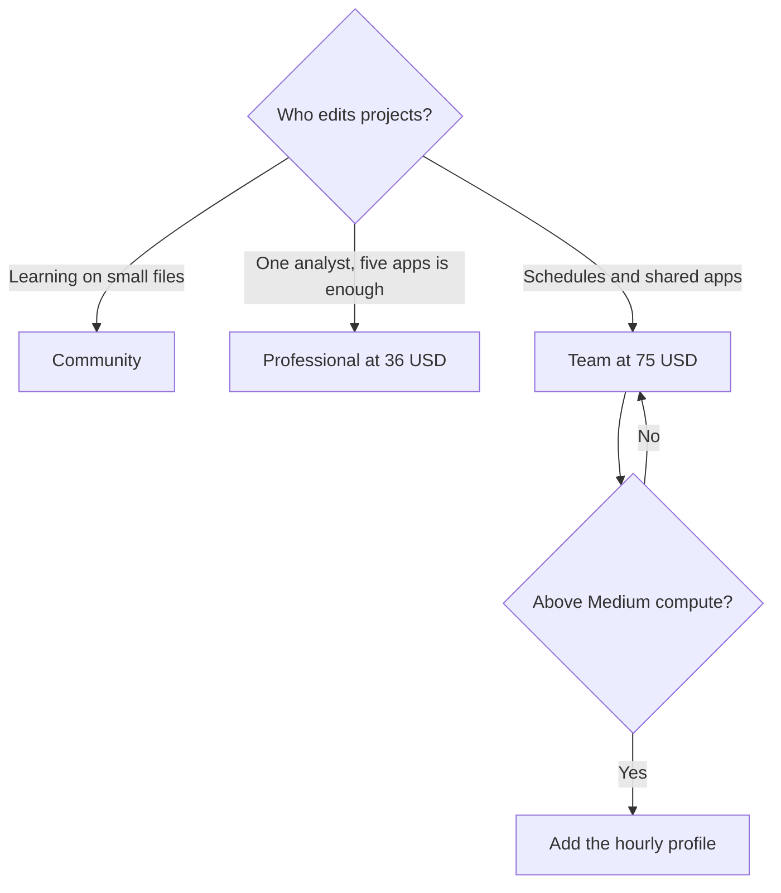

**Hex pricing is Community at $0, Professional at $36 per editor per month, and Team at $75 per editor per month.** Enterprise is custom. Medium compute is included on paid plans. Larger profiles are pay-as-you-go, billed per minute, with an hourly rate printed on the page. AI credits are a third line: paid plans include a monthly grant per seat, and that grant does not roll over.

Those figures are USD from [Hex's pricing page](https://hex.tech/pricing/), read October 24, 2026. Team has a 14-day trial with no card, described in the FAQ. The page also links a 30-day Team signup. Use the trial you actually start. The product story is [Hex review](/blog/hex-review-2026/). We did not benchmark a notebook.

## The seats

| Plan | Price | What the card emphasizes |
|---|---|---|
| Community | $0 | Agent trial, any data source, all cell types, small compute |
| Professional | $36 per editor per month | Hex agent, standard credits, up to 5 published apps, 30-day version history, medium compute |
| Team | $75 per editor per month | Extended credits, unlimited published apps, scheduled runs, alerts, shared components, advanced compute add-on |
| Enterprise | Custom | Explorer seats, audit logs, SSO, premium credits, HIPAA and single-tenant add-ons |

Three Professional editors are $108 a month, $1,296 a year, with Medium included. Three Team editors are $225 a month, $2,700 a year, before any Large profile. Upgrades and downgrades apply immediately, with a charge or credit for the rest of the cycle. Cancel from Settings, then Manage Plan. Access continues until the period ends. If a Team trial ends and you do nothing, Hex says you drop to Community.

Students and educators can request Professional for free through support@hex.tech. Qualified nonprofits can ask about a discount. Those are applications, not a code on the card.

## Compute, in hours

The page prints an hourly equivalent and bills per minute. Free trials are limited to Medium.

| Profile | Memory | Price per hour |
|---|---|---|
| Extra small, Small, Medium | 2 GB, 4 GB, 8 GB | Free |
| Large | 16 GB | $0.32 |
| Extra large | 32 GB | $0.65 |
| 2XL | 64 GB | $1.29 |
| 4XL | 128 GB | $2.58 |
| L4 GPU | 27 GB | $2.93 |
| A10G GPU | 27 GB | $4.06 |

Large for one 40-hour week is about $12.80 at $0.32 an hour. Ten hours on an A10G is $40.60. A forgotten kernel is a real bill because the meter is time, not a seat. "Hex is $36" leaves this line out.

Credits are separate. Hex says AI features consume credits based on the effort of the task. There is no "one credit equals one question" rate on the pricing page. A short chart and a long agent run are different debits. Add-on credits are optional. Enterprise grants are whatever the order form says.

## Hex next to a spreadsheet chat

[Julius](/tools/julius-ai/) Plus is $20 a month, or $16 billed annually, for a question about a file, on the ops roundup's October 16 directory figure. Hex assumes a warehouse, a notebook, and a published app. If the job is a recurring spreadsheet, start with [best AI for Excel and Google Sheets](/blog/best-ai-for-excel-and-google-sheets-2026/) before you put an editor on a $75 seat.

[ChatGPT](/tools/chatgpt/) Plus at $20 can draft SQL. It does not publish the Hex app or attach the compute profile. [Notion AI](/tools/notion-ai/) can hold the writeup after the chart exists. Business is $20 per seat per month on the October 16 card. The semantic definitions stay in Hex if that is where the team governed them. A knowledge-graph shaped question about entities is a different store: [what a knowledge graph is](/blog/what-is-a-knowledge-graph-in-ai-2026/).

RevOps teams who need the warehouse number in a weekly review, and Clay for the list, can read [best AI tools for RevOps](/blog/best-ai-tools-for-revops-2026/). An Explorer seat exists as an enterprise add-on for people who should view more than they edit. Buying Team for every manager because they wanted a password is how the invoice grows.

## FAQ

### How much does Hex cost?

Community is free. Professional is $36 per editor per month. Team is $75 per editor per month. Enterprise is custom. Checked October 24, 2026.

### Is compute included?

Extra small, Small, and Medium are free. Medium is included on paid plans. Large and above, including GPUs, are billed per minute at the hourly rates in the table.

### Do AI credits roll over?

Professional and Team grants refresh monthly and do not roll over. You can buy add-on credits.

### Is there a free trial of Team?

The FAQ says 14 days, no card. The pricing page also links a 30-day Team signup. Start one of them, and do not assume both clocks apply.

## Last verified

October 24, 2026, from hex.tech/pricing. Julius, ChatGPT, and Notion comparison prices are from directory pages checked October 16, 2026. Published October 24, 2026.

**Sources:** [Hex pricing](https://hex.tech/pricing/).

*Published by Andrew for [AI Tools Optimizer](https://aitoolsoptimizer.com).*

[Hex](/tools/hex/) is in the [data and analytics directory](/tools/category/data-analytics/). Directory pages may use affiliate links. A purchase through them may earn us a commission at no extra cost to you.
