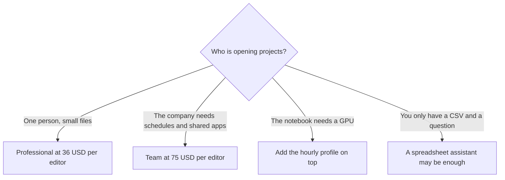

**[Hex](/tools/hex/) is a collaborative analytics workspace: notebooks, an agent, published data apps, and a semantic layer for people who already have a warehouse.** The seat price is public. On October 24, 2026 Hex's pricing page listed Community at **$0**, Professional at **$36 per editor per month**, and Team at **$75 per editor per month**. Enterprise is custom. The number that changes a finance review is not $36. It is the compute profile you turn on after Medium.

We did not benchmark Hex against a notebook you already run, and we did not time a dashboard. The prices below are the ones printed on hex.tech/pricing that day, including the structured offer data on the page.

## The seats

| Plan | Price | What the card emphasizes |
|---|---|---|
| Community | $0 | Agent trial, any data source, all cell types, small compute |
| Professional | $36 per editor / month | Hex agent, standard credits, up to 5 published apps, 30-day version history, medium compute |
| Team | $75 per editor / month | Extended credits, unlimited published apps, scheduled runs and alerts, shared components, 14-day trial with no card |
| Enterprise | Custom | Explorer seats, audit logs, SSO, premium credits, HIPAA and single-tenant add-ons |

The seat card is [Hex pricing explained](/blog/hex-pricing-explained-2026/).

Medium compute is included on paid plans. Larger profiles are pay-as-you-go, billed per minute, and the page prints an hourly equivalent:

| Compute profile | Memory | CPU | Price per hour |
|---|---|---|---|
| Extra small | 2 GB | 0.25 | Free |
| Small | 4 GB | 0.5 | Free |
| Medium | 8 GB | 1 | Free |
| Large | 16 GB | 2 | $0.32 |
| Extra large | 32 GB | 4 | $0.65 |
| 2XL | 64 GB | 8 | $1.29 |
| 4XL | 128 GB | 16 | $2.58 |
| A10G GPU | 27 GB | 6 | $4.06 |
| L4 GPU | 27 GB | 6 | $2.93 |

Free trials are limited to Medium. A Team trial that never touches Large will not show you the compute line. That is fine for a product test and incomplete for a budget.

## Credits are a third line

Hex says AI features consume credits based on the effort of the task. Paid plans include a grant. Professional and Team grants are monthly, per seat, and do not roll over. Add-on credits are optional. Enterprise grants are whatever the order form says. There is no "one credit equals one question" rate on the pricing page. A short chart and a long agent run are not the same debit. If you are comparing Hex with a chat subscription, compare the credit grant with that chat's usage cap, not the seat price with a $20 consumer plan.

Students and educators can request Professional for free through support@hex.tech. Qualified nonprofits can ask about a discount. Those are application programs, not a code on the pricing card.

## What to use it for

Hex is for a data team that wants the analysis and the published app in one project. A notebook cell, a chart, and a link a stakeholder can open are the workflow the product describes. The agent is there to draft and edit that work. Community is the hobby path: small compute, an agent trial, and a way to show a project. Professional is the individual path: five published apps, a month of version history, and Medium included. Team is the company path: unlimited apps, scheduled runs, alerts, shared components, and the advanced compute add-on.

An Explorer seat exists as an enterprise add-on for people who should view more than they should edit. If your cost model is "every manager needs a login," ask whether those logins are editors at $75 or viewers on a different line. Buying Team for a room of editors because the viewers also wanted a password is how this invoice grows.

[Julius AI](/tools/julius-ai/) is the directory's other analysis workspace, aimed at uploading a file and asking a question. Hex assumes you are closer to a warehouse, a dbt project, or a shared semantic model. [Notion AI](/tools/notion-ai/) can sit on the writeup after the chart exists. [ChatGPT](/tools/chatgpt/) can draft SQL. None of those is a substitute for Hex's published app and the compute profile attached to it. If the job is a recurring spreadsheet rather than a warehouse, start with [best AI for Excel and Google Sheets](/blog/best-ai-for-excel-and-google-sheets-2026/) before you put an editor on a $75 seat.

## A year of editors, as arithmetic

Three Professional editors are $108 a month, **$1,296 a year**, with Medium included and no GPU. Three Team editors are $225 a month, **$2,700 a year**, before a Large profile. Large at $0.32 an hour is about **$23** if one project runs Large for one work week of compute (40 hours × $0.32). A GPU at $4.06 an hour is a different conversation: ten hours is $40.60, and a forgotten kernel is a real bill. Hex bills that usage per minute. The hourly figure is the page's own unit so you can estimate.

This is why "Hex is $36" is an incomplete sentence. It is $36 per editor, plus credits if the grant runs out, plus compute above Medium. The same discipline is in [which AI subscription is worth paying for](/blog/which-ai-subscription-is-worth-paying-for/): name the meter, then buy the meter.

## Who should pay

**Use Community** for a class project or a public notebook on small compute. **Pay for Professional** when you are the only editor and five published apps are enough. **Pay for Team** when scheduled runs, shared components, and more than a trial of the agent are the requirement. The 14-day Team trial does not need a card. **Talk to sales** for SSO, audit logs, HIPAA, or a single tenant. **Do not buy Hex** to avoid learning where the data lives. The agent still queries what you connect.

Cancel from Settings, then Manage Plan, if you are on Professional or Team. Hex says you keep the paid plan until the period ends. Upgrades and downgrades apply immediately, with a charge or credit for the rest of the cycle.

## FAQ

### How much does Hex cost?

Community is free. Professional is $36 per editor per month. Team is $75 per editor per month. Enterprise is custom. Those figures were on the pricing page on October 24, 2026.

### Is compute included?

Extra small, Small, and Medium are priced at $0 on the compute table. Large starts at $0.32 an hour. GPUs are listed at $2.93 and $4.06 an hour. Paid plans include Medium.

### Do AI credits roll over?

Hex says Professional and Team credit grants refresh monthly and do not roll over. You can buy add-on credits.

### Is there a free trial?

Team can be tried for 14 days with no payment card. If you do nothing at the end, the workspace drops to Community. Trials are limited to Medium compute.

### Can a student get Professional free?

Hex says students and educators at universities and bootcamps can. The path is an email to support, not a self-serve toggle. Confirm you still qualify before a semester starts.

## Last verified

October 24, 2026, from Hex's pricing page. Credit grant sizes are described as standard, extended, and premium rather than as a single public integer on the cards we read. Ask for the grant size in writing if a purchase depends on it.

**Sources:** [Hex pricing](https://hex.tech/pricing/), [Hex](https://hex.tech).

[Hex](/tools/hex/) is in the [data and analytics directory](/tools/category/data-analytics/). Directory pages may use affiliate links. A purchase through them may earn us a commission at no extra cost to you.
