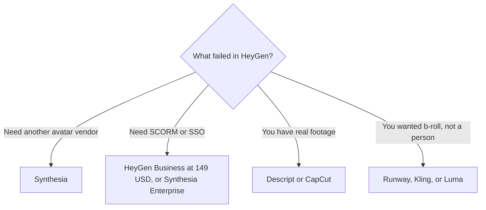

**The direct HeyGen alternative is Synthesia, if you still need a presenter on camera without a shoot. Everything else on this page is a different job: generated b-roll, an edit of footage you filmed, or a voice with no face.** Switching to Runway because HeyGen's credit receipt was annoying will not give you an avatar plan. It will give you a second meter.

HeyGen's own bill is [HeyGen pricing explained](/blog/heygen-pricing-explained-2026/). The head-to-head with the other avatar product is [HeyGen vs Synthesia](/blog/heygen-vs-synthesia-2026/). Training modules are [Synthesia vs HeyGen for training](/blog/synthesia-vs-heygen-for-training-2026/). The wider shelf is [best AI video generators](/blog/best-ai-video-generators-2026/).

Prices are US list prices excluding tax from directory pages checked October 16, 2026. A refetch of vendor pricing pages for this article returned 401, so nothing below is a new scrape. Published October 24, 2026. We did not score likeness or lip sync.

## The job, then the tool

| The job | Start here | First price that matters | Not this |
|---|---|---|---|
| A talking presenter, another vendor | [Synthesia](/tools/synthesia/) | Starter $29/month billed monthly, shown as $19 with yearly billing, 1,250 credits | A text-to-video model |
| Stay on HeyGen and change the tier | [HeyGen](/tools/heygen/) | Creator $29 for 600 credits and 1080p. Business $149 if you need SCORM | Assuming Pro at $49 adds SCORM. SCORM is on Business |
| Footage you already filmed | [Descript](/tools/descript/) | Hobbyist $16/person/month billed annually | An avatar of someone who did not record |
| A voice, no face | [ElevenLabs](/tools/elevenlabs/) | Starter $6/month | A video export |
| Generated shots, not a presenter | [Runway](/tools/runway/), [Kling AI](/tools/kling-ai/), or [Luma AI](/tools/luma-ai/) | Runway Standard $12/month billed annually. Luma Plus $30 | Calling any of them a HeyGen replacement |
| Captions and a cut | [CapCut](/tools/capcut/) | Pro $19.99/month, or $179.99/year | A training avatar |

## Synthesia is the actual alternative

[Synthesia](/tools/synthesia/) Basic is free, watermarked, with 500 credits and about 10 minutes of video. Starter is $29 billed monthly, shown as $19 on yearly billing, with 1,250 credits, downloads, and logo removal. Pro is $89 billed monthly for 6,000 credits, with higher credit tiers up to $676 a month on the recorded card. The invoice is [Synthesia pricing explained](/blog/synthesia-pricing-explained-2026/).

Read the gate before you switch to save money. On the Synthesia page recorded October 16, one-click translation, Brand Kits, SAML/SSO, unlimited video minutes, and SCORM sit on Enterprise. HeyGen puts SSO, SCORM, and LMS integrations on Business at $149 a month, with extra seats at $20. A team that needs SCORM can be cheaper on HeyGen Business than on a Synthesia contract you have not seen. Get the Enterprise number before you call Synthesia the bargain.

Creator-tier avatar work on HeyGen is $29, the same monthly list as Synthesia Starter. The difference at that price is the credit definition and the minute cap, not a winner. HeyGen Creator allows videos up to 30 minutes and lists 600 credits. This directory does not reprint a single HeyGen credits-per-minute rate. Synthesia's recorded sketch is about 100 credits a video minute after the included time. Measure one real module on each trial. Do not convert those two credit names into each other.

Consent is the same on both. The steps for a likeness you are allowed to use are [how to create AI avatars with HeyGen](/blog/how-to-create-ai-avatars-with-heygen-2026/). An avatar of a coworker who did not agree is not an alternative. It is a reason to stop.

## Tools people book instead, and should not

**Generated video.** [Runway](/tools/runway/) Standard is $12 a month billed annually for 625 credits, or $15 month to month. [Kling AI](/tools/kling-ai/) Standard renews at $8.80 after a $6.99 first month, for 660 credits, on the October 16 card. [Luma AI](/tools/luma-ai/) Plus is $30 a month or $300 a year for 10,000 credits, and the pricing page we read has no free plan. [Pika](/tools/pika/) Starter is $10 for 900 credits, and the commercial license starts at Creator for $35. These are shot tools. The map is [Runway vs Kling vs Veo](/blog/runway-vs-kling-vs-veo-2026/). Luma's arithmetic is [Luma AI pricing explained](/blog/luma-ai-pricing-explained-2026/).

**An editor.** [Descript](/tools/descript/) is for media you recorded. Hobbyist is $16 per person billed annually. The card is [Descript pricing explained](/blog/descript-pricing-explained-2026/). [CapCut](/tools/capcut/) Pro is the template-and-captions seat. [invideo AI](/tools/invideo-ai/) Starter is $20 a seat monthly or $10 billed annually. None of them is an avatar studio.

**A voice.** [ElevenLabs](/tools/elevenlabs/) Starter at $6 is narration. Pair it with footage. It does not become HeyGen. The bill is [ElevenLabs pricing explained](/blog/elevenlabs-pricing-explained-2026/).

## FAQ

### What is the closest HeyGen alternative?

Synthesia. Compare Starter with HeyGen Creator on one script you already use. If the requirement is SCORM, compare HeyGen Business at $149 with Synthesia Enterprise, not with Starter.

### Is Runway a HeyGen alternative?

Only if you stopped needing a presenter. Runway generates shots. It does not replace an avatar plan. Keep HeyGen or Synthesia for the person on camera, and add a generator only for b-roll you can name.

### Which HeyGen plan should I leave before I switch?

Leave Free, which is three one-minute videos, if you are publishing. Leave Creator for Pro only if you need 4K or the 600-credit month is short. Leave the product entirely when the vendor, not the tier, is the problem. Pro at $49 does not add SCORM.

### Are there free alternatives?

Synthesia Basic is free and watermarked. HeyGen Free is three one-minute videos. Descript Free includes 60 media minutes. A watermarked test is a test. It is not a training library.

## Last verified

October 16, 2026 for HeyGen, Synthesia, Runway, Kling, Descript, ElevenLabs, CapCut, invideo, and Pika list prices. Luma's $30 Plus price matches the October 24 review as well. Published October 24, 2026.

**Sources:** [HeyGen pricing](https://www.heygen.com/pricing), [Synthesia pricing](https://www.synthesia.io/pricing), [Runway pricing](https://runwayml.com/pricing).

*Published by Andrew for [AI Tools Optimizer](https://aitoolsoptimizer.com).*

[HeyGen](/tools/heygen/) and [Synthesia](/tools/synthesia/) are in the [video directory](/tools/category/video/). Directory pages may use affiliate links. A purchase through them may earn us a commission at no extra cost to you.
