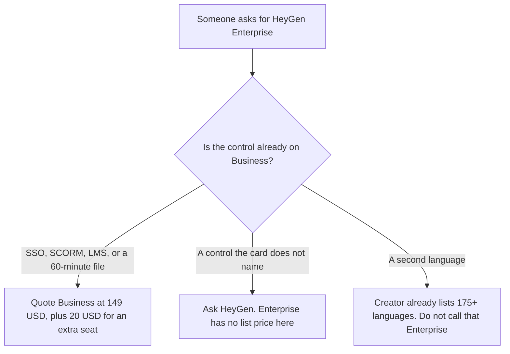

**HeyGen Enterprise is custom.** The October 16, 2026 directory card lists custom credits and "advanced security and support." It does not list a dollar, a credit total, or a seat price. Business, the published tier under it, is $149 a month for 1,500 credits, videos up to 60 minutes, SSO, SCORM, LMS integrations, and interactive video, with extra seats at $20 a month. The full ladder, from Free through Business, is [HeyGen pricing explained](/blog/heygen-pricing-explained-2026/). This page is the Enterprise line, and what not to invent when a security review asks for it.

SSO is on Business, on that card. A buyer who needs SSO does not automatically need Enterprise. Ask HeyGen which controls sit only on the custom contract. Do not copy another vendor's Enterprise list onto this one.

The product page is [HeyGen review](/blog/heygen-review-2026/). Synthesia's custom tier is [Synthesia pricing explained](/blog/synthesia-pricing-explained-2026/). The customer-webinar cut is [HeyGen vs Synthesia for customer webinars](/blog/heygen-vs-synthesia-for-customer-webinars-2026/).

Prices that do exist below are US monthly list prices excluding tax, from the directory card checked October 16, 2026. Yearly billing is offered on HeyGen. The card we used does not print an Enterprise yearly dollar, so this page does not invent one. Published October 24, 2026. We did not score avatars. We did not receive an Enterprise quote.

## What the card actually separates

| Plan | Price recorded | Credits recorded | What you may quote |
|---|---|---|---|
| Business | $149 a month | 1,500 | 60-minute videos, 5 custom video avatars, SSO, SCORM, LMS, interactive video. Extra seats $20 a month |
| Enterprise | Custom | Custom | Advanced security and support. No dollar. No credit total |
| Creator, for contrast | $29 a month | 600 | 30-minute videos, 1080p, no watermark, voice cloning, 175+ languages and dialects. Not an Enterprise feature |

Five custom video avatars are on Business. Unlimited photo avatars are on paid plans, on the card. Creator removes the watermark. Pro at $49 adds 4K and 1,000 credits. None of those are Enterprise. Multiplying $149 by a headcount does not produce an Enterprise price. An extra Business seat is $20. Ten extra seats are 10 times $20, which is $200 a month, on top of the $149 workspace if that is how your contract counts the first seat. Confirm the seat math on the quote. The $20 figure is the card's extra-seat price. It is not an Enterprise discount.

HeyGen's summary does not publish one universal minutes-per-credit rate. Budget Business credits from a receipt, as the base pricing article says. Enterprise credits are custom. A receipt from Creator does not predict them.

## What a neighboring Enterprise row does, and does not, tell you

**HeyGen's published admin tier.** [HeyGen](/tools/heygen/) Business is the self-serve number for SCORM, SSO, and LMS. If the security review can be answered with those words, quote $149 and the $20 seat. The likeness steps are [how to create AI avatars with HeyGen](/blog/how-to-create-ai-avatars-with-heygen-2026/). Consent is not a plan feature.

**Synthesia's custom tier.** [Synthesia](/tools/synthesia/) Enterprise is also custom. That card names unlimited video minutes, 1-click translation into 140+ languages, SAML/SSO, Brand Kits, and SCORM export. SCORM on Synthesia is an Enterprise line. SCORM on HeyGen is a Business line. Do not swap those sentences. Starter is $29 a month billed monthly. The invoice is [Synthesia pricing explained](/blog/synthesia-pricing-explained-2026/).

**A filmed edit, which is not an avatar contract.** [Descript](/tools/descript/) is the tool when you are cutting footage you already shot. This page does not restate a Descript dollar. An Enterprise avatar quote does not edit the camera you used.

**The script the avatar may speak.** [Notion AI](/tools/notion-ai/) Business is $20 a seat a month on the October 16 card. The page holds the approved script. It is not a HeyGen seat. The invoice is [Notion AI pricing explained](/blog/notion-ai-pricing-explained-2026/).

## What not to assume

Do not print an Enterprise price. Do not say SSO requires Enterprise. Do not say 175 languages require Enterprise. Creator lists them. Do not treat "advanced security and support" as a named control such as SCIM, a data-processing addendum, or a region pin. If the review needs those words, they have to come from HeyGen's quote or trust page, dated, not from this article. Do not convert a non-USD checkout into the $149.

## FAQ

### How much is HeyGen Enterprise?

The October 16 card says custom. There is no seat price and no credit total on that card. Business at $149 a month is the last published dollar. If a reseller offers a number, that quote is the price, and this page will not round it into a list.

### Does Enterprise include SSO?

SSO is already listed on Business. Enterprise says advanced security and support. A company that needs SSO, SCORM, and a 60-minute video can quote Business without a sales call, on this card. A company that needs a control Business does not name has to ask what the custom contract adds.

### What is the $20 seat?

The card says extra seats are $20 a month on Business. That is not an Enterprise seat price. It does not become Enterprise because you add many of them. Confirm whether the $149 includes the first seat before you multiply.

### Does this page replace the main HeyGen pricing article?

No. That article is Free, Creator, Pro, Business, and how to read credits without a per-minute rate. This article is the Enterprise name: what Business already includes, and what not to invent when the form says Enterprise.

## Last verified

October 16, 2026, from the directory card, matching the October 24 base pricing article's monthly list. Published October 24, 2026. Enterprise remains custom.

**Sources:** [HeyGen pricing](https://www.heygen.com/pricing), [HeyGen](https://www.heygen.com).

*Published by Andrew for [AI Tools Optimizer](https://aitoolsoptimizer.com).*

[HeyGen](/tools/heygen/) is in the [video directory](/tools/category/video/). Directory pages may use affiliate links. A purchase through them may earn us a commission at no extra cost to you.
