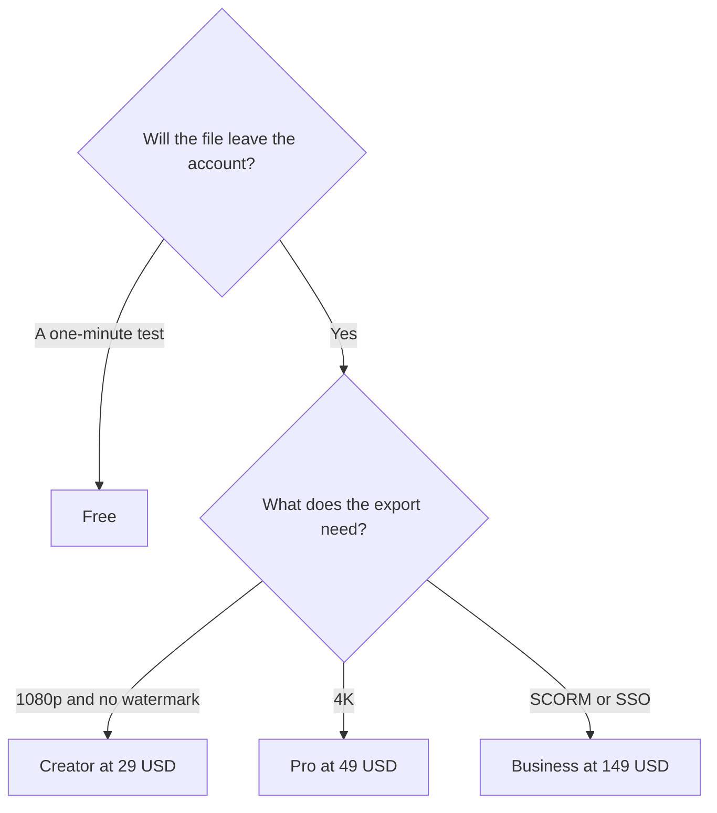

**HeyGen pricing is a video cap and a credit allowance, then a resolution and an admin tier.** Free is 3 videos a month, up to 1 minute each. Creator is $29 a month for 600 credits, videos up to 30 minutes, 1080p, watermark removal, and voice cloning. Pro is $49 a month for 1,000 credits and 4K. Business is $149 a month for 1,500 credits, videos up to 60 minutes, SSO, SCORM, and LMS integrations.

Prices are US monthly list prices excluding tax, from HeyGen's pricing page as recorded October 16, 2026. Yearly billing is offered. This explainer is published October 24, 2026. HeyGen's summary does not publish one universal minutes-per-credit rate, so this article treats credits as an allowance and minute caps as maximum video length. The review is [HeyGen review](/blog/heygen-review-2026/). Synthesia's bill is [Synthesia pricing explained](/blog/synthesia-pricing-explained-2026/). The comparison is [HeyGen vs Synthesia](/blog/heygen-vs-synthesia-2026/).

## The ladder

| Plan | Monthly list | Credits | The gate |
|---|---|---|---|
| Free | $0 | Covered by the 3-video cap | 3 videos, 1 minute each, Avatar IV, 1 custom video avatar, 30+ languages |
| Creator | $29 | 600 | 30-minute videos, 1080p, no watermark, voice cloning, 175+ languages and dialects. Credit rollover is listed on yearly billing |
| Pro | $49 | 1,000 | 4K, faster processing, advanced models |
| Business | $149 | 1,500 | 60-minute videos, 5 custom video avatars, SSO, SCORM, LMS, interactive video. Extra seats $20/month |
| Enterprise | Custom | Custom | Security and support beyond the published Business tier |

Stock avatars on Free are part of the 3-video test. Paid plans add unlimited photo avatars. Business includes 5 custom video avatars. Count the likenesses you have consent to use before you count seats. The steps are [how to create AI avatars with HeyGen](/blog/how-to-create-ai-avatars-with-heygen-2026/).

## How to read the credits without a per-minute rate

HeyGen publishes credit totals and maximum video length. It does not, on the summary we used, publish a single "one minute costs N credits" number we should reprint. Budget like this:

1. Stay inside the minute cap for the plan. Creator stops at 30 minutes per video. Business stops at 60. Free stops at 1.
2. Produce one real video on Creator and read the credit receipt.
3. Divide that receipt into the 600-credit month. That quotient is your volume, for that length and those features.
4. Move to Pro when the receipt says 600 is short, or when the export must be 4K. Pro is $20 more and 400 more credits. It is not automatically a better avatar.
5. Move to Business when the buyer asked for SCORM, SSO, or a 60-minute file. Those are the features that justify $149. Extra seats are $20 a month each. A second creator is not a second $149 unless they need their own workspace.

Yearly billing can change the effective monthly price and, on Creator, is where credit rollover was listed. Read the yearly toggle in the account. This table keeps the monthly list.

## Four buyers

**A marketer testing a 45-second product clip.** Free. If the avatar is wrong for the brand, you have spent a video slot, not $29.

**A solo creator shipping 1080p explainers.** Creator at $29. Voice cloning and 175+ languages are on this plan, not held for Enterprise. That is the contrast with Synthesia, where 1-click translation into 140+ languages was an Enterprise line.

**A creator whose client asked for 4K.** Pro at $49. Confirm the credit receipt still fits in 1,000. 4K is the feature. The extra 400 credits are the allowance.

**A training team that must hand a package to an LMS.** Business at $149, because SCORM and LMS integrations have a published price. Synthesia lists SCORM on Enterprise, which is custom. If you also need Synthesia's Brand Kits and unlimited minutes in one contract, get that quote too. The $149 is the self-serve number.

## Mistakes that change the bill

- **Paying for Pro to remove a watermark.** Creator removes it.
- **Assuming a credit is a minute.** We do not have that rate from HeyGen. Use a receipt.
- **Buying Business for a second language.** Creator already lists 175+ languages and dialects. Business is admin, length, and learning-system export.
- **Cloning a voice or a face you do not have consent to use.** The plan that unlocks cloning does not grant the likeness.
- **Editing a filmed interview in HeyGen.** That is [Descript](/tools/descript/) or [CapCut](/tools/capcut/). CapCut Pro is $19.99 a month, or $179.99 a year. Avatar tools replace a camera. They do not cut the camera you used.

Other video tools are in [best AI video generators](/blog/best-ai-video-generators-2026/). A voice with no picture is [ElevenLabs](/tools/elevenlabs/) Starter at $6 a month.

## FAQ

### How much is HeyGen Creator?

$29 a month on the monthly list we recorded, with 600 credits, videos up to 30 minutes, 1080p, watermark removal, voice cloning, and 175+ languages. Yearly billing is offered. Check that toggle for the price you will be charged.

### Is HeyGen free?

Yes, for 3 videos a month, up to 1 minute each, with Avatar IV, one custom video avatar, and 30+ languages. It is a test, not a content calendar.

### What is the difference between Pro and Business?

Pro is $49 and adds 4K, faster processing, and 1,000 credits. Business is $149 and adds 60-minute videos, SSO, SCORM, LMS integrations, interactive features, and extra seats at $20 a month. Buy Business for the learning system. Buy Pro for 4K.

### Does HeyGen include a commercial license?

Use the export under HeyGen's current terms for the plan you are on. This article does not restate a license clause we did not quote from the pricing page. Watermark removal, which you need for a clean publish, starts on Creator.

## Last verified

October 16, 2026 for the monthly list prices, credit allowances, and minute caps. Published October 24, 2026. A single credits-per-minute rate was not on the summary we used.

**Sources:** [HeyGen pricing](https://www.heygen.com/pricing), [HeyGen](https://www.heygen.com/).

[HeyGen](/tools/heygen/) is in the [video directory](/tools/category/video/). Directory pages may use affiliate links. A purchase through them may earn us a commission at no extra cost to you.
