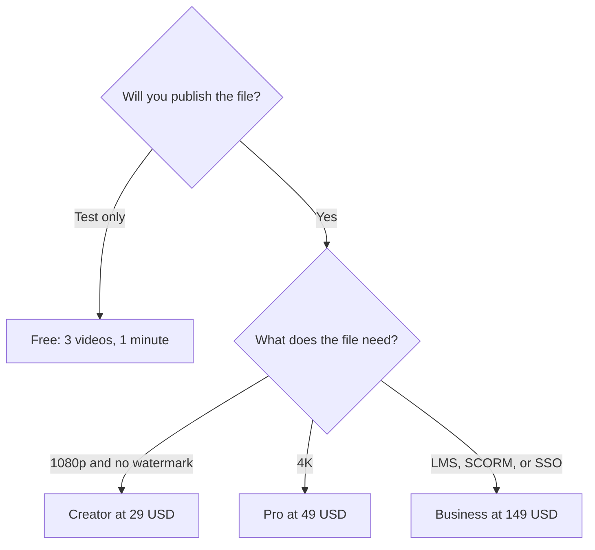

**[HeyGen](/tools/heygen/) turns a script into a presenter video.** Free covers 3 videos a month, each up to 1 minute, with Avatar IV and 30+ languages. Creator is $29 a month for 600 credits, videos up to 30 minutes, 1080p, watermark removal, voice cloning, and 175+ languages and dialects. Pro is $49 a month for 1,000 credits and 4K. Business is $149 a month for 1,500 credits, videos up to 60 minutes, SSO, SCORM, and LMS features, with extra seats at $20 a month.

Those are monthly list prices in US dollars from HeyGen's pricing page, recorded October 16, 2026. Yearly billing is offered. HeyGen's summary does not publish one universal "minutes per credit" rate, so the credit totals below are allowances, and the minute caps are maximum video length. Checkout, tax, and local currency can differ from the US list price.

The head-to-head with Synthesia is in [HeyGen vs Synthesia](/blog/heygen-vs-synthesia-2026/). Generators that invent footage, rather than a presenter, are in [best AI video generators](/blog/best-ai-video-generators-2026/).

## What each plan is allowed to publish

| Plan | Monthly list price | Credits | The gate that matters |
|---|---|---|---|
| Free | $0 | Included in the 3-video cap | 3 videos, 1 minute each, Avatar IV, 1 custom video avatar, 30+ languages |
| Creator | $29 | 600 | 30-minute videos, 1080p, watermark removal, voice cloning, 175+ languages. Credit rollover on yearly billing |
| Pro | $49 | 1,000 | 4K, faster processing, advanced models, script editing and proofreading tools HeyGen lists on paid tiers |
| Business | $149 | 1,500 | 60-minute videos, 5 custom video avatars, SSO, SCORM, LMS, interactive video. Extra seats $20/month |
| Enterprise | Custom | Custom | Security and support beyond the published Business tier |

This table scores the published contract. It is a plan-fit table. We did not score avatar realism, lip sync, or translation quality in a lab.

In plain language: stay on Free to see whether an avatar is acceptable. Move to Creator when the file has to leave the account without a watermark. Move to Pro for 4K. Move to Business when a learning system has to receive the video.

## What you are actually buying

HeyGen is a presenter studio. You pick a stock avatar or create a custom video avatar from a clip or a reference image, paste a script, and render. Avatar IV is available on every plan, with extended use on paid plans. Paid plans add unlimited photo avatars. Inputs include text, images, stock media, and audio.

Voice cloning starts on Creator. Free covers 30+ languages. Creator and above list 175+ languages and dialects. That gap is the reason a multilingual team outgrows Free even when three short videos would have been enough in one language.

Business is a different product shape: workspace collaboration, comments, quizzes and links inside the video, SCORM export, and LMS integrations. A solo creator who will never open a learning system does not need that seat. A training team that will is comparing Business with [Synthesia](/tools/synthesia/) Enterprise, which is where Synthesia places SCORM. Read the [Synthesia review](/blog/synthesia-review-2026/) before you assume the $149 HeyGen seat and a Synthesia Enterprise contract are the same purchase.

## A credit budget that stays honest

HeyGen lists credits and a maximum video length. It does not, in the pricing summary we used, guarantee that 600 Creator credits equal 30 minutes of finished video. A 30-minute file is allowed on Creator. Whether 600 credits cover it depends on the model, the length, and the extras you add.

Do this with one real script:

1. Write a 60-second version and a 3-minute version of the same explainer.
2. Render the short one on Free. If the avatar is wrong for the audience, stop. No paid plan fixes a format the viewer will not watch.
3. If you still want it, render the 3-minute cut on Creator and read the credit deduction.
4. Multiply by the number of videos and languages you will ship this month. Translation is a second render, not a free duplicate.
5. If the deduction blows through 600 credits, price Pro's 1,000 credits or a yearly Creator plan with rollover. Leave Business for the LMS requirement.

Custom avatars need consent from the person in the clip. That duty sits with you, and the rule depends on where you and that person are. HeyGen's terms are the product rules. Local privacy and likeness law is separate.

## When a camera, or another tool, is the real purchase

| The job | Fit | Where to look |
|---|---|---|
| A presenter who was never filmed | Strong on HeyGen | Creator for most published explainers |
| The same script in many languages | Strong on paid plans | 175+ languages from Creator |
| SCORM inside an LMS | Strong on Business | Also compare Synthesia Enterprise |
| Cut a video you already filmed | Poor fit | [Descript review](/blog/descript-review-2026/) |
| A cinematic shot with no presenter | Poor fit | [Runway](/tools/runway/) in the video guide |
| Voice only, no face | Poor fit | [ElevenLabs](/tools/elevenlabs/) |

## Fit score

| Question | Free | Creator $29 | Pro $49 | Business $149 |
|---|---|---|---|---|
| See Avatar IV on your script | Yes | Yes | Yes | Yes |
| Keep a file longer than 1 minute | No | Up to 30 minutes | Up to 30 minutes | Up to 60 minutes |
| Remove the watermark | No | Yes | Yes | Yes |
| Clone a voice | No | Yes | Yes | Yes |
| Export 4K | No | No | Yes | Check the live plan |
| Send SCORM to an LMS | No | No | No | Yes |

"Yes" means HeyGen's pricing page lists the feature on that plan. It is not a quality score from a shoot we ran.

## FAQ

### Is HeyGen free?

Yes. Free includes 3 videos a month, up to 1 minute each, Avatar IV, 500+ stock avatars, 1 custom video avatar, and 30+ languages. Publishing without a watermark starts at Creator.

### How much does HeyGen cost?

Creator is $29 a month, Pro is $49, and Business is $149, on the monthly prices recorded October 16, 2026. Enterprise is custom. Yearly billing exists. Confirm the live checkout, including tax.

### How many minutes is 600 credits?

HeyGen does not state a single minutes-per-credit rate in the summary this review uses. Render one real video and read the deduction before you buy a year.

### Can HeyGen clone a voice?

Voice cloning is listed from Creator upward. Clone a voice you have rights to use.

## Last verified

October 16, 2026, against HeyGen's pricing page and homepage. Recheck before you buy. Prices move, and a promotion can change the number at checkout.

**Sources:** [HeyGen pricing](https://www.heygen.com/pricing), [HeyGen](https://www.heygen.com).

[HeyGen](/tools/heygen/) is in the [video directory](/tools/category/video/). Directory pages may use affiliate links. A purchase through them can earn us a commission at no extra cost to you.
