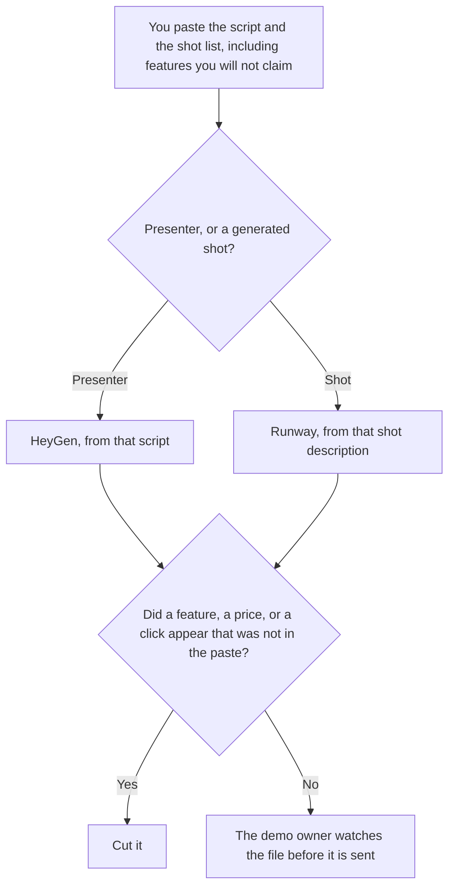

**Use HeyGen when the demo clip is a presenter reading a script you already wrote. Use Runway when the clip is a generated shot, and you already know the frame you want.** A product demo can need both, in that order: the shot, then the person who explains it. Neither tool may invent a feature, a price, or a click the product does not have. A training lesson, which is a different length and a different owner, is [HeyGen vs Synthesia for training modules](/blog/heygen-vs-synthesia-for-training-modules-2026/). The credit math for shots is [Runway pricing explained](/blog/runway-pricing-explained-2026/).

HeyGen and Runway prices are from directory pages checked October 16, 2026. Claude's prices are from claude.com/pricing on October 24, 2026. Notion is the October 16 card. Published October 24, 2026. We did not score realism. We did not time a render.

## Which clip you are making

| The frame | Start here | First paid step | The limit |
|---|---|---|---|
| A person on camera, from a script you wrote | [HeyGen](/tools/heygen/) | Creator is $29 a month | The words are the script. A feature not in the script stays out |
| A generated shot of a motion you described | [Runway](/tools/runway/) | Standard is $12 a month billed annually, or $15 monthly | Credits are the meter. A shot is not a product recording |
| The script, kept stable | [Claude](/tools/claude/) | Pro is $17 a month billed annually, or $20 monthly | It does not film |
| The shot list the team reopens | [Notion AI](/tools/notion-ai/) | Business is $20 a seat a month | The list is the record of what was approved |

A clip that "shows" a button the product does not have is a false demo. If the shot list says the UI is a screen recording you already captured, do not replace it with a generated interface. Say Screen recording, not generated, on that row.

HeyGen Free is 3 videos a month, up to 1 minute, on the October 16 card. Creator at $29 is the seat with 1080p, watermark removal, and videos up to 30 minutes. The invoice is [HeyGen pricing explained](/blog/heygen-pricing-explained-2026/). Use a likeness you have consent to use. The review is [HeyGen review](/blog/heygen-review-2026/).

Runway Free is 125 one-time credits on that card. Standard is 625 credits a month. The directory describes that allowance as about 52 seconds of Gen-4.5. That seconds line is the card's illustration, not a promise this page remeasured. Pro is $28 a month annually, or $35 monthly. The review is [Runway review](/blog/runway-review-2026/).

## What the clip is allowed to say

The script you approved, and the shots on the list. A lower-third price that was not in the script comes out. The training-module comparison is the path when the file is a lesson with a quiz. This page is a short demo.

**HeyGen Creator** is the presenter path. Paste the script. A generation that adds a sentence is the take you discard.

**Runway Standard** is the shot path. One shot, then watch it. Do not spend the credit pool on variations of a feature you have not shipped.

**Claude Pro** holds the script so the next cut uses the same claims. The review is [Claude review](/blog/claude-review-2026/).

**Notion Business** holds the shot list and the date the owner approved the words.

A prompt that holds the line:

"Use only the script and the shot list I pasted. If a feature is not in the script, do not show it. Do not add a price. Do not describe the clip as a recording of the product unless I wrote that it is."

## What not to delegate

Do not ask for a demo of a feature that is not shipped. Do not use a coworker's face as the avatar without consent. Do not send the file because the render finished. The demo owner watches it, including the words on screen.

## FAQ

### How is this different from the training-module comparison?

That page is a lesson: a script, a length, and an owner who enrolls people. This page is a short demo clip for a product moment. HeyGen can sit on both. Synthesia is the other training seat. Runway is here because a demo often needs a shot, not a second avatar tool.

### Do I need both?

You need the one that matches the frame. A presenter with no generated shot is HeyGen. A shot with no presenter is Runway. A demo that uses both still has one script. Do not let each tool rewrite it.

### How many seconds do I get?

HeyGen's October 16 card lists maximum video length, not a universal seconds-per-credit rate this page should invent. Runway's card lists credits, and illustrates Standard as about 52 seconds of Gen-4.5. Quote the card, then read the usage screen on the shot you actually ran.

### Who may send the clip?

The demo owner, after watching it against the script. A finished render is not approval. A feature that appeared in the picture and not in the script is a reason to recut.

## Last verified

October 16, 2026 for HeyGen, Runway, and Notion. October 24, 2026 for Claude. Published October 24, 2026.

**Sources:** [HeyGen pricing](https://www.heygen.com/pricing), [Runway pricing](https://runwayml.com/pricing), [Claude pricing](https://claude.com/pricing), [Notion pricing](https://www.notion.com/pricing).

*Published by Andrew for [AI Tools Optimizer](https://aitoolsoptimizer.com).*

[HeyGen](/tools/heygen/) is in the [video directory](/tools/category/video/). Directory pages may use affiliate links. A purchase through them may earn us a commission at no extra cost to you.
