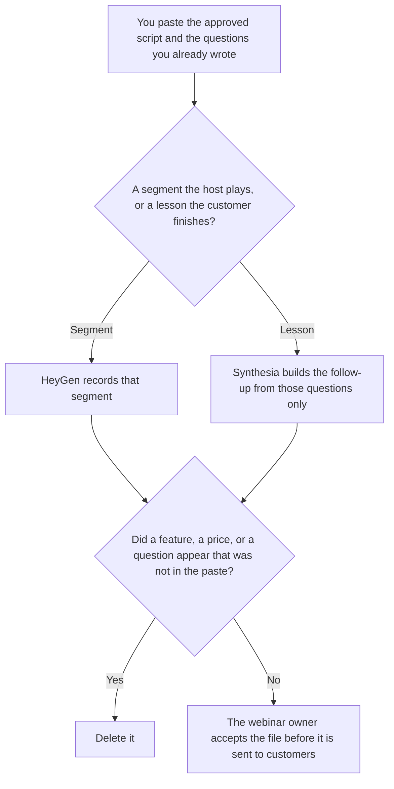

**Use HeyGen when the customer webinar needs a short recorded segment a host will play, from a script a person already approved. Use Synthesia when the follow-up has to be a lesson a customer can finish, with a survey or a quiz the script already contains.** The avatar may speak the script. It may not add a feature, a price, or a promise. Neither tool hosts the live room. A person still runs the webinar. A training module you assign inside the company is [HeyGen vs Synthesia for training modules](/blog/heygen-vs-synthesia-for-training-modules-2026/). A sales leave-behind, which is not a webinar, is [HeyGen vs Synthesia for sales](/blog/heygen-vs-synthesia-for-sales-2026/).

The pair without this webinar constraint is [HeyGen vs Synthesia](/blog/heygen-vs-synthesia-2026/). The script before the avatar is [how to create a webinar script with AI](/blog/how-to-create-a-webinar-script-with-ai-2026/).

HeyGen and Synthesia prices below are the October 16 directory cards, matching the monthly stickers in [HeyGen pricing explained](/blog/heygen-pricing-explained-2026/) and [Synthesia pricing explained](/blog/synthesia-pricing-explained-2026/). Notion and Claude prices are stated with their dates below. Published October 24, 2026. We did not score attendance, lip sync, or completion. We did not host a webinar with either tool.

## Which piece you are filming

| The piece | Start here | First paid step | The script |
|---|---|---|---|
| A short recorded segment the host will play | [HeyGen](/tools/heygen/) | Creator is $29 a month | The approved script, inside the minute cap you can spare |
| A follow-up lesson with a survey or a quiz | [Synthesia](/tools/synthesia/) | Starter is $29 a month billed monthly | Only the questions you already wrote |
| The outline the host will say live | [Claude](/tools/claude/) | Pro is $17 a month billed annually, or $20 monthly | No claim that was not in the brief |
| The page that lists the segment and the follow-up | [Notion AI](/tools/notion-ai/) | Business is $20 a seat a month | Plus at $10 is not the full AI tier |

HeyGen Free is 3 videos a month, up to 1 minute each. Creator at $29 includes 600 credits, videos up to 30 minutes, 1080p, watermark removal, and voice cloning, on the October 16 card. Pro is $49 for 1,000 credits and 4K. Business is $149 for 1,500 credits, videos up to 60 minutes, SSO, SCORM, and LMS integrations, with extra seats at $20 a month. Enterprise is custom. A watermark-free segment a customer will see is Creator at minimum. SCORM is Business on this card, not a reason to call sales if Business already lists it. The enterprise page is [HeyGen Enterprise pricing explained](/blog/heygen-enterprise-pricing-explained-2026/).

Synthesia Basic is free, with 10 minutes and a watermark, and 500 credits a month, on the October 16 card. Starter is $29 a month billed monthly, shown as $19 a month with yearly billing, with 1,250 credits. Pro is $89 a month billed monthly, with 6,000 credits. Enterprise is custom: the card names unlimited video minutes, 1-click translation into 140+ languages, SAML/SSO, Brand Kits, and SCORM export. A survey on a follow-up is a Synthesia lesson. It is not a reason to quote HeyGen Business unless you also need HeyGen's SCORM row.

HeyGen's card lists 175+ languages and dialects on paid plans, and 30+ on Free. Synthesia's 1-click translation into 140+ languages is an Enterprise line on that card. If the webinar must be dubbed, read both invoices before you assume the $29 seat includes the language step you need. This page does not convert a yearly toggle into a new monthly sticker.

## What the segment is allowed to say

The script you approved. A question you wrote. A next step you wrote. If the price is not in the script, the avatar does not say one. If the survey does not exist, the follow-up does not grow a quiz. The host's live remarks are the host's. The avatar file is only the segment.

**HeyGen Creator** is the segment. The product page is [HeyGen review](/blog/heygen-review-2026/). The steps for a likeness are [how to create AI avatars with HeyGen](/blog/how-to-create-ai-avatars-with-heygen-2026/). Use a likeness only with consent.

**Synthesia Starter** is the follow-up when a watermark is unacceptable and the lesson is short. Move to Pro when the credit receipt says 1,250 is short. The card says video costs about 100 credits a minute beyond the first included minutes. Read the receipt. Do not treat 100 as a promise this page remeasured.

**Claude Pro** holds the script so a later edit does not add a promise. The review is [Claude review](/blog/claude-review-2026/).

**Notion Business** stores the accepted script, the owner, and the date the file was sent. The invoice is [Notion AI pricing explained](/blog/notion-ai-pricing-explained-2026/).

A prompt that holds the line:

"Draft only from the script and the questions I pasted. If a price is missing, do not say one. Do not add a feature. Do not add a survey question. Do not describe this file as the live webinar."

## What not to delegate

Do not ask the avatar to "handle questions." Do not invent a customer quote. Do not send the follow-up before the webinar owner has accepted the script. A generated host is not the person who will be in the room.

## FAQ

### How is this different from the training-module page?

That page is a lesson you assign to employees: a clip beside a page, or a package your learning system accepts. This page is a customer webinar: a segment a host plays, and a follow-up a customer finishes. The same SCORM row can matter to both. The audience and the script are different. Do not reuse an internal training script as a customer segment.

### How is this different from the sales page?

That page is a sales video: a pitch or a leave-behind for a deal. This page is a webinar segment and its follow-up. A price in a sales video still has to be a price you wrote. A webinar does not become a sales video because a customer asked about pricing. Keep the files separate.

### How is this different from HeyGen vs Synthesia with no webinar constraint?

That page is the general avatar comparison. This page adds a live host and a customer audience. Neither product replaces the person who runs the session. Use the general page for the product choice. Use this page when the file is a segment or a follow-up.

### Who may send the file to customers?

The webinar owner. A segment that adds a feature is not accepted. A quiz that adds a question is not accepted. The live room is still a person.

## Last verified

October 16, 2026 for HeyGen and Synthesia, via the directory cards and the pricing articles cited above. October 24, 2026 for Claude. October 16, 2026 for Notion. Published October 24, 2026.

**Sources:** [HeyGen pricing](https://www.heygen.com/pricing), [Synthesia pricing](https://www.synthesia.io/pricing), [Claude pricing](https://claude.com/pricing), [Notion pricing](https://www.notion.com/pricing).

*Published by Andrew for [AI Tools Optimizer](https://aitoolsoptimizer.com).*

[HeyGen](/tools/heygen/) is in the [video directory](/tools/category/video/). Directory pages may use affiliate links. A purchase through them may earn us a commission at no extra cost to you.
