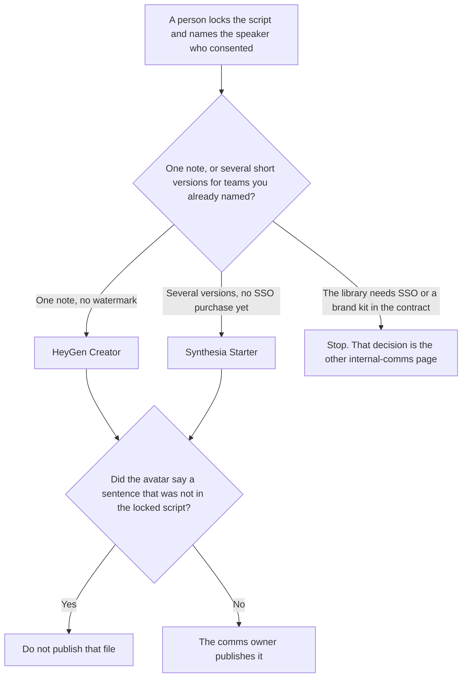

**Use HeyGen Creator when one consented speaker will deliver one internal note, in one language, and the file cannot carry a watermark. Use Synthesia Starter when that same approved script must be cut into several short versions for teams you already named, and you are not buying SSO on this page.** The library decision, with SSO and brand kits, is [Synthesia vs HeyGen for internal comms](/blog/synthesia-vs-heygen-for-internal-comms-2026/). A product changelog clip is [HeyGen vs Synthesia for product updates](/blog/heygen-vs-synthesia-for-product-updates-2026/).

The invoices are [HeyGen pricing explained](/blog/heygen-pricing-explained-2026/) and [Synthesia pricing explained](/blog/synthesia-pricing-explained-2026/). The team shelf is [best AI tools for internal comms](/blog/best-ai-tools-for-internal-comms-2026/).

Prices are US list prices excluding tax from directory pages checked October 16, 2026. This page did not refetch either pricing URL on October 24. Published October 24, 2026. We did not score avatars, lip sync, or languages.

## What this week's note is buying

| | [HeyGen](/tools/heygen/) | [Synthesia](/tools/synthesia/) |
|---|---|---|
| Free test | 3 videos a month, up to 1 minute each | 10 minutes of video, watermark, 500 credits a month |
| First plan that removes the watermark | Creator, $29 a month, 600 credits, 1080p, videos up to 30 minutes | Starter, $29 a month billed monthly, shown as $19 on yearly billing, 1,250 credits |
| A larger credit pool, still not the SSO decision | Pro, $49 a month, 1,000 credits and 4K | Pro, $89 a month billed monthly, 6,000 credits |
| SSO, on the other page | Business, $149 a month, lists SSO. Extra seats $20 | The directory puts SAML/SSO on Enterprise, which is custom |
| Who may change the script | A person, before you generate | A person, before you generate |

Creator includes voice cloning on the October 16 card. Cloning a coworker requires consent you can show. A stock avatar does not remove that duty if the script speaks as a named person. Synthesia's one-click translation and Brand Kits were Enterprise lines on the page the other article checked. This page does not treat a Starter download as that bundle.

HeyGen Business at $149 also lists SCORM and videos up to 60 minutes. That is the training-shaped seat. A monthly internal note does not need an LMS export. If someone asks for SCORM, you have left this page.

## What the video is allowed to say

The locked script, and nothing the script did not say. A date that was not in the script stays out. A reassurance that was not in the script stays out. The comms owner can record a new take after they change the script. They do not "fix it in the avatar."

**HeyGen Creator** is the one-note path at $29. Free's three videos are a test, with a one-minute cap. The review is [HeyGen review](/blog/heygen-review-2026/).

**Synthesia Starter** is the several-cuts path when 1,250 credits cover the versions you listed and you do not need SSO yet. The yearly figure shown as $19 is the directory's yearly billing line. Budget the monthly list if you have not started the year. The review is [Synthesia review](/blog/synthesia-review-2026/).

**Notion Business** stores the locked script, the speaker's consent note, and the date. [Notion AI](/tools/notion-ai/) Business is $20 a seat a month on the October 16 card. The invoice is [Notion AI pricing explained](/blog/notion-ai-pricing-explained-2026/).

**Grammarly Pro** is a pass on the script before you generate, at $12 a member a month billed annually, or $30 monthly. [Grammarly](/tools/grammarly/) does not approve an avatar. Compare the script before and after. The invoice is [Grammarly pricing explained](/blog/grammarly-pricing-explained-2026/).

A prompt that holds the line:

"Format the internal script I pasted. If a date is missing, write Date not set. Do not add a reassurance. Do not add a policy line. Do not change the speaker."

## What not to delegate

Do not ask the avatar to sound "more reassuring" than the script. Do not generate a named executive who has not consented. Do not buy Business or Enterprise from this page because the note is internal. SSO and brand kits are the other article. The comms owner publishes the file. A preview is not a send.

## FAQ

### How is this different from the other internal-comms comparison?

That page chooses a library: HeyGen Business when SSO is on a published plan, Synthesia Enterprise when Brand Kits and one-click translation are the contract. This page is one locked script, this week, before that library exists. If you already know you need SSO, stop here and use that page.

### How is this different from a product update?

A product update follows a changelog. An internal note follows a script the comms owner locked, which might be a policy, a move, or a thank-you. The same tools can render both. The source of the words is different. Do not let a changelog sentence into an internal note that did not include it.

### Which avatar looks more natural?

We did not measure that. Creator at $29 removes HeyGen's watermark on the card we used. Synthesia Starter at $29 monthly is the first Synthesia plan that removes the watermark on that card. Watch the file with the script in your hand. A natural face does not excuse a new sentence.

### Who may change the script after a preview?

The comms owner, in the script, before a new generation. A preview that "almost" says the right thing is not a publish. Consent for the speaker stays attached to the script you actually generated.

## Last verified

October 16, 2026 for HeyGen, Synthesia, Notion, and Grammarly. Published October 24, 2026. This page did not refetch the vendor pricing URLs on October 24.

**Sources:** [HeyGen pricing](https://www.heygen.com/pricing), [Synthesia pricing](https://www.synthesia.io/pricing), [Notion pricing](https://www.notion.com/pricing), [Grammarly pricing](https://www.grammarly.com/plans).

*Published by Andrew for [AI Tools Optimizer](https://aitoolsoptimizer.com).*

[HeyGen](/tools/heygen/) is in the [video directory](/tools/category/video/). Directory pages may use affiliate links. A purchase through them may earn us a commission at no extra cost to you.
