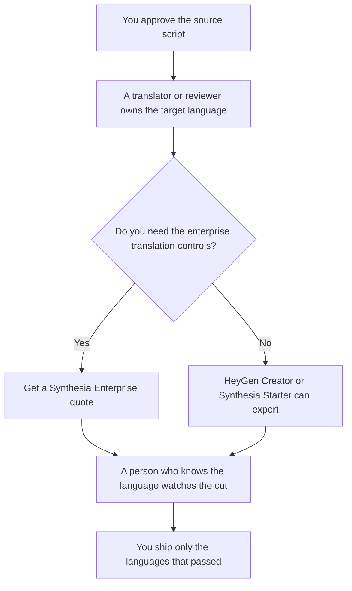

**Use HeyGen when the language list and the credit pack on a self-serve plan match the videos you will export. Use Synthesia when the team needs the enterprise translation controls the directory records, and you have a quote.** Both can put a presenter on screen in another language. Neither knows the approved translation. A dubbed line you did not review is a different promise in a different country.

The steps once you have a source cut are [how to localize video with AI](/blog/how-to-localize-video-with-ai-2026/). Training videos are a different job: [Synthesia vs HeyGen for training](/blog/synthesia-vs-heygen-for-training-2026/). The invoices are [HeyGen pricing explained](/blog/heygen-pricing-explained-2026/) and [Synthesia pricing explained](/blog/synthesia-pricing-explained-2026/).

Prices are US list prices excluding tax from directory pages checked October 16, 2026. Published October 24, 2026. We did not score lip sync, translation quality, or voice match.

## Which plan matches the language list

| The localization you actually need | Start here | What you still do |
|---|---|---|
| A test in a few languages, one minute, watermark acceptable | [HeyGen](/tools/heygen/) Free: 3 videos a month, up to 1 minute, 30+ languages | Approve the source script first |
| A paid HeyGen seat with a long language list | Creator at $29 a month: 600 credits, 175+ languages, voice cloning, watermark removal | A reviewer who knows the language checks the line |
| Higher export needs on HeyGen | Pro at $49 a month: 1,000 credits and 4K. Business at $149: 1,500 credits, 60-minute videos, SSO, SCORM | Extra Business seats are $20 a month on that card |
| A short Synthesia test with a watermark | [Synthesia](/tools/synthesia/) Basic at $0: 10 minutes or 500 credits, watermarked | Same script rule |
| A self-serve Synthesia seat | Starter at $29 a month, shown as $19 with yearly billing, 1,250 credits | Downloads and logo removal are on that tier |
| One-click translation into 140+ languages, with SSO and SCORM | Synthesia Enterprise, custom credits | Get the quote. Do not invent the dollar |

Synthesia's directory card says video costs about 100 credits per minute and dubbing about 76 credits per minute, beyond the first 10 included minutes. Pro is $89 a month with 6,000 credits. This page does not convert HeyGen credits into minutes. The pricing article is the place to check before you forecast a 12-language pack.

## What has to be true in every language

The claim, the number, and the call to action match the source a person approved. Idioms get rewritten by someone who knows the audience. The model can draft a reading. It cannot clear a regulated sentence. Product names stay as the brand wrote them unless a local owner changed them.

**HeyGen Creator** is the self-serve plan with the long language count on the card we read: 175+ languages, against 30+ on Free. That count is a list of options. It is not a quality score. The review is [HeyGen review](/blog/heygen-review-2026/).

**Synthesia Enterprise** is the plan that lists 1-click translation into 140+ languages, plus SAML/SSO, brand kits, and SCORM. Starter is a credit plan for teams that do not need that bundle. The review is [Synthesia review](/blog/synthesia-review-2026/).

[Descript](/tools/descript/) Business is $50 a month billed annually and lists translation and dubbing in 30+ languages. It is an editor for footage you already have. [ElevenLabs](/tools/elevenlabs/) can supply a voice. Neither replaces the language reviewer.

A prompt that holds the line:

"Use only the approved script I pasted for this language. Do not add a claim. Do not convert a price unless I gave the converted price. Leave a product name unchanged. If a line is marked do-not-translate, keep it."

## What not to delegate

Do not auto-publish every language the plan allows. Do not dub a customer's voice. Do not treat a language count as coverage for a market you have not staffed with a reviewer. The onboarding video and the sales video are other articles. This page is the language step.

## FAQ

### Which dub sounds more natural?

We did not measure that. Generate one minute in the language you care about, on the cheapest plan that allows a download, and have a fluent reviewer watch it. A longer language list does not answer that watch.

### Can we forecast credits for twelve languages?

On Synthesia's recorded rates, dubbing is about 76 credits per minute beyond the included minutes. Multiply by minutes and languages, then confirm on an invoice. HeyGen's card gives monthly credits and does not give a per-minute dub rate we can quote. Use the pricing article, then one real export.

### Is Enterprise required to localize?

Only if you need the controls listed on that tier: the 140+ language action, SSO, or SCORM. A small set of languages can start on HeyGen Creator or Synthesia Starter. The reviewer is required on every tier.

### What about on-screen text?

Spoken localization does not move burned-in text. Rebuild titles in the editor for each language. A voice track over English words is a partial job. Say so in the plan.

## Last verified

October 16, 2026 for HeyGen, Synthesia, Descript, and ElevenLabs prices named above. Published October 24, 2026.

**Sources:** [HeyGen pricing](https://www.heygen.com/pricing), [Synthesia pricing](https://www.synthesia.io/pricing), [Descript pricing](https://www.descript.com/pricing).

*Published by Andrew for [AI Tools Optimizer](https://aitoolsoptimizer.com).*

[Synthesia](/tools/synthesia/) is in the [video directory](/tools/category/video/). Directory pages may use affiliate links. A purchase through them may earn us a commission at no extra cost to you.
