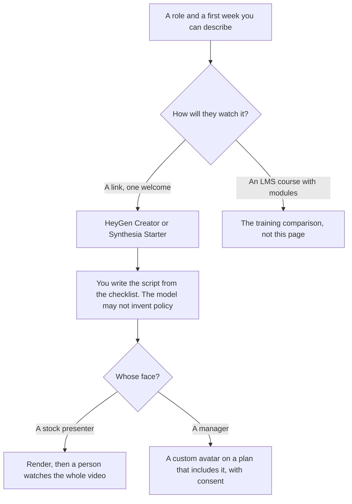

**For a first-week onboarding video a new hire plays from a link, start with HeyGen Creator at $29 a month when you need 1080p, no watermark, and voice cloning on a self-serve plan. Use Synthesia Starter when the yearly sticker and its credit pool are the ones you already checked.** A multi-module course that must live in an LMS is a different purchase. That comparison is [Synthesia vs HeyGen for training](/blog/synthesia-vs-heygen-for-training-2026/). An all-hands is [Synthesia vs HeyGen for internal comms](/blog/synthesia-vs-heygen-for-internal-comms-2026/). This page is the welcome: who we are, how the first week works, where the tools are.

The general split is [HeyGen vs Synthesia](/blog/heygen-vs-synthesia-2026/). The written checklist beside the video is [how to create an onboarding checklist with AI](/blog/how-to-create-an-onboarding-checklist-with-ai-2026/). The doc the video should not replace is [how to create onboarding docs with AI](/blog/how-to-create-onboarding-docs-with-ai-2026/).

Prices are US list prices excluding tax from directory pages checked October 16, 2026. Published October 24, 2026. We did not score which avatar looks more human.

## The onboarding job

| What the new hire receives | Lean toward | Why, on the card |
|---|---|---|
| A test, watermark acceptable, under a minute | [HeyGen](/tools/heygen/) Free: 3 videos a month, up to 1 minute, 1 custom video avatar, 30+ languages | Enough to see if a face belongs in the welcome |
| A watermarked longer test | [Synthesia](/tools/synthesia/) Basic: 500 credits, 10 minutes, watermark | Share links and templates are on the free plan |
| A real welcome, one owner, no watermark | HeyGen Creator at $29 a month: 600 credits, up to 30 minutes, 1080p, voice cloning, 175+ languages | The self-serve path for a named host |
| You want Synthesia's yearly rate | Starter, shown as $19 a month on yearly billing. Monthly Starter is $29, with 1,250 credits, downloads, and the logo off | Confirm the credit estimate for the number of welcomes you will render |
| The manager's face, more than a single test avatar | HeyGen Business at $149 a month lists 5 custom video avatars. Extra seats are $20 a month | Free includes 1 custom video avatar. Do not assume Creator includes five |
| The file must enter an LMS as SCORM | HeyGen Business lists SCORM and LMS integrations. Synthesia lists SCORM on Enterprise, which is custom, and learner seats at $29 per learner per month on that card | That is the training purchase. Stop and read the training page |

The script's source is the checklist and the policy page, not the model's memory of "how onboarding usually works." A wrong PTO rule in a friendly voice is worse than a plain doc. The person who approves the script is [what human-in-the-loop AI is](/blog/what-is-human-in-the-loop-ai-2026/).

## What the welcome costs

**HeyGen Free** is the screen test. **Creator at $29** is the plan this page starts from for a published welcome. A year at that monthly rate is 12 × $29 = $348. **Pro at $49** lists 4K and 1,000 credits. Buy Pro for resolution, not because a new hire requires 4K. **Business at $149** is the team, SSO, and SCORM row, with 1,500 credits and videos up to 60 minutes. Five people who only need to edit, if you add seats at the recorded $20, are a different invoice from five Creator subscriptions. Read the seat rules at checkout. The card is [HeyGen pricing explained](/blog/heygen-pricing-explained-2026/). Making the avatar is [how to create AI avatars with HeyGen](/blog/how-to-create-ai-avatars-with-heygen-2026/).

**Synthesia Starter at $29 a month billed monthly**, shown as **$19 a month on yearly billing**, includes 1,250 credits. The directory does not print the yearly total as a single precomputed number beyond that monthly-equivalent. **Pro is $89 a month billed monthly**, with 6,000 credits, and packs up to 48,000 credits at $676 a month. **Enterprise** is the row for one-click translation into 140+ languages, Brand Kits, unlimited personal avatars, and SCORM. Personal avatars exist as a feature. Unlimited personal avatars are the Enterprise line. Do not assign a Starter price to a custom manager avatar this card did not price. The card is [Synthesia pricing explained](/blog/synthesia-pricing-explained-2026/). A course, if that is what you are actually making, is [how to make training videos with Synthesia](/blog/how-to-make-training-videos-with-synthesia-2026/).

Localization of a welcome that must exist in another language is a second decision. HeyGen paid plans list 175+ languages and dialects. Synthesia's one-click 140+ language line is Enterprise. The workflow is [how to localize video with AI](/blog/how-to-localize-video-with-ai-2026/). Translate the script with a person who knows the policy. Do not dub a wrong benefit into a second language.

## What should not be an avatar

**A screen recording of the real tool.** [Descript](/tools/descript/) Hobbyist is $16 a person a month billed annually. A new hire learning the product should see the product. An avatar describing a button they cannot see is a weaker welcome.

**The written week.** [Notion AI](/tools/notion-ai/) Business is $20 a seat a month for the full AI tier. The video points at the page. The page holds the dates, the logins, and the owner. Plus at $10 is not that full tier. The invoice is [Notion AI pricing explained](/blog/notion-ai-pricing-explained-2026/).

**A sales follow-up.** That is [HeyGen vs Synthesia for sales](/blog/heygen-vs-synthesia-for-sales-2026/). Do not send a prospect your internal welcome, and do not use a sales avatar plan as the HR system of record.

## FAQ

### Is onboarding the same as training?

On this site, no. Onboarding here is the first-week welcome for an employee. Training is a course with completion, an LMS, and often SCORM. If your learning team needs those, use the training comparison. Buying Business or Enterprise for a three-minute welcome is how the video budget swallows the checklist.

### Can we use a stock avatar?

Yes. Many welcomes should. A custom avatar needs consent and a plan that includes the avatar count you need. HeyGen Free includes one custom video avatar. Business lists five. Synthesia's unlimited personal avatars are Enterprise.

### How many videos does a 600-credit plan make?

This page does not convert credits into videos. The directory does not print a single credit-per-minute rate for a welcome. Render one script during a test and read the receipt. Then multiply by the roles you will actually record, not by headcount.

### Should the model write the welcome script?

It can format a script from the checklist you paste. It may not add a benefit, a manager's name, or a start date you did not provide. If a line is missing, the script should say so, and a person in HR should fill it.

## Last verified

October 16, 2026 for HeyGen, Synthesia, Descript, and Notion AI. Published October 24, 2026.

**Sources:** [HeyGen pricing](https://www.heygen.com/pricing), [Synthesia pricing](https://www.synthesia.io/pricing), [Notion pricing](https://www.notion.com/pricing).

*Published by Andrew for [AI Tools Optimizer](https://aitoolsoptimizer.com).*

[HeyGen](/tools/heygen/) is in the [video directory](/tools/category/video/). Directory pages may use affiliate links. A purchase through them may earn us a commission at no extra cost to you.
