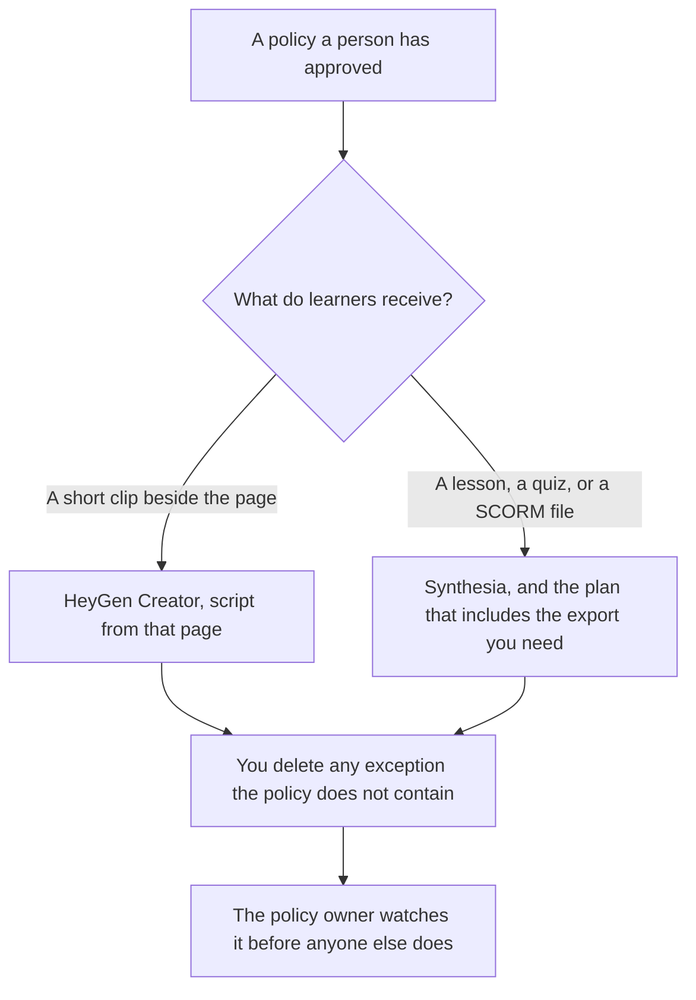

**Use HeyGen when the policy training piece is a short clip a person watches, and the script is a policy page you already published. Use Synthesia when the same policy has to be a lesson with a quiz, a survey, or a SCORM file for a learning system.** The model may speak the policy. It may not add an exception, a deadline, or a penalty the page does not contain. A help-center how-to is [HeyGen vs Synthesia for support videos](/blog/heygen-vs-synthesia-for-support-videos-2026/). The quiz after the lesson is [how to create training quizzes with AI](/blog/how-to-create-training-quizzes-with-ai-2026/).

Prices below are from the HeyGen and Synthesia pricing pages fetched October 24, 2026. Notion and Grammarly prices are from directory pages checked October 16, 2026. Published October 24, 2026. We did not score completion, lip sync, or whether anyone followed the policy.

## Which policy video you are making

| The piece | Start here | First paid step | The script |
|---|---|---|---|
| A short clip beside the policy page | [HeyGen](/tools/heygen/) Free, 3 watermarked videos a month, up to 1 minute | Creator is $29 a month, with 1080p and HeyGen branding removed | The published policy, cut down |
| The same clip on Synthesia's monthly card | [Synthesia](/tools/synthesia/) Basic, watermarked, 10 minutes and 500 credits a month | Starter is $29 a month billed monthly, with logo removal | The same policy |
| A lesson with a quiz, a survey, or SCORM | Synthesia | Enterprise is where the October 24 page puts SCORM export. Learner seats are $29 per learner a month | The approved lesson |
| The policy page people will read | [Notion AI](/tools/notion-ai/) | Business is $20 a seat a month | The page is the source. The video does not replace it |

HeyGen's October 24 page lists Pro at $49 a month and Business at $149 a month. Business lists SCORM export and LMS integrations. If the requirement is SCORM, do not stop at Creator. The page says yearly billing includes 2 months free. The invoice is [HeyGen pricing explained](/blog/heygen-pricing-explained-2026/).

Synthesia's October 24 page lists Pro at $89 a month billed monthly, with 6,000 credits, and higher credit tiers up to 48,000 credits for $676 a month. Enterprise is where that page puts 1-click translation into 140+ languages, Brand Kits, and SCORM export. The October 16 directory record showed Starter at $19 a month with yearly billing. This October 24 fetch did not reproduce that yearly sticker cleanly. Use checkout for the yearly price. The invoice is [Synthesia pricing explained](/blog/synthesia-pricing-explained-2026/). The training workflow is [how to make training videos with Synthesia](/blog/how-to-make-training-videos-with-synthesia-2026/).

## What the clip may say

Only sentences the policy owner has accepted. A video that adds "you can skip this if you are a contractor" will become the policy. If the page is silent, the script says the page is silent and points at the owner. Update the page first. Then regenerate the clip.

**HeyGen Creator** fits a presenter-style reading of a short policy: what changed, who it applies to, where to read the rest. Keep it short enough that a credit month covers the policies you actually re-record.

**Synthesia Starter** fits the same clip when you want that monthly card. Move up when you need the lesson tools or SCORM. Do not buy Enterprise for a two-minute reminder that also fits in an email.

**Notion Business** is the policy page if that is the wiki. The video links to it. The invoice is [Notion AI pricing explained](/blog/notion-ai-pricing-explained-2026/).

A prompt that holds the line:

"Turn the policy I pasted into a spoken script. Use only sentences from that policy. Do not add an exception. End with the owner and the URL I pasted, or write Owner missing."

## What not to delegate

Do not ask the model what the policy should be. Do not publish a clip the policy owner has not watched. Do not put a customer's name, a case id, or a disciplinary detail in a training video. [Grammarly](/tools/grammarly/) Pro is $12 a member a month billed annually, or $30 monthly, for a last pass on a sentence. If the rewrite softens a requirement, put the requirement back. The invoice is [Grammarly pricing explained](/blog/grammarly-pricing-explained-2026/).

## FAQ

### Which avatar is more convincing?

We did not score that. Pick HeyGen when the output is a short clip on Creator. Pick Synthesia when the output is a lesson or a SCORM package. Watch one sample against the policy page before you buy a larger credit tier.

### Do I need SCORM?

Only if the learning system requires a SCORM package. A link to a video is not SCORM. HeyGen's Business row and Synthesia's Enterprise row are where those October 24 pages put SCORM. Read the row before you assume Creator or Starter exports it.

### What about yearly billing?

HeyGen's page says yearly billing includes 2 months free. Synthesia's page offers yearly billing. The older $19 Starter figure is the October 16 directory record, not a sticker this fetch could confirm. Checkout is the yearly price.

### Who may change the script after the policy changes?

The policy owner, then you re-record. A model does not "update the tone" of a policy in the video while the page stays the same. The page and the clip have to match.

## Last verified

October 24, 2026 for HeyGen and Synthesia pricing pages. October 16, 2026 for Notion and Grammarly. Published October 24, 2026.

**Sources:** [HeyGen pricing](https://www.heygen.com/pricing), [Synthesia pricing](https://www.synthesia.io/pricing), [Notion pricing](https://www.notion.com/pricing), [Grammarly pricing](https://www.grammarly.com/plans).

*Published by Andrew for [AI Tools Optimizer](https://aitoolsoptimizer.com).*

[Synthesia](/tools/synthesia/) is in the [video directory](/tools/category/video/). Directory pages may use affiliate links. A purchase through them may earn us a commission at no extra cost to you.
